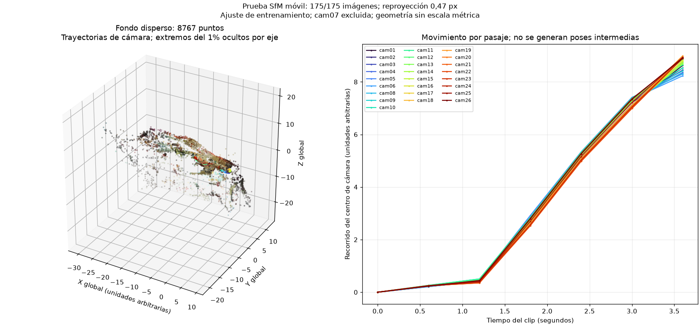

# skate-trick-4dgs

### Repetición de trucos de skate desde puntos de vista libres mediante 4D Gaussian Splatting

[English](README.md) · [Español](README.es.md) · **Corte de seguimiento: 18 de noviembre de 2026**

**Repositorio:** [craptou/Projet_4D_Gaussian_Splatting](https://github.com/craptou/Projet_4D_Gaussian_Splatting) · Publicado el 19 de noviembre de 2026 · Rama `main`.

¿Puede una única repetición guardada de un truco de skate, grabada desde varios puntos de vista móviles, convertirse en una representación 3D dinámica que permita generar vistas nuevas?

Este es el **proyecto final de Computer Vision**. Estudia esa pregunta con grabaciones de True Skate y la [implementación oficial de 4DGaussians](https://github.com/hustvl/4DGaussians). La tarea de visión estima cámaras y estructura a partir de imágenes; generar vistas nuevas es la etapa directa de síntesis. **Etapa actual: poses estimadas para las 2725 imágenes de entrenamiento. Todavía no se ha entrenado la reconstrucción dinámica.**

## Para revisar el proyecto

**GPU local — 20 de noviembre:** [prueba DyNeRF superada en la RTX 4050](docs/progress/local-gpu.es.md): extensiones CUDA, cargador, 2 pasos coarse + 10 fine, modelo guardado y 30 pares render/objetivo reservados. Entrenamiento: 25,52 s; renderizado: 17,09 s. Imágenes muy borrosas; calidad útil y entrenamiento True Skate pendientes.

**Actualización del 20 de noviembre:** [Preparación de referencia DyNeRF](docs/progress/dynerf.es.md): vídeos reales calibrados y localización de una cámara reservada. [Abrir el cuaderno Colab](https://colab.research.google.com/github/craptou/Projet_4D_Gaussian_Splatting/blob/main/notebooks/dynerf_reference.ipynb) para la siguiente prueba GPU. Geometría CPU comprobada; entrenamiento/renderizado Colab **sin ejecutar**. Las diapositivas/informe anteriores corresponden al corte del 18 de noviembre.

| Material | English | Español |
|---|---|---|
| Referencia DyNeRF: resultados CPU y ejecución Colab propuesta | [Read](docs/progress/dynerf.en.md) | [Leer](docs/progress/dynerf.es.md) |
| Relación con el curso y páginas del PDF aportado | [Read](docs/progress/course-alignment.en.md) | [Leer](docs/progress/course-alignment.es.md) |
| Último experimento: poses completas, reintentos y controles | [Read](docs/progress/fullrate.en.md) | [Leer](docs/progress/fullrate.es.md) |
| Informe de avance: métodos, resultados y limitaciones | [Read](docs/progress/report.en.md) | [Leer](docs/progress/report.es.md) |
| Presentación — 12 diapositivas | [PDF](presentations/progress.en.pdf) · [PowerPoint](presentations/progress.en.pptx) | [PDF](presentations/progress.es.pdf) · [PowerPoint](presentations/progress.es.pptx) |
| Guion y notas para la presentación | [Read](presentations/progress.en.md) | [Leer](presentations/progress.es.md) |
| Bitácora fechada y evidencias | [Read](docs/progress/work-log.en.md) | [Leer](docs/progress/work-log.es.md) |
| Hitos, riesgos y próximos criterios de aceptación | [Read](docs/progress/roadmap.en.md) | [Leer](docs/progress/roadmap.es.md) |

La bitácora utiliza commits reales y resultados observados. Los apuntes **apuntes del curso** se vinculan con cámaras/proyección, muestreo, renderizado y trayectorias. El responsable indica que el seguimiento se califica. En el PDF no se encontró rúbrica del proyecto final, pesos de nota ni fecha de entrega; la hoja de ruta distingue propuestas de validación y requisitos oficiales.

## Resultados demostrados

| Evidencia | Resultado verificado | Interpretación |
|---|---|---|
| Grabación original | 118,63 s; 720 × 1280; 30 FPS | Una repetición guardada, grabada desde puntos de vista sucesivos |
| Segmentación automática | 26 pasajes candidatos; 109 imágenes por clip | No demuestra que existan 26 ángulos distintos |
| Evento común de puntuación | Detectado en 26/26 vistas; diferencia ≤1 imagen | Alineación de un evento, no de toda la repetición |
| Prueba de poses mediante SfM | **175/175 imágenes**, 25 pasajes, un modelo | Siete imágenes por pasaje; cam07 excluida |
| Localización completa | **2725/2725 poses**, 109 imágenes por cada uno de 25 pasajes | 175 referencias conservadas + 2550 estimaciones visuales; sin interpolación |
| Geometría del fondo | **8767 puntos**, 8377 compartidos entre pasajes | Fondo estático disperso, no el skate en movimiento |
| Error medio de reproyección | **0,473 px** | Ajuste a observaciones conservadas, no calidad de vistas nuevas |
| Estadístico de las nuevas poses | **0,592 px** de promedio de errores medios por imagen | Distinto del ajuste disperso; 132 estimaciones tienen menos de 50 inliers |
| Verificación de herramientas | **25 pruebas superadas** | PnP sintético con outliers, FFmpeg y exclusión de la vista de prueba |

[Corte legible por máquina](docs/evidence/checkpoint-2026-11-18.json) · [Experimento técnico de poses, en inglés](docs/pose-pilot-2026-11-18.md)

[Corte de poses completas](docs/evidence/fullrate-2026-11-18.json) · [Cobertura y movimiento](docs/assets/fullrate-quality.es.png)



*Fondo disperso y desplazamiento recuperado de los centros de cámara. La escala es arbitraria. Es un diagnóstico de SfM, no una vista nueva renderizada.*

## Flujo de trabajo y límite actual

```mermaid
flowchart LR
 A[Repetición guardada de True Skate] --> B[26 pasajes candidatos]
 B --> C[Recorte y controles de sincronización]
 C --> D[SfM del fondo: referencias muestreadas]
 D --> E[Localización visual de todas las imágenes]
 E -. siguiente .-> V[Validación de cámaras y cargador]
 V -.-> F[Optimización de Gaussianas 4D]
 F -.-> G[Vista nueva en un instante elegido]
 G -.-> H[Evaluación con cam07 reservada]
```



La cámara **se mueve durante cada repetición**. MultipleView reutiliza una sola pose por secuencia; utilizarlo sin cambios impondría un modelo incorrecto. El mapa SfM permite ahora localizar todas las imágenes de entrenamiento; 31 imágenes difíciles se recuperaron en reintentos documentados. Todavía hace falta validar un adaptador por imagen. Véase el [análisis del código original, en inglés](docs/moving-camera-plan.md).


*Captura aportada por el responsable del proyecto: seis vistas en los fotogramas 73 y 109. Estas pequeñas ilustraciones del juego explican el método; no son imágenes reconstruidas.*

## Lo que aún falta demostrar

- Hay cobertura completa, pero no poses reales conocidas; 132 estimaciones con soporte menor requieren revisión. cam07 aún no está localizada.
- Los parámetros intrínsecos, la escala arbitraria y las imágenes de movimiento rápido requieren más controles.
- La prueba reducida de compatibilidad DyNeRF funciona; reproducción oficial completa, calidad útil y entrenamiento/renderizado True Skate pendientes.
- Todavía no se han medido PSNR, SSIM ni LPIPS en la vista reservada.

El proyecto envuelve código de investigación existente; no propone un algoritmo 4DGS nuevo. Las contribuciones actuales son la preparación de capturas, las comprobaciones, los scripts experimentales y las evidencias documentadas. Se utilizó asistencia de IA para programación y documentación; Git registra los artefactos resultantes, sin atribuir autoría manual a cada línea.

## Reproducir e inspeccionar

```powershell
git submodule update --init --recursive
python -m venv .venv
.\.venv\Scripts\python.exe -m pip install -e ".[sfm]"
.\.venv\Scripts\python.exe -m unittest discover -s tests -v
```

Los vídeos originales, modelos y bases de datos se excluyen de Git. Las pruebas utilizan vídeos sintéticos. Se versionan figuras pequeñas y un resumen de métricas sin rutas personales para revisar las evidencias sin descargar la grabación. Repetir el experimento real requiere además la grabación del responsable, identificada mediante SHA-256 en el corte.

[Desarrollo, en inglés](docs/development.en.md) · [Comandos, en inglés](docs/pose-pilot-2026-11-18.md) · [Entorno, en inglés](environment/README.md) · [Mantenimiento del seguimiento](docs/progress/README.md)

## Dependencia y referencias

Submódulo oficial: `third_party/4DGaussians`, fijado en `843d5ac636c37e4b611242287754f3d4ed150144` el 19 de octubre de 2026. La licencia raíz del código original es Apache-2.0; se mantienen los avisos particulares de los archivos y dependencias.

Wu et al., **4D Gaussian Splatting for Real-Time Dynamic Scene Rendering**, CVPR 2024, pp. 20310–20320. [Artículo](https://arxiv.org/abs/2310.08528) · [Repositorio oficial](https://github.com/hustvl/4DGaussians) · [COLMAP / PyCOLMAP](https://colmap.github.io/pycolmap/index.html). La guía de desarrollo incluye la cita bibliográfica.
