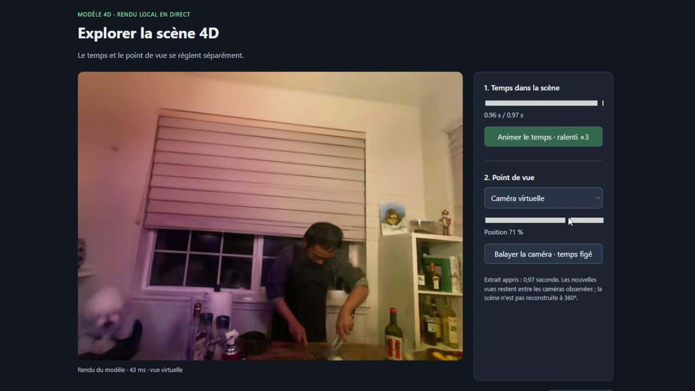
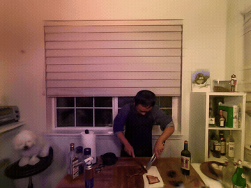
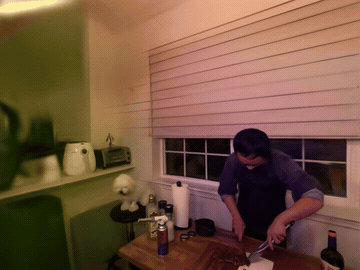
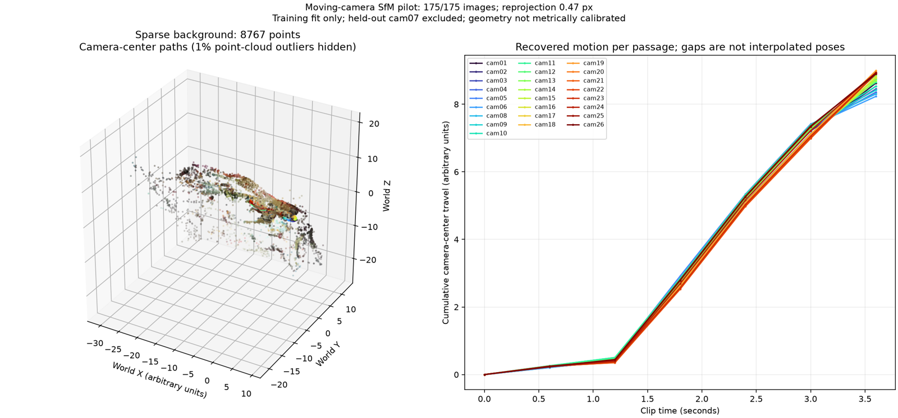

# skate-trick-4dgs

### Free-Viewpoint Replay of Skate Tricks using 4D Gaussian Splatting

[English](README.md) · [Español](README.es.md) · **Latest checkpoint: 24 November 2026** · Slides/report archive: 18 November.

**Repository:** [craptou/Projet_4D_Gaussian_Splatting](https://github.com/craptou/Projet_4D_Gaussian_Splatting) · Published 19 November 2026 · Branch `main`.

Can one saved skate replay, recorded from several moving viewpoints, become a dynamic 3D representation that supports novel-view rendering?

**Latest experiment — one static instant, 24 November:** [bilingual results and geometric checks](docs/progress/static-board.en.md). A restricted 14-view fit makes the board recognizable in inspected training views, but it still fails in reserved view20. Three inconsistent views are excluded from this optimization; 13 silhouettes provide approximate volume seeds. A second, fixed-geometry appearance control does not resolve the failure. [Board close-ups](docs/assets/static-board-detail.jpg) · [Projected initial volume](docs/assets/static-board-hull.jpg). Motion is disabled; this is not a successful 4D reconstruction.

**Previous experiment — foreground weighting, 24 November:** [controlled trial and bilingual report](docs/progress/foreground-trial.en.md). Same data, cameras, initialization and 5,000-step budget; added a foreground error term on 13 view19 training images. Masked training PSNR rises **11.79 → 25.18 dB**, but a broad dark smear replaces the board and reserved-view full-image PSNR falls **27.05 → 25.70 dB**. This is a diagnostic result, not successful board reconstruction. [Training comparison](docs/assets/foreground-trial-training.gif) · [Reserved-view comparison](docs/assets/foreground-trial-validation.gif). Next proposed gate: inspect board geometry at one fixed instant from several angles before adding motion.

This is the **final project for Computer Vision**. It studies that question using True Skate footage and the official [4DGaussians implementation](https://github.com/hustvl/4DGaussians). The vision task estimates cameras and scene structure from images; novel-view rendering is the forward image-synthesis stage. **Current stage: a restricted static True Skate fit recovers recognizable board appearance in training views, but reserved-view reconstruction fails. Three problematic angles remain unresolved. The earlier moving-view dataset has 2725 estimated training poses; the separate DyNeRF reference has a trained model and viewer.**

**Baseline — new capture trained on 24 November:** [full trial, comparisons and limitations](docs/progress/clean-pilot.en.md). From 18 active replay views, 17 training cameras register and view20 is reserved. After 200 coarse + 5,000 fine steps, reserved-view PSNR improves from 22.53 to 27.05 dB between fine checkpoints 2,000 and 5,000. The background improves; **the skateboard remains unrecognizable**. Empty view18 provides a useful foreground diagnostic for view19: the model barely outperforms the empty background in candidate board pixels. [Watch the comparison](docs/assets/clean-pilot-comparison.gif) · [Capture recovery and selection](docs/progress/clean-capture.en.md).

**24 November — first True Skate dynamic attempt:** [results, failure analysis and reproduction](docs/progress/fixed-dynamic-pilot.en.md): 8 training views, one reserved view, 13 instants spanning 0.4 seconds. Training: 200 coarse + 2000 fine steps in 85.92 s. Background blurred, moving board not recovered; the frozen-time control is slightly better on full reserved images. [Input/model animation](docs/assets/fixed-pilot-comparison.gif).

**24 November — owner-executed initialization experiment:** [results and temporal diagnostic](docs/progress/resampling-result.en.md). Resampling 1,115 points to 8,920 did not recover the skateboard. Reserved-view PSNR changes by +0.172 dB, while SSIM and changing-region PSNR worsen. The render also varies in target-stable background regions. [Three-way animation](docs/assets/resampling-comparison.gif). [Initialization launcher](docs/progress/next-initialization.en.md).

**24 November — longer training completed by the owner:** [progression and comparisons](docs/progress/duration-result.en.md). On inspected training cam08, PSNR rises 18.80 → 24.01 → 25.86 dB at 2,000 / 5,000 / 10,000 steps. Reserved cam13 peaks at 5,000 (16.43 dB) then declines (15.73 dB); the board remains unrecognizable. [Curves](docs/assets/duration-progression.png) · [Four-column animation](docs/assets/duration-comparison.gif) · [Launcher](docs/progress/duration-control.en.md). More optimization helps training appearance, while generalization and board motion remain unresolved.

**24 November - fixed-view geometry pilot:** [12/12 training cameras registered](docs/progress/fixed-geometry.en.md), 1,355 sparse points, mean reprojection error 0.562 px; cam13 reserved before mapping. Static-background feasibility only; board reconstruction and True Skate dynamic training remain pending.

**23 November — new fixed-camera capture:** [automatic recovery and checks](docs/progress/fixed-capture.en.md): 14 clips × 10.65 s, 13 distinct candidate viewpoints after one likely duplicate. All exports decoded successfully. Board visibility, action synchronization and calibration remain to be checked. This is a separate dataset from the earlier moving-camera recording.

## Start here — project review

**See the 4D scene from the DyNeRF reference:** [interactive local viewer and two demonstrations](docs/progress/4d-demonstration.en.md). [Animate time with fixed camera](docs/assets/4d-demo-time.mp4) or [freeze time and move the camera](docs/assets/4d-demo-view.mp4). The live viewer independently controls time/viewpoint using the trained GPU model. This remains a partial frontal reconstruction of approximately one second.

**Recorded walkthrough supplied by the project owner — 27 seconds:** [watch/download the MP4](docs/assets/4d-viewer-recording.mp4). The recording shows the viewer interface, animated time and manual changes to the virtual viewpoint. It can be viewed without installing the GPU environment.

[](docs/assets/4d-viewer-recording.mp4)

| Fixed camera, time advances | Frozen time, camera moves |
|---|---|
|  |  |

These small animations can be viewed directly in GitHub. They are recorded model renders, reduced for display; numerical evaluation uses the original PNGs. The **live viewer's source code is in this repository**, but GitHub does not run its Python/CUDA server. Live interaction requires the local trained model and GPU; [launch instructions](docs/progress/4d-demonstration.en.md#local-interactive-rendering) are provided separately.

**Latest result — 20 November:** [bounded DyNeRF quality pilot](docs/progress/quality-pilot.en.md), 200 coarse + 3000 fine steps in **5 min 25 s**. On 30 held-out validation images, PSNR/SSIM improve from **14.96 dB / 0.687** to **24.98 dB / 0.879**, using consistent checkpoint color settings. Scene recognizable, residual color/blur errors; roughly 255 MiB of run artifacts and 16 GiB disk still free. True Skate training and physical tracking remain pending.

**Local GPU update — 20 November:** the [bounded DyNeRF execution passed on the RTX 4050](docs/progress/local-gpu.en.md): CUDA extensions, loader, 2 coarse + 10 fine steps, saved model and 30 held-out render/target pairs. Training program: 25.52 s; rendering program: 17.09 s. Images remain very blurred; useful reconstruction quality and True Skate training are still unproven.

**20 November update:** [DyNeRF reference preparation](docs/progress/dynerf.en.md) now checks real calibrated videos and a held-out camera localization. [Open the Colab notebook](https://colab.research.google.com/github/craptou/Projet_4D_Gaussian_Splatting/blob/main/notebooks/dynerf_reference.ipynb) for the next GPU execution gate. CPU geometry checks passed; Colab training and rendering remain **not run**. The earlier slides/report are the 18 November checkpoint.

| Material | English | Español |
|---|---|---|
| 4D demonstration: independent time/view controls and demo clips | [Read](docs/progress/4d-demonstration.en.md) | [Leer](docs/progress/4d-demonstration.es.md) |
| DyNeRF quality pilot: before/after images, validation metrics and reload correction | [Read](docs/progress/quality-pilot.en.md) | [Leer](docs/progress/quality-pilot.es.md) |
| DyNeRF reference: measured CPU results and proposed Colab execution | [Read](docs/progress/dynerf.en.md) | [Leer](docs/progress/dynerf.es.md) |
| Connection to the supplied course topics, with PDF page references | [Read](docs/progress/course-alignment.en.md) | [Leer](docs/progress/course-alignment.es.md) |
| Latest experiment: full-rate poses, retries and quality checks | [Read](docs/progress/fullrate.en.md) | [Leer](docs/progress/fullrate.es.md) |
| Progress report: methods, results, limitations | [Read](docs/progress/report.en.md) | [Leer](docs/progress/report.es.md) |
| Presentation — 12 slides | [PDF](presentations/progress.en.pdf) · [PowerPoint](presentations/progress.en.pptx) | [PDF](presentations/progress.es.pdf) · [PowerPoint](presentations/progress.es.pptx) |
| Presentation outline and speaker notes | [Read](presentations/progress.en.md) | [Leer](presentations/progress.es.md) |
| Dated work log and evidence | [Read](docs/progress/work-log.en.md) | [Leer](docs/progress/work-log.es.md) |
| Milestones, risks and next acceptance criteria | [Read](docs/progress/roadmap.en.md) | [Leer](docs/progress/roadmap.es.md) |

The work log uses actual commits and observed results. The supplied **course notes** notes are mapped to camera/projection geometry, raster sampling, rendering and trajectories. The owner states that project follow-up is graded. No final-project rubric, grade weights or deadline were found in that PDF; the roadmap distinguishes proposed acceptance tests from official course requirements.

## What has been demonstrated

| Evidence | Verified result | Interpretation |
|---|---|---|
| Source recording | 118.63 s; 720 × 1280; 30 FPS | One saved replay recorded at successive viewpoints |
| Automatic cutting | 26 candidate passages; 109 frames per clip | Does not establish 26 unique angles |
| Common score event | Detected in 26/26 views; spread ≤1 frame | Event alignment, not full replay synchronization |
| Sparse camera-pose pilot | **175/175 images**, 25 passages, one model | Seven frames per passage; cam07 excluded |
| Full-rate localization | **2725/2725 poses**, all 109 frames in 25 training passages | 175 anchors retained + 2550 image-based estimates; no interpolation |
| Background geometry | **8,767 points**, 8,377 shared across passages | Sparse static background, not the moving skateboard |
| Mean reprojection error | **0.473 px** | Fit to retained observations, not novel-view quality |
| New-pose reprojection statistic | **0.592 px** average of per-frame inlier means | A different statistic from sparse bundle adjustment; 132 estimates have fewer than 50 inliers |
| Helper verification | **25 tests passed** | Includes synthetic PnP recovery with outliers, FFmpeg extraction and holdout exclusion |

[Machine-readable checkpoint](docs/evidence/checkpoint-2026-11-18.json) · [Detailed pose experiment](docs/pose-pilot-2026-11-18.md)

[Full-rate checkpoint](docs/evidence/fullrate-2026-11-18.json) · [Coverage and motion diagnostic](docs/assets/fullrate-quality.en.png)



*Sparse background and recovered camera-center travel. The scale is arbitrary. This is an SfM diagnostic, not a rendered novel view.*

## Pipeline and present boundary

```mermaid
flowchart LR
 A[Saved True Skate replay] --> B[26 candidate passages]
 B --> C[Crop and synchronization checks]
 C --> D[Masked background SfM: sampled anchors]
 D --> E[Full-rate image-based camera localization]
 E -. next .-> V[Camera and loader validation]
 V -.-> F[4D Gaussian optimization]
 F -.-> G[Novel view at a chosen time]
 G -.-> H[Held-out cam07 evaluation]
```



The capture camera **moves during each replay**. Upstream MultipleView reuses one pose for every frame of a camera sequence; using it unchanged would be an invalid camera model. The sampled CPU SfM map now supports independent poses for all training frames, with 31 difficult frames recovered in documented retries. A validated per-frame adapter is still required. See the [source-code analysis](docs/moving-camera-plan.md).


*Capture evidence supplied by the project owner: six views at frames 73 and 109. These small gameplay illustrations explain the method; they are not reconstructed images.*

## What remains unproven

- Full-rate coverage is demonstrated, but pose ground truth is unavailable; 132 lower-support estimates need targeted review. cam07 has not been localized.
- Intrinsics, arbitrary world scale and fast-motion frames need further checks.
- A reduced DyNeRF compatibility smoke run now works; full official reproduction, useful reconstruction quality and True Skate training/rendering remain unproven.
- Held-out PSNR, SSIM and LPIPS have not been measured.

This project wraps upstream research code; it does not introduce a new 4DGS algorithm. Its contributions so far are capture preparation, safeguards, experiment scripts and documented evidence. AI-assisted coding and documentation were used; Git history records the resulting artifacts, not a claim that every line was manually authored.

## Reproduce and inspect

```powershell
git submodule update --init --recursive
python -m venv .venv
.\.venv\Scripts\python.exe -m pip install -e ".[sfm]"
.\.venv\Scripts\python.exe -m unittest discover -s tests -v
```

Raw footage, models and databases stay outside Git; tests use generated media. Small figures and a sanitized metrics snapshot are tracked for review without the original recording. Repeating the real-data experiment additionally requires the owner's recording, identified by SHA-256 in the checkpoint.

[Development guide](docs/development.en.md) · [Pose-pilot commands](docs/pose-pilot-2026-11-18.md) · [Environment](environment/README.md) · [Documentation maintenance](docs/progress/README.md)

## Dependency and references

Official submodule: `third_party/4DGaussians`, pinned at `843d5ac636c37e4b611242287754f3d4ed150144` on 19 October 2026. The upstream root license is Apache-2.0; individual source and dependency notices remain applicable.

Wu et al., **4D Gaussian Splatting for Real-Time Dynamic Scene Rendering**, CVPR 2024, pp. 20310–20320. [Paper](https://arxiv.org/abs/2310.08528) · [Official repository](https://github.com/hustvl/4DGaussians) · [COLMAP / PyCOLMAP](https://colmap.github.io/pycolmap/index.html). The development guide includes the full citation.
