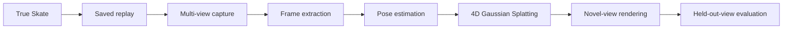

# skate-trick-4dgs

**Free-Viewpoint Replay of Skate Tricks using 4D Gaussian Splatting**

A university Computer Graphics / Computación Visual Interactiva project studying one deterministic skate trick replay captured from several True Skate viewpoints.

**Research question:** Can a skate trick recorded from multiple replay-camera viewpoints be reconstructed as a dynamic 3D representation that supports novel-view rendering using 4D Gaussian Splatting?

Replay capture provides a controlled way to study synchronization, camera calibration, dynamic scene representations and image-based evaluation. The goal is a measurable held-out-view experiment as well as free-viewpoint replay.



## Current status

Official dependency and all nested submodules initialized; Windows capture helpers installed in `.venv`; extraction, validation, contact sheets and holdout-safe staging implemented with unit/FFmpeg smoke tests. System audited. Fixed-camera COLMAP/training/render wrappers prepared, **not integration-tested**. No replay dataset captured. No CUDA extension build, official dataset reproduction, training, renderer or held-out metrics completed: WSL distro, toolkit, compiler environment, Conda, PyTorch and COLMAP are missing. Portable GitHub CLI exists but is unauthenticated; no remote has been created.

**Camera requirement:** upstream MultipleView needs a fixed pose per camera and matched constant intrinsics. Follow/Orbit/Custom capture may move. Moving footage may be stored/inspected but is rejected by our fixed preprocessing. See [source analysis and moving-camera plan](docs/moving-camera-plan.md).

## Repository structure

| Path | Purpose |
|---|---|
| `docs/` | Architecture, audit, capture/camera assumptions and experiments |
| `environment/` | Upstream version specification and WSL setup strategy |
| `configs/datasets/` | Blank capture metadata template |
| `configs/experiments/` | Bounded smoke configurations |
| `data/{raw,frames,processed,sample}/` | Ignored capture/reconstruction artifacts |
| `src/skate4d/`, `scripts/`, `tests/` | CPU capture helpers, wrappers and tests |
| `notebooks/` | Future analysis |
| `outputs/` | Ignored logs, controlled preprocessing workspaces and models |
| `third_party/4DGaussians/` | Unmodified official Git submodule |

## Installation

```powershell
git submodule update --init --recursive
python -m venv .venv
.\.venv\Scripts\python.exe -m pip install -e .
.\.venv\Scripts\python.exe scripts/check_system.py
.\.venv\Scripts\python.exe -m unittest discover -s tests -v
```

Python 3.11+ and FFmpeg/FFprobe are required for Windows capture helpers. Training uses a separate upstream Python 3.7 / PyTorch 1.13.1 / CUDA 11.6 environment; follow [environment setup](environment/README.md). Driver CUDA capability is not the toolkit version. No modern compatibility environment is claimed or required without an observed failure.

## Dataset and fixed-camera workflow

```text
data/raw/kickflip_test/
    metadata.json
    cam01.mp4
    cam02.mp4
    ...
    cam_holdout.mp4
```

Copy `configs/datasets/metadata.template.json` into that directory and fill actual values, especially `replay_id`, `camera_mode`, `camera_motion`, and `holdout_camera`. `cam07` is also a valid declared holdout. All videos must show the same replay interval with matching constant FPS, count and resolution; [capture protocol](docs/capture-protocol.md) and [dataset specification](docs/dataset-spec.md) explain the checks.

From repository root (Windows venv Python or the documented WSL environment):

```bash
python scripts/extract_frames.py --input data/raw/kickflip_test --output data/frames/kickflip_test
python scripts/validate_multiview.py data/frames/kickflip_test
python scripts/inspect_frames.py data/frames/kickflip_test --output outputs/kickflip-contact.jpg
```

An optional `--interval N` selects the same source frames in every view without independently resampling. Extracted names are `cam01/frame_00001.jpg` onward; the manifest retains source indexes and FPS. Inspect replay state visually before proceeding.

After official-scene reproduction succeeds, in the WSL training environment:

```bash
bash scripts/preprocess_fixed_cameras.sh kickflip_test
bash scripts/train_4dgs.sh kickflip_test
bash scripts/render_4dgs.sh kickflip_test
```

Preprocessing retains unique logs/workspaces, never calls destructive `multipleviewprogress.sh`, excludes the holdout and writes `sparse_`, `points3D_multipleview.ply`, `poses_bounds_multipleview.npy` under `data/processed/<name>`. It requires dense CUDA COLMAP and matching centered shared intrinsics. Training is bounded to 2 coarse + 10 fine iterations. Rendering tests execution on upstream test samples; **it is not held-out evaluation**. Existing destinations are not overwritten. Wrappers accept simple dataset names and resolve project paths themselves; do not pass arbitrary paths as dataset names.

## Upstream dependency and reproduction

- Official source: [hustvl/4DGaussians](https://github.com/hustvl/4DGaussians).
- Pinned commit: `843d5ac636c37e4b611242287754f3d4ed150144`, pinned 2026-10-19.
- Upstream root license: Apache-2.0 (`LICENSE.md`). Preserve individual source/dependency notices; this wrapper's LICENSE does not replace them.
- Wu et al., **4D Gaussian Splatting for Real-Time Dynamic Scene Rendering**, CVPR 2024, pp. 20310–20320. [Paper](https://arxiv.org/abs/2310.08528), [project](https://guanjunwu.github.io/4dgs/index.html).

Reproduce the official D-NeRF `bouncingballs` example first. Its official combined download is 257793177 bytes (~246 MiB); it was not downloaded. [Experiments](docs/experiments.md) gives exact bounded training/render commands and independent pass gates. Preserve failures and exact versions before changing dependencies. No True Skate training is scientifically interpretable until this reproduction works.

## Experiment plan and limitations

1. Reproduce official data; verify CUDA extension imports and short train/render.
2. Verify deterministic replay synchronization and true fixed-camera feasibility.
3. Calibrate and smoke-train training views; inspect pose and point-cloud quality.
4. Implement explicit held-out camera rendering and PSNR/SSIM/LPIPS comparisons.

The stock MultipleView loader repeats a pose across time, assumes shared intrinsics, and samples its own training cameras for tests. Its first-frame calibration can be biased by the dynamic board/fingers. Per-frame camera estimation, real holdout rendering and metrics remain planned work. 6 GB VRAM may constrain resolution/model size; game motion blur, image compression, rolling screen capture artifacts and replay-state drift can limit quality. No game camera export has been verified.

Read [architecture](docs/architecture.md), [camera models](docs/camera-models.md), [moving-camera recommendation](docs/moving-camera-plan.md), [system report](docs/system-report.md), and [decisions](docs/decision-log.md).

## GitHub

Local branch is `main`. Portable CLI is `.tools/gh/bin/gh.exe` (ignored). From PowerShell at this repository root, authenticate and create the private repository:

```powershell
.\.tools\gh\bin\gh.exe auth login
.\.tools\gh\bin\gh.exe repo create skate-trick-4dgs --private --source . --remote origin --push
```

## Citation

```bibtex
@InProceedings{Wu_2024_CVPR,
  author = {Wu, Guanjun and Yi, Taoran and Fang, Jiemin and Xie, Lingxi and Zhang, Xiaopeng and Wei, Wei and Liu, Wenyu and Tian, Qi and Wang, Xinggang},
  title = {4D Gaussian Splatting for Real-Time Dynamic Scene Rendering},
  booktitle = {Proceedings of the IEEE/CVF Conference on Computer Vision and Pattern Recognition (CVPR)},
  year = {2024}, month = {June}, pages = {20310-20320}
}
```
