# skate-trick-4dgs

### Free-Viewpoint Replay of Skate Tricks using 4D Gaussian Splatting

[English](README.md) · [Español](README.es.md) · **Progress checkpoint: 18 November 2026**

**Repository:** [craptou/Projet_4D_Gaussian_Splatting](https://github.com/craptou/Projet_4D_Gaussian_Splatting) · Published 19 November 2026 · Branch `main`.

Can one saved skate replay, recorded from several moving viewpoints, become a dynamic 3D representation that supports novel-view rendering?

This is the **final project for Computer Vision**. It studies that question using True Skate footage and the official [4DGaussians implementation](https://github.com/hustvl/4DGaussians). The vision task estimates cameras and scene structure from images; novel-view rendering is the forward image-synthesis stage. **Current stage: all 2725 training frames have estimated camera poses. Dynamic reconstruction has not been trained yet.**

## Start here — project review

**Local GPU update:** Colab was replaced by a [foreground Windows/WSL launcher](docs/progress/local-gpu.en.md). Ubuntu and a native CUDA kernel work on the RTX 4050; PyTorch detects the GPU. Remaining setup and the first 4DGaussians training/render run have **not yet completed**. Launch instructions and live progress are provided in that checkpoint.

**20 November update:** [DyNeRF reference preparation](docs/progress/dynerf.en.md) now checks real calibrated videos and a held-out camera localization. [Open the Colab notebook](https://colab.research.google.com/github/craptou/Projet_4D_Gaussian_Splatting/blob/main/notebooks/dynerf_reference.ipynb) for the next GPU execution gate. CPU geometry checks passed; Colab training and rendering remain **not run**. The earlier slides/report are the 18 November checkpoint.

| Material | English | Español |
|---|---|---|
| DyNeRF reference: measured CPU results and proposed Colab execution | [Read](docs/progress/dynerf.en.md) | [Leer](docs/progress/dynerf.es.md) |
| Connection to the supplied course topics, with PDF page references | [Read](docs/progress/course-alignment.en.md) | [Leer](docs/progress/course-alignment.es.md) |
| Latest experiment: full-rate poses, retries and quality checks | [Read](docs/progress/fullrate.en.md) | [Leer](docs/progress/fullrate.es.md) |
| Progress report: methods, results, limitations | [Read](docs/progress/report.en.md) | [Leer](docs/progress/report.es.md) |
| Presentation — 12 slides | [PDF](presentations/progress.en.pdf) · [PowerPoint](presentations/progress.en.pptx) | [PDF](presentations/progress.es.pdf) · [PowerPoint](presentations/progress.es.pptx) |
| Presentation outline and speaker notes | [Read](presentations/progress.en.md) | [Leer](presentations/progress.es.md) |
| Dated work log and evidence | [Read](docs/progress/work-log.en.md) | [Leer](docs/progress/work-log.es.md) |
| Milestones, risks and next acceptance criteria | [Read](docs/progress/roadmap.en.md) | [Leer](docs/progress/roadmap.es.md) |

The work log uses actual commits and observed results. The supplied **course notes** notes are mapped to camera/projection geometry, raster sampling, rendering and trajectories. The owner states that project follow-up is graded. No final-project rubric, grade weights or deadline were found in that PDF; the roadmap distinguishes proposed acceptance tests from official course requirements.

## What has been demonstrated

| Evidence | Verified result | Interpretation |
|---|---|---|
| Source recording | 118.63 s; 720 × 1280; 30 FPS | One saved replay recorded at successive viewpoints |
| Automatic cutting | 26 candidate passages; 109 frames per clip | Does not establish 26 unique angles |
| Common score event | Detected in 26/26 views; spread ≤1 frame | Event alignment, not full replay synchronization |
| Sparse camera-pose pilot | **175/175 images**, 25 passages, one model | Seven frames per passage; cam07 excluded |
| Full-rate localization | **2725/2725 poses**, all 109 frames in 25 training passages | 175 anchors retained + 2550 image-based estimates; no interpolation |
| Background geometry | **8,767 points**, 8,377 shared across passages | Sparse static background, not the moving skateboard |
| Mean reprojection error | **0.473 px** | Fit to retained observations, not novel-view quality |
| New-pose reprojection statistic | **0.592 px** average of per-frame inlier means | A different statistic from sparse bundle adjustment; 132 estimates have fewer than 50 inliers |
| Helper verification | **25 tests passed** | Includes synthetic PnP recovery with outliers, FFmpeg extraction and holdout exclusion |

[Machine-readable checkpoint](docs/evidence/checkpoint-2026-11-18.json) · [Detailed pose experiment](docs/pose-pilot-2026-11-18.md)

[Full-rate checkpoint](docs/evidence/fullrate-2026-11-18.json) · [Coverage and motion diagnostic](docs/assets/fullrate-quality.en.png)


*Sparse background and recovered camera-center travel. The scale is arbitrary. This is an SfM diagnostic, not a rendered novel view.*

## Pipeline and present boundary

```mermaid
flowchart LR
 A[Saved True Skate replay] --> B[26 candidate passages]
 B --> C[Crop and synchronization checks]
 C --> D[Masked background SfM: sampled anchors]
 D --> E[Full-rate image-based camera localization]
 E -. next .-> V[Camera and loader validation]
 V -.-> F[4D Gaussian optimization]
 F -.-> G[Novel view at a chosen time]
 G -.-> H[Held-out cam07 evaluation]
```



The capture camera **moves during each replay**. Upstream MultipleView reuses one pose for every frame of a camera sequence; using it unchanged would be an invalid camera model. The sampled CPU SfM map now supports independent poses for all training frames, with 31 difficult frames recovered in documented retries. A validated per-frame adapter is still required. See the [source-code analysis](docs/moving-camera-plan.md).


*Capture evidence supplied by the project owner: six views at frames 73 and 109. These small gameplay illustrations explain the method; they are not reconstructed images.*

## What remains unproven

- Full-rate coverage is demonstrated, but pose ground truth is unavailable; 132 lower-support estimates need targeted review. cam07 has not been localized.
- Intrinsics, arbitrary world scale and fast-motion frames need further checks.
- Official 4DGS reproduction, CUDA extension compilation, dynamic training and rendering have not run.
- Held-out PSNR, SSIM and LPIPS have not been measured.

This project wraps upstream research code; it does not introduce a new 4DGS algorithm. Its contributions so far are capture preparation, safeguards, experiment scripts and documented evidence. AI-assisted coding and documentation were used; Git history records the resulting artifacts, not a claim that every line was manually authored.

## Reproduce and inspect

```powershell
git submodule update --init --recursive
python -m venv .venv
.\.venv\Scripts\python.exe -m pip install -e ".[sfm]"
.\.venv\Scripts\python.exe -m unittest discover -s tests -v
```

Raw footage, models and databases stay outside Git; tests use generated media. Small figures and a sanitized metrics snapshot are tracked for review without the original recording. Repeating the real-data experiment additionally requires the owner's recording, identified by SHA-256 in the checkpoint.

[Development guide](docs/development.en.md) · [Pose-pilot commands](docs/pose-pilot-2026-11-18.md) · [Environment](environment/README.md) · [Documentation maintenance](docs/progress/README.md)

## Dependency and references

Official submodule: `third_party/4DGaussians`, pinned at `843d5ac636c37e4b611242287754f3d4ed150144` on 19 October 2026. The upstream root license is Apache-2.0; individual source and dependency notices remain applicable.

Wu et al., **4D Gaussian Splatting for Real-Time Dynamic Scene Rendering**, CVPR 2024, pp. 20310–20320. [Paper](https://arxiv.org/abs/2310.08528) · [Official repository](https://github.com/hustvl/4DGaussians) · [COLMAP / PyCOLMAP](https://colmap.github.io/pycolmap/index.html). The development guide includes the full citation.
