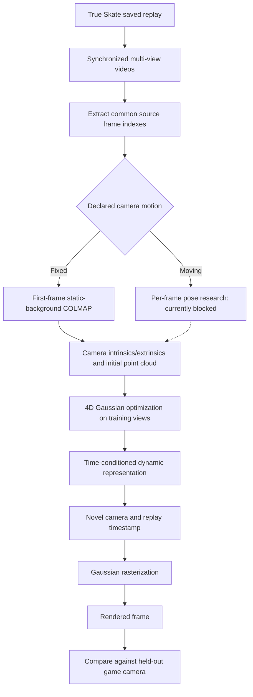

# Pipeline architecture

Capture helpers are project-owned CPU tools under `src/skate4d` and `scripts`; `third_party/4DGaussians` is an unchanged pinned dependency. Raw recordings and intermediate artifacts stay outside version control. Metadata and extraction provenance travel with frame datasets. Fixed preprocessing stages only training cameras under contiguous camXX names and saves an explicit name mapping; the original holdout remains in the frame dataset.

3D Gaussian Splatting generally optimizes a mostly static collection of anisotropic Gaussian primitives with position, scale, rotation, opacity and view-dependent appearance. This 4DGS implementation combines Gaussian primitives with a time-conditioned deformation representation (spatiotemporal feature grids and a deformation network). Optimization compares rasterized samples with training images at their timestamps. The temporal representation models changing scene properties; it does not estimate unknown capture camera trajectories for us.

COLMAP supplies camera calibration and a starting point cloud, not the final dynamic representation. Dynamic foreground correspondences may bias calibration. A novel-view query supplies both a camera and a time; changing both together in a pretty orbit video is distinct from a controlled held-out-camera test at matched replay time.

Preprocessing uses a unique retained workspace under `outputs/preprocess`, with command logs. No recursive deletion is performed. Upstream's helper scripts run with this controlled working directory; its destructive shell script is never called. Training/render wrappers run from upstream's directory for import/config behavior but write model output to project `outputs/`.
