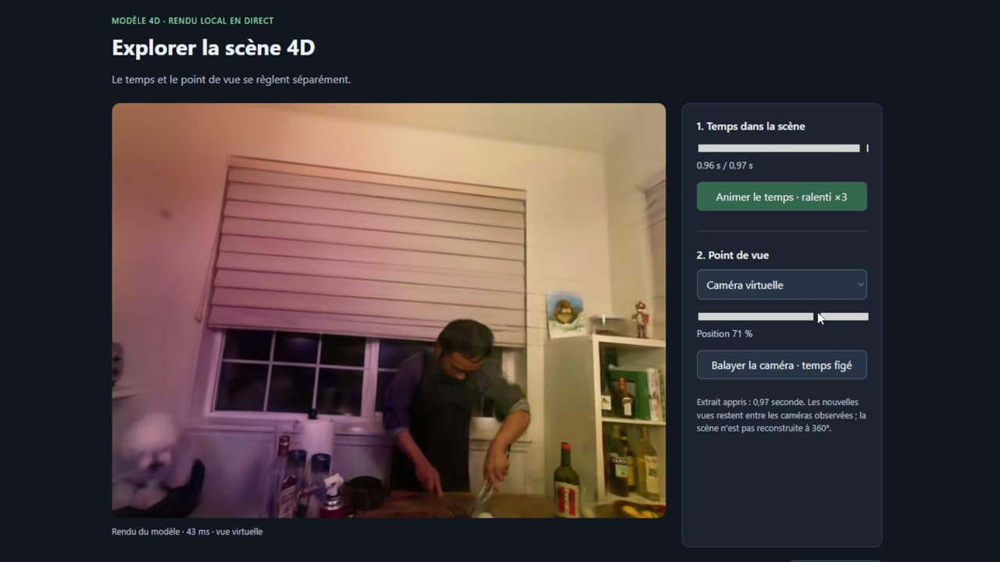

# Demonstrating the 4D scene — 20 November 2026

[Español](4d-demonstration.es.md)

The image comparisons evaluate a model; they do not by themselves demonstrate independent control of space and time. The learned representation consists of canonical 3D Gaussians (`point_cloud.ply`) plus a time-dependent deformation network (`deformation.pth` and related state). An ordinary static PLY viewer would omit that deformation. We now demonstrate the saved **10,799-gaussian step-3000 model** without retraining.

## Local interactive rendering

From repository PowerShell:

```powershell
powershell -NoProfile -ExecutionPolicy Bypass -File .\scripts\Open-4DScene.ps1
```

Open **http://127.0.0.1:8765** once the terminal reports readiness. The Windows launcher reuses the Linux CUDA environment and model, with no package install. The local Python server renders each requested time/view on the GPU: it is not a lookup of pre-rendered frames. The browser displays those JPEG renders.

- **Animate time:** keep cam00 fixed while the scene evolves; the preview runs at 3× slow motion.
- **Sweep camera:** freeze time and move a virtual camera between calibrated cam01 and cam20. Position is interpolated linearly and rotation by SLERP. Intermediate poses are newly requested viewpoints.
- Both controls can be changed independently. The stop button shuts down the viewer and releases the GPU process. The service binds loopback only.

The viewer is a partial frontal reconstruction, not a 360-degree scan. The trained timestamps span source frames 0–29 (0.967 seconds between endpoints). No claims are made about unseen backsides, longer time ranges or correct physical point trajectories. Canonical Gaussian centers change with model time, but the learned displacement is not ground-truth motion.

## Shareable demonstrations

### Owner-supplied screen recording

[Watch/download the 27-second viewer walkthrough](../assets/4d-viewer-recording.mp4).

[](../assets/4d-viewer-recording.mp4)

The owner supplied a 27.167-second, 1920 × 1080, 60 FPS MKV recording. It shows time playback active while the virtual-viewpoint slider is changed manually. The published full-length MP4 keeps the 1080p interface readable, uses H.264 at 30 FPS, copies the AAC audio without re-encoding, and places playback metadata at the start for browser compatibility. Its size is **3.70 MB**, versus **9.08 MB** for the source. The original recording is preserved locally and excluded from Git. [File hashes and conversion evidence](../evidence/viewer-recording-2026-11-20.json).

This captures operation of the actual interactive viewer; the two clips below isolate time and viewpoint separately. It is a recorded demonstration, not an online GPU service or a new training/evaluation run.

| Clip | What is held fixed | What changes |
|---|---|---|
| [Time animation](../assets/4d-demo-time.mp4) | cam00 pose | Model time 0 → 29/300; 30 renders displayed over 3 seconds |
| [Frozen-time viewpoint sweep](../assets/4d-demo-view.mp4) | Source frame 14 (model time 14/300) | Virtual camera translation/rotation; 60 renders over 4 seconds |

Both clips are **768 × 576**, generated directly from the frozen model. Combined size is about **2.4 MiB**; they are explicitly allowed small derived assets, not raw-video uploads. `scripts/view_4d_reference.py --model MODEL --export OUTPUT` reproduces the exports inside the GPU environment.

The repository README also includes animated GIF previews at **360 × 270, 10 FPS**, transcoded from these clips. They show time and viewpoint changes directly on GitHub without a GPU installation. They are prerecorded previews; the live interactive Python/CUDA application is not hosted by GitHub. GIF palette/resolution changes are only for presentation and do not enter the quantitative evaluation.

## Verification

The service was reached from Windows through WSL localhost. Actual render requests returned 768 × 576 JPEGs; changing time with fixed camera changed pixels, and changing camera at fixed time changed pixels. Invalid nonfinite time returned HTTP 400. The interface loaded its rendered image in headless Chrome and was visually inspected. Live API checks and model/export diagnostics are captured in the [evidence snapshot](../evidence/4d-demonstration-2026-11-20.json). Nonzero learned motion or image differences alone do not prove accurate dynamic geometry.

Source imagery and derived renders: Neural 3D Video Synthesis (Li et al., CVPR 2022), [source dataset](https://github.com/facebookresearch/Neural_3D_Video), CC-BY-NC-4.0. The local model/data remain outside Git; code, diagnostics and the small demo clips are tracked. Automatic browser opening was blocked by execution controls; the viewer URL is supplied for manual opening.
