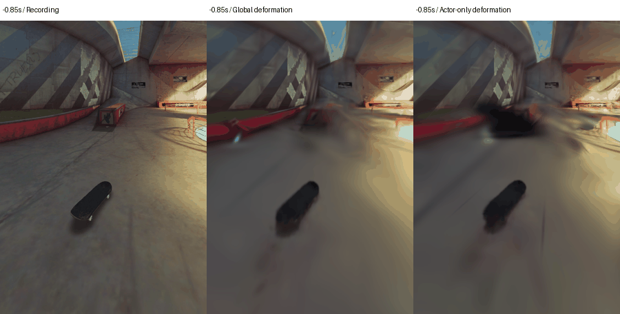
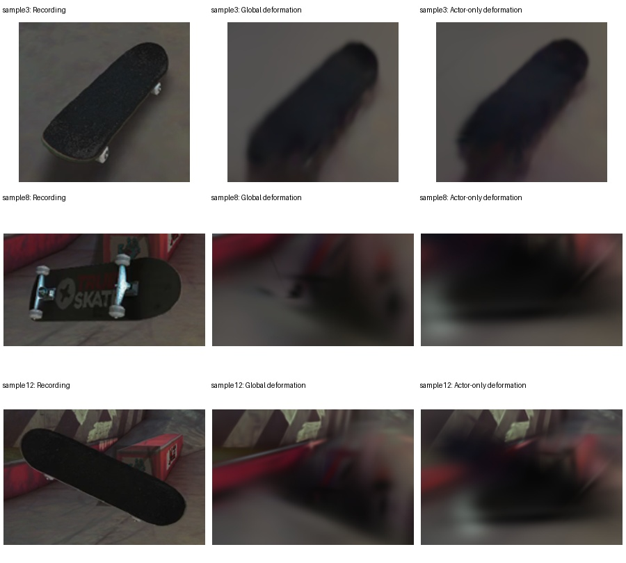

# Restrict temporal deformation to board-seed descendants

[Español](actor-only.es.md) · [Previous shared temporal model](joint-temporal.en.md)

Experiment date: **24 November 2026**. This experiment asks whether allowing the background to deform explains part of the previous temporal reconstruction failure. It retains the three observed times and the 6,000-step fine-training budget, changing only how the deformation network outputs are applied.

**Result: background variation decreases strongly, but board motion remains unsuccessful.** Full-image scores improve while the changing-region scores decline. This is a useful background constraint, not an improved reconstruction of the flip. [Measured evidence](../evidence/actor-only-2026-11-24.json).



The ten timestamps play at 250 ms/frame, approximately five times slower than the capture. Three were optimization targets and seven were intermediate evaluation targets. Both model columns are saved 6,000-step temporal checkpoints.

## Measured result and next decision

Training-program time is **305.34 seconds**, excluding the loader probe and rendering. The checkpoint contains **8,652 points: 5,518 background descendants and 3,134 actor descendants**. Auditing the saved checkpoint gives exactly zero background-attribute change at the three tested times for all five attributes. The previous global model has 10,079 points; changed densification is an outcome of the routing change.

| Validation view20 metric | Global deformation | Actor-only deformation |
|---|---:|---:|
| Full-image PSNR, three observed times | 26.32 dB | 28.77 dB |
| Ten-time change-union PSNR, observed times | 23.10 dB | 20.82 dB |
| Same region, seven intermediate times | 20.52 dB | 19.02 dB |
| Same region, frozen-middle control, intermediate times | 20.47 dB | 19.43 dB |
| Interframe MAE in target-stable pixels, lower is more stable | 0.005694 | 0.000445 |

Target-stable-pixel variation falls by approximately **12.8×**, close to the target value 0.000381. The corresponding view19 variation falls from 0.002592 to 0.0000869, with target 0.0000934. These values measure stability, not correct scene shape. The background still contains a persistent dark artifact near the box, and the airborne board is badly represented in both views.



[Training-view animation](../assets/actor-only-training.gif) · [Training-view close-ups](../assets/actor-only-training.jpg).

Approximate validation deck-envelope PSNR at samples 3/8/12 changes from **26.15/15.67/21.99** to **24.99/15.74/26.00 dB**. The last number rises despite a visually incorrect board and broad dark artifact. These approximate regional scores cannot establish board identity or rotation. The middle board remains poor, and the intermediate-time model performs **0.41 dB worse than its own frozen-time control** in the change union. Temporal fitting also weakens in training view19: observed change-union PSNR drops 21.33 → 16.33 dB, and intermediate 16.11 → 14.41 dB. The failure is not confined to view20 generalization.

The selected near-canonical spatial probe reports no near-cut crossings at the ten times in the two views; it covers 3,127 selected points, not all points or material board identities. Thus it does not explain or rule out every possible visibility failure.

**Decision:** keep this as a measured background-stability experiment and preserve the earlier model for comparison. It does not show that background deformation was the only cause of failure. The next controlled test should increase temporal supervision from three to ten existing capture instants while keeping this routing and evaluating board appearance separately. More times can provide closer motion targets; success is not guaranteed. If the board still fails at supervised times, revisit the actor initialization and foreground fitting before proposing physical tracking. No additional training is currently running.

## What changes

The canonical cloud has 2,337 background seeds from the static-camera reconstruction and 3,000 seeds from the first instant's approximate silhouette volume. Their descendants retain these roles when the upstream optimizer clones, splits or prunes points. Background descendants bypass temporal changes to **position, scale, rotation, opacity and spherical-harmonic appearance**. Board-seed descendants retain the learned deformation. This is an explicit runtime adaptation to the pinned implementation, not an upstream feature claimed to work by default.

Background parameters still learn during optimization. At a saved checkpoint they are independent of requested time; this does not freeze them throughout training. Board occlusion can still change pixels in front of a static background. Roles describe seed ancestry, not perfect segmentation: some background seeds or hull seeds may have the wrong physical interpretation. Neither role provides material-point identity or a rotation measurement.

All 45 RGB images, 45 masks and the canonical point cloud are byte-identical to the previous joint dataset. The preparation helper records their hashes. Camera poses, scale 4, 42 training images, 37 training masks, three validation images, normalized times 0/5⁄9/1, loss weights and the effective training configuration stay unchanged. Models start from the same untrained seeds; no previous trained weights are reused. One run per condition and CUDA nondeterminism limit causal precision.

## Evaluation

The comparison uses the previous **6,000-step duration-run checkpoint**, not the earlier independent 3,000-step pilot. It renders the same ten timestamps in view20 and view19, including seven intermediate targets excluded from model optimization. A same-model frozen-middle-time control checks whether temporal interpolation is useful. Wider capture data already contributed to preparation, and view20 is repeatedly used for validation; this is not a fresh independent test set.

Report full-image quality, temporal-change-region quality, approximate deck-envelope quality at observed times, and consecutive pixel changes in target-stable regions separately. The deck envelopes are existing assistant-traced evaluation annotations, not owner labels or independent semantic truth. The loaded-checkpoint audit also checks exact background invariance for all five attributes at times 0, 5⁄9 and 1. Pixel stability and parameter invariance measure different things.

## Reproduction

Verification: Windows runs 56 tests, with 44 passes and 12 optional-dependency skips. The three new routing/gradient/parent-inheritance tests pass in WSL with Torch/CUDA. A broader WSL run has 53 passes, one skip and two unrelated extraction errors: its older FFmpeg does not recognize the existing `-fps_mode` option. No extraction code or packages are changed for this training experiment. The actual GPU loader and saved-checkpoint audits are additional integration checks.

Existing local WSL GPU environment and prepared datasets are required. No package reinstallation is requested. Choose fresh output paths when repeating the experiment.

```powershell
.venv/Scripts/python.exe scripts/prepare_actor_only_replay.py
.venv/Scripts/python.exe -u scripts/run_fixed_pilot.py --source data/processed/true-skate-joint-three-actor --output outputs/joint-three-actor/gpu --configs configs/experiments/true-skate-joint-three-duration.py --checkpoints 3000 6000

$evaluator = (wsl -d Ubuntu-22.04 -u root --exec wslpath -a -u "$PWD/scripts/evaluate_joint_replay.py").Trim()
wsl -d Ubuntu-22.04 -u root --exec /opt/skate4d/venv/bin/python $evaluator --source data/processed/true-skate-joint-three-actor --run outputs/joint-three-actor/gpu --config configs/experiments/true-skate-joint-three-duration.py --iteration 6000 --output outputs/joint-three-actor/timeline-6000
.venv/Scripts/python.exe scripts/review_actor_replay.py
```

Raw captures, processed inputs, checkpoints and full-resolution renders remain local. The repository publishes the adaptation, reproduction commands, compact comparisons and measured evidence.
