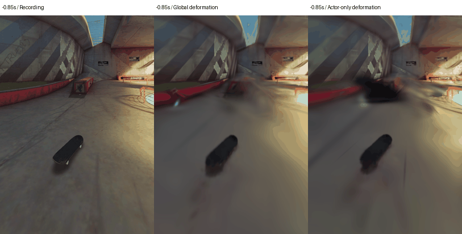
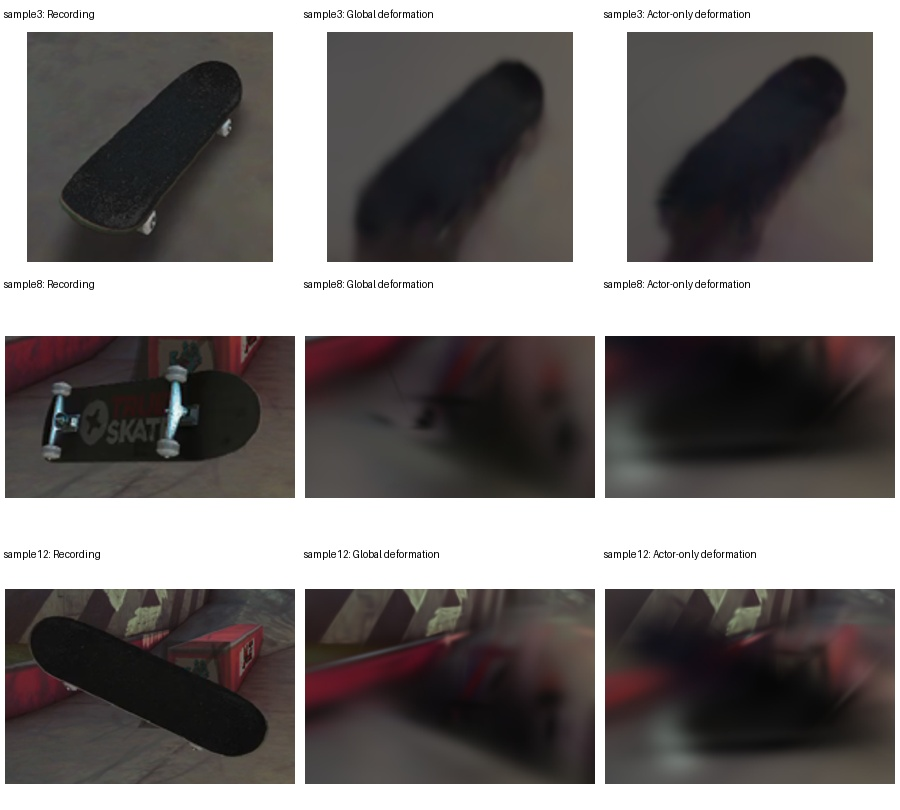

# Limitar la deformación temporal a los descendientes de las semillas de la tabla

[English](actor-only.en.md) · [Modelo temporal conjunto anterior](joint-temporal.es.md)

Fecha del experimento: **24 de noviembre de 2026**. Se pregunta si permitir la deformación del fondo explica parte del fallo temporal anterior. Conserva los tres instantes observados y el presupuesto de 6.000 pasos finos; solo cambia cómo se aplican las salidas de la red de deformación.

**Resultado: la variación del fondo disminuye mucho, pero el movimiento de la tabla sigue sin reconstruirse correctamente.** Mejora la imagen completa y empeoran las regiones cambiantes. Es una restricción útil del fondo, no una mejor reconstrucción del flip. [Evidencia medida](../evidence/actor-only-2026-11-24.json).



Los diez instantes se muestran a 250 ms por imagen, unas cinco veces más despacio que la captura. Tres fueron objetivos de optimización y siete de evaluación intermedia. Ambas columnas del modelo usan checkpoints temporales de 6.000 pasos.

## Resultado medido y siguiente decisión

El programa de entrenamiento tarda **305,34 segundos**, sin incluir comprobaciones del cargador ni renders. El checkpoint contiene **8.652 puntos: 5.518 descendientes del fondo y 3.134 del volumen de la tabla**. La auditoría del checkpoint guardado obtiene cambio exactamente cero en los cinco atributos del fondo a los tres tiempos comprobados. El modelo global anterior tiene 10.079 puntos; la diferencia de densificación es un resultado del cambio de rutas.

| Métrica de validación view20 | Deformación global | Solo descendientes de la tabla |
|---|---:|---:|
| PSNR de imagen completa, tres instantes observados | 26,32 dB | 28,77 dB |
| PSNR en unión de cambio de diez instantes, tiempos observados | 23,10 dB | 20,82 dB |
| Misma región, siete instantes intermedios | 20,52 dB | 19,02 dB |
| Misma región, control central congelado, instantes intermedios | 20,47 dB | 19,43 dB |
| MAE entre imágenes en píxeles estables del objetivo; menor significa más estabilidad | 0,005694 | 0,000445 |

La variación en píxeles estables baja aproximadamente **12,8 veces**, cerca del valor objetivo 0,000381. En view19 baja de 0,002592 a 0,0000869, con objetivo 0,0000934. Miden estabilidad, no geometría correcta. Persiste un artefacto oscuro cerca de la caja y la tabla en el aire sigue mal representada en ambas vistas.



[Animación de entrenamiento](../assets/actor-only-training.gif) · [Ampliaciones de entrenamiento](../assets/actor-only-training.jpg).

El PSNR aproximado de la envolvente del deck en validación, muestras 3/8/12, pasa de **26,15/15,67/21,99** a **24,99/15,74/26,00 dB**. El último valor mejora pese a una tabla visualmente incorrecta y un artefacto oscuro amplio. Estas puntuaciones regionales no establecen identidad ni rotación. La tabla central sigue siendo deficiente y el modelo intermedio resulta **0,41 dB peor que su propio control congelado** en la unión de cambio. También empeora el ajuste temporal en entrenamiento view19: PSNR de unión observada 21,33 → 16,33 dB, e intermedia 16,11 → 14,41 dB. El fallo no se limita a la generalización de view20.

La comprobación espacial cercana al volumen canónico no detecta cruces del corte cercano en diez instantes y dos vistas; cubre 3.127 puntos seleccionados, no todos los puntos ni identidades materiales de la tabla. No explica ni descarta todos los posibles fallos de visibilidad.

**Decisión:** conservarlo como experimento medido de estabilidad del fondo y mantener el modelo anterior para comparar. No demuestra que deformar el fondo fuera la única causa del fallo. La siguiente prueba controlada debería pasar de tres a diez instantes de la captura existente, conservando estas rutas y evaluando la tabla por separado. Más instantes proporcionan objetivos de movimiento próximos; no garantizan éxito. Si la tabla sigue fallando en instantes supervisados, revisar inicialización y ajuste del primer plano antes de proponer seguimiento físico. No hay entrenamiento adicional en ejecución.

## Qué cambia

La nube canónica contiene 2.337 semillas del fondo reconstruido con cámaras fijas y 3.000 semillas del volumen aproximado de siluetas del primer instante. Los descendientes conservan su función cuando el optimizador original clona, divide o elimina puntos. Los descendientes del fondo evitan cambios temporales de **posición, escala, rotación, opacidad y apariencia por armónicos esféricos**. Los descendientes del volumen de la tabla conservan la deformación aprendida. Es una adaptación explícita en ejecución de la implementación fijada, no una función que se atribuya al código original sin cambios.

Los parámetros del fondo siguen aprendiendo durante la optimización. En un checkpoint son independientes del tiempo solicitado; no se congelan durante todo el entrenamiento. La tabla puede seguir ocultando píxeles del fondo. Las funciones indican procedencia de semillas, no segmentación perfecta: algunas semillas del fondo o del volumen podrían tener una interpretación física incorrecta. Tampoco proporcionan identidad de puntos materiales ni medición de rotaciones.

Las 45 imágenes RGB, 45 máscaras y la nube canónica son idénticas byte a byte a los datos conjuntos anteriores. El preparador registra sus hashes. No cambian poses, escala 4, 42 imágenes de entrenamiento, 37 máscaras de entrenamiento, tres imágenes de validación, tiempos normalizados 0/5⁄9/1, pesos de pérdida ni configuración efectiva. Se parte de las mismas semillas sin entrenar; no se reutilizan pesos aprendidos. Una ejecución por condición y el no determinismo CUDA limitan la precisión causal.

## Evaluación

Se compara con el checkpoint anterior de **6.000 pasos del control de duración**, no con el piloto independiente de 3.000 pasos. Se renderizan los mismos diez instantes en view20 y view19, incluidos siete objetivos intermedios excluidos de la optimización. Un control del mismo modelo con tiempo central congelado comprueba la utilidad de interpolar. Datos más amplios ya contribuyeron a la preparación y view20 se usa repetidamente para validación: no es un conjunto de prueba nuevo e independiente.

Se evalúan por separado imagen completa, región de cambio temporal, envolventes aproximadas de la tabla en instantes observados y cambios consecutivos en píxeles estables del objetivo. Las envolventes son anotaciones existentes trazadas por el asistente para evaluación, no etiquetas del propietario ni verdad semántica independiente. La auditoría del checkpoint cargado también comprueba invariancia exacta de los cinco atributos del fondo a tiempos 0, 5⁄9 y 1. Estabilidad de píxeles e invariancia de parámetros son medidas distintas.

## Reproducción

Verificación: Windows ejecuta 56 pruebas, con 44 aprobadas y 12 omitidas por dependencias opcionales. Las tres nuevas pruebas de rutas, gradientes y herencia de funciones pasan en WSL con Torch/CUDA. La ejecución WSL completa tiene 53 aprobadas, una omitida y dos errores de extracción ajenos al cambio: su FFmpeg antiguo no reconoce la opción existente `-fps_mode`. Este experimento no modifica extracción ni paquetes. El cargador GPU real y las auditorías de checkpoints añaden comprobaciones de integración.

Se requieren el entorno GPU WSL y los datos preparados locales. No se solicita reinstalar paquetes. Elegir rutas de salida nuevas al repetir el experimento.

```powershell
.venv/Scripts/python.exe scripts/prepare_actor_only_replay.py
.venv/Scripts/python.exe -u scripts/run_fixed_pilot.py --source data/processed/true-skate-joint-three-actor --output outputs/joint-three-actor/gpu --configs configs/experiments/true-skate-joint-three-duration.py --checkpoints 3000 6000

$evaluator = (wsl -d Ubuntu-22.04 -u root --exec wslpath -a -u "$PWD/scripts/evaluate_joint_replay.py").Trim()
wsl -d Ubuntu-22.04 -u root --exec /opt/skate4d/venv/bin/python $evaluator --source data/processed/true-skate-joint-three-actor --run outputs/joint-three-actor/gpu --config configs/experiments/true-skate-joint-three-duration.py --iteration 6000 --output outputs/joint-three-actor/timeline-6000
.venv/Scripts/python.exe scripts/review_actor_replay.py
```

Grabaciones, entradas procesadas, checkpoints y renders completos permanecen locales. El repositorio publica adaptación, comandos, comparaciones compactas y evidencia medida.
