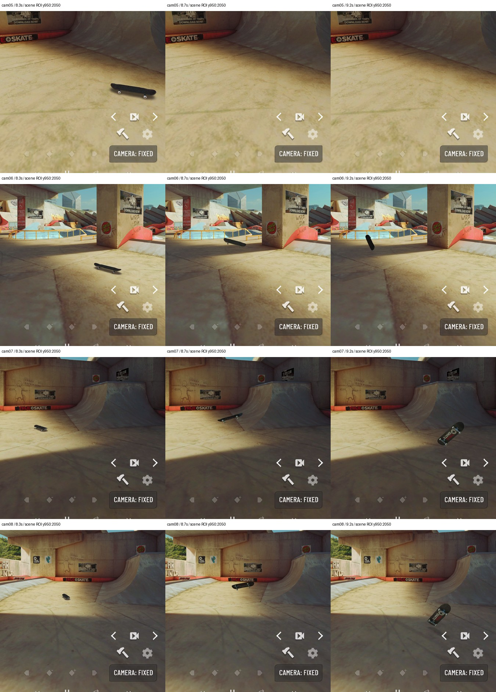

# Board visibility review — 24 November 2026

[Español](board-visibility.es.md) · [Camera geometry pilot](fixed-geometry.en.md)

Following the owner's observation, the later part of the recovered clips was inspected across all 13 distinct candidate views. The previous contact sheet sampled approximately 5.3 seconds, before the most useful board action. Its small or absent board previews were not representative of the whole recording.

Visual samples at clip times 6, 7, 8, 9 and 10 seconds, followed by closer inspection at 8.3, 8.7 and 9.2 seconds, show that **8.3–9.2 seconds is a candidate action window** containing the board's approach, jump and rotation across multiple views. Times refer to the extracted 10.65-second clips, not the original eight-minute recording. This was a sampled visual review, not continuous tracking or a synchronization measurement.

The figure shows cam05–cam08, with source scene rows 950–2050 resized to 450×440 pixels per image. It retains the game overlays to expose possible occlusion. cam05 shows the board at 8.3 seconds but not at 8.7 or 9.2 seconds in the inspected scene region. cam04 and cam09 reach or cross a frame edge near 9.2 seconds. These views need exclusion, a shorter interval or explicit visibility handling for a dynamic experiment; their background geometry remains usable.

Candidate views for the next dynamic preparation are cam01, cam02, cam03, cam06, cam07, cam08, cam10, cam11 and cam12. cam13 remains reserved for evaluation and must be localized separately. This selection is preliminary: verify visibility throughout the interval, check temporal alignment using an observable action event, and account for UI overlap before exporting training images. No new training or synchronization correction was performed during this review. Local diagnostic sheets are under `outputs/fixed-board-review/`; existing clips and camera models were unchanged.
