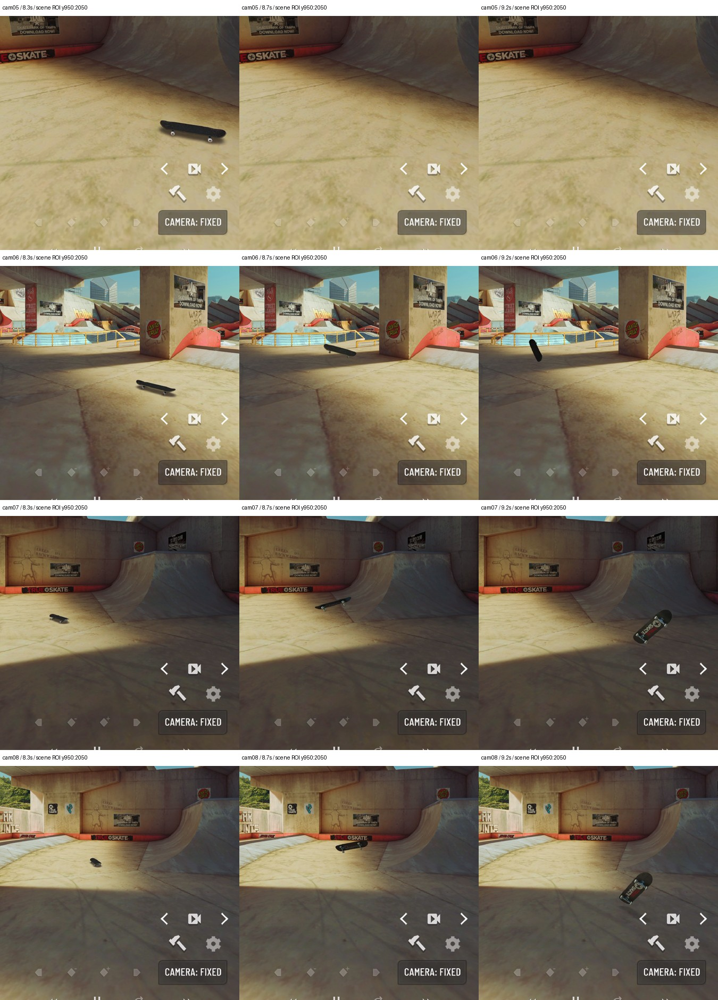

# Revisión de visibilidad de la tabla — 24 de noviembre de 2026

[English](board-visibility.en.md) · [Prueba de geometría](fixed-geometry.es.md)

A partir de la observación del responsable, se revisó la parte final de los clips recuperados en las 13 vistas candidatas distintas. La hoja de contacto anterior correspondía aproximadamente al segundo 5,3, antes de la acción más útil. Sus miniaturas con la tabla pequeña o ausente no representaban toda la grabación.

Las muestras visuales en los segundos 6, 7, 8, 9 y 10, seguidas de una inspección más cercana en 8,3, 8,7 y 9,2, muestran que **8,3–9,2 segundos es un intervalo de acción candidato** con aproximación, salto y rotación de la tabla desde varias vistas. Los tiempos corresponden a los clips extraídos de 10,65 segundos, no a la grabación original de ocho minutos. Es una revisión visual muestreada, no seguimiento continuo ni medición de sincronización.

La figura muestra cam05–cam08, con las filas originales 950–2050 redimensionadas a 450×440 píxeles por imagen. Conserva la interfaz para mostrar posibles oclusiones. cam05 muestra la tabla a los 8,3 segundos, pero no a los 8,7 ni 9,2 en la región de escena inspeccionada. cam04 y cam09 alcanzan o cruzan un borde del encuadre cerca de los 9,2 segundos. Para un experimento dinámico, estas vistas requieren exclusión, un intervalo más corto o tratamiento explícito de la visibilidad; su geometría del fondo sigue siendo utilizable.

Las vistas candidatas para preparar el siguiente experimento dinámico son cam01, cam02, cam03, cam06, cam07, cam08, cam10, cam11 y cam12. cam13 sigue reservada para evaluación y debe localizarse por separado. La selección es preliminar: verificar visibilidad durante todo el intervalo, comprobar alineación temporal mediante un evento observable y tratar los solapamientos de interfaz antes de exportar imágenes de entrenamiento. Esta revisión no ejecutó entrenamiento ni corrección de sincronización. Las hojas de diagnóstico locales están en `outputs/fixed-board-review/`; no se modificaron los clips ni los modelos de cámara existentes.
