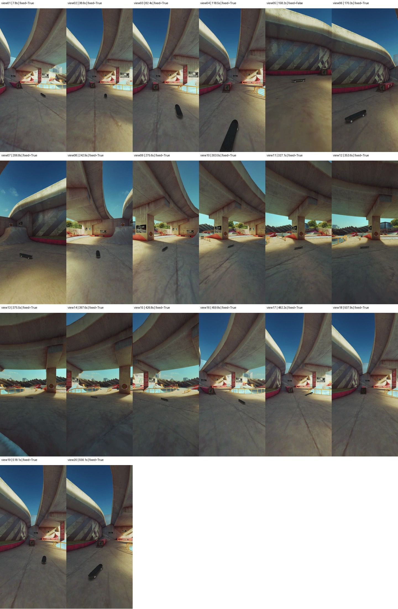
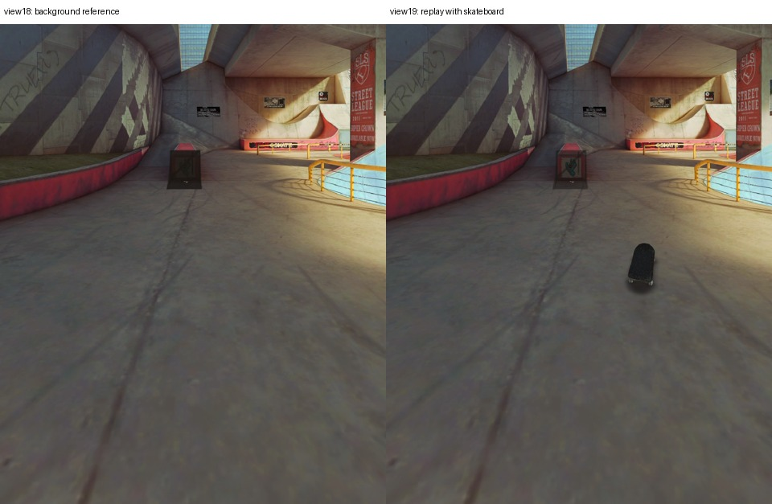

# New recording: menu-hidden view recovery — 24 November 2026

[Español](clean-capture.es.md) · [Measured evidence](../evidence/clean-capture-2026-11-24.json)

**Subsequent experiment:** this page records the recovery stage. The new capture has since been synchronized, calibrated and trained; see the [completed trial and foreground failure analysis](clean-pilot.en.md).

The owner supplied a new unedited **567.67-second** phone recording and indicated that the replay menu was hidden for each take. Automatic processing recovered **20 passages**, retaining the original image framing. Nineteen are consistent with a fixed camera in three sampled images; view05 moves, and view18/view19 are a likely repeated viewpoint. This leaves **18 distinct fixed-view candidates**, pending synchronization and calibration.

**Role selection update:** the owner identified view18 as the same framing without the skateboard. The active replay list now contains **18 clips**, including view19. view05 is archived under `excluded/`; view18 is retained under `background/` as a background reference, not another dynamic training view. [Selection and integrity evidence](../evidence/clean-capture-roles-2026-11-24.json).



These previews occur at each passage's midpoint, not necessarily the same replay instant. IDs follow recording order and are independent of earlier datasets. They do not denote regular angular spacing. Source imagery is owner-captured True Skate gameplay; game assets belong to their respective owners.

## Extraction and verification

The existing phone-specific UI detector samples the replay interface at 10 samples/second. Menu-absent intervals of at least three seconds are screened for the red editor toolbar, so camera-placement phases are not mistaken for clean replay. Mixed intervals receive a local scan. A 0.35-second margin at both ends reduces transition contamination. Passages are then exported at 60 FPS, 1126×2436, H.264 CRF 18, without audio.

The 20 clips span **3.48–6.68 seconds** each, totaling 7,133 decoded frames and 118.88 seconds. All files were fully decoded without errors; no replay-menu pattern was detected in any exported frame. Their combined size is **17.10 MiB**. The original 986.7 MB recording's SHA-256 was verified unchanged after processing. The variable-rate source is resampled to constant 60 FPS; duplicate/drop capture-frame behavior does not create new simulation observations.

Three-frame background SIFT checks use the same displacement criteria as the previous recovery: at least 80 matches, median displacement ≤0.75 preview pixels and 90th percentile ≤2.5, at 480-pixel image width. These sampled checks are not full-sequence pose verification or calibration. Menu absence also does not guarantee absence of trick-score text or all other overlays.

## Flagged passages


- **view05**, source 158.15–162.15 seconds (approximately 2 min 38 s), fails sampled fixed-camera consistency. The preceding menu visibly states **CAMERA: AUTO**. All other preceding mode labels state FIXED. Its file was removed from the active list and retained at `excluded/view05.mp4`.
- **view18 and view19** share closely matching background framing but different scene content. The owner clarified that view18 has no skateboard. Four visual samples at 0.1, 1.0, 2.0 and 3.3 seconds support keeping it as a background reference. view19 remains the active replay for that viewpoint.



A full-resolution background PNG was extracted from view18 at one second. It can support difference-image checks for view19, but differences may also include shadows, local appearance changes and compression; this is not a verified semantic board mask. No subtraction-based training or new optimization was run during role selection.

## Local files and next gate

The working directory `data/raw/true-skate-clean-2026-11-24/` contains 18 active `view*.mp4` files, retaining original IDs except view05/view18. `excluded/view05.mp4` and `background/view18.mp4` retain the other two passages; `background/reference-for-view19.png` is the full-resolution background image. `cuts.json` separates active replay views, excluded passages and background references. The pre-selection manifest is retained as `cuts.before-role-selection.json`; moved videos were verified byte-identical. The original recording, clips and analysis traces remain local and ignored by Git. The helper, overview and compact evidence are published. No earlier clips/models were overwritten, and no training was launched.

Reproduction with the existing Windows helper environment and FFmpeg:

```powershell
.\.venv\Scripts\python.exe scripts/inspect_fixed_screenrecording.py "ScreenRecording_11-24-2026 16-58-35_1.mp4" --output outputs/fixed-clean-review
.\.venv\Scripts\python.exe scripts/recover_hidden_hud_views.py "ScreenRecording_11-24-2026 16-58-35_1.mp4" --export
```

For repeated recovery, choose a fresh `--output`; existing manifests/videos are protected against overwrite. The detector targets this 1126×2436 UI layout. The next step is to verify board visibility and align the shared action, then estimate cameras for this new dataset. **Hiding the menu supplies cut boundaries, not temporal synchronization.** Unequal passage durations and differing midpoint board states must be handled before training; earlier poses and training splits must not be reused silently.
