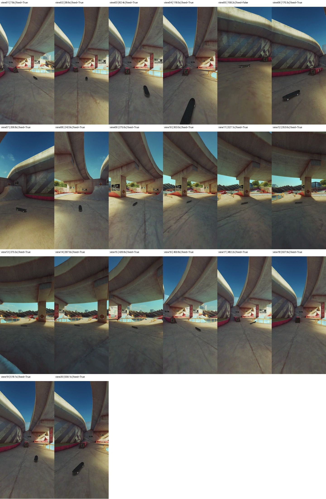
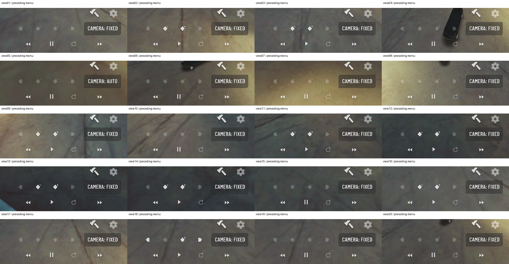
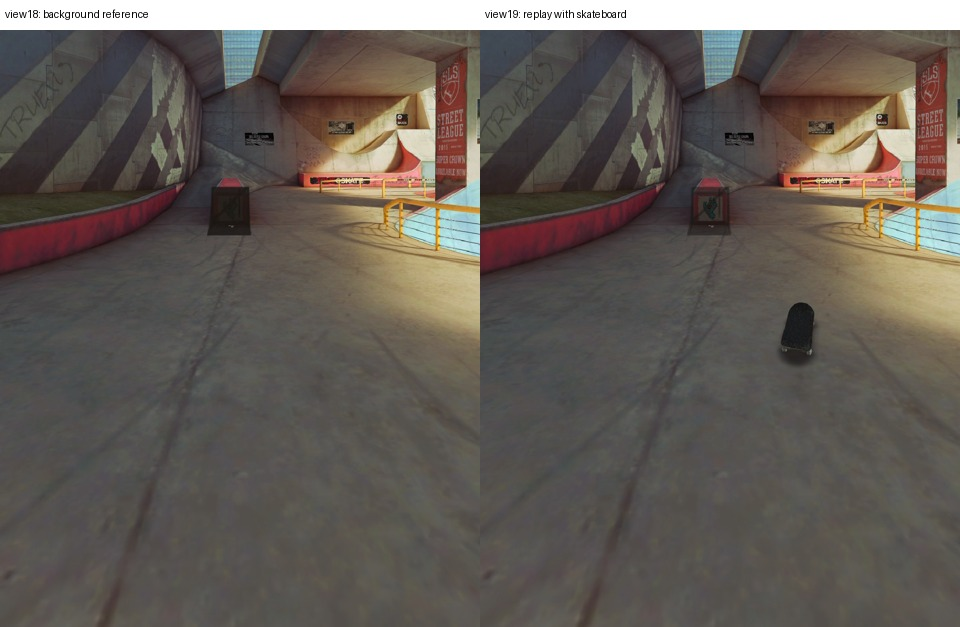

# Nueva grabación: recuperación de vistas sin menú — 24 de noviembre de 2026

[English](clean-capture.en.md) · [Evidencia medida](../evidence/clean-capture-2026-11-24.json)

El responsable aportó una grabación nueva sin editar de **567,67 segundos**, indicando que ocultaba el menú del replay en cada toma. Se recuperaron automáticamente **20 pasajes**, conservando el encuadre original. Diecinueve son compatibles con cámara fija en tres imágenes muestreadas; view05 se mueve y view18/view19 parecen repetir un punto de vista. Quedan **18 vistas fijas candidatas distintas**, pendientes de sincronización y calibración.

**Actualización de selección:** el responsable indicó que view18 muestra el mismo encuadre sin la tabla. La lista activa contiene ahora **18 clips**, incluyendo view19. view05 se archiva en `excluded/`; view18 se conserva en `background/` como referencia del fondo, no como otra vista de entrenamiento dinámico. [Evidencia de selección e integridad](../evidence/clean-capture-roles-2026-11-24.json).



Cada miniatura corresponde al punto medio de su pasaje, no necesariamente al mismo instante del replay. Los identificadores siguen el orden de grabación y son independientes de conjuntos anteriores. No representan separaciones angulares regulares. Las imágenes fueron capturadas por el responsable en True Skate; los recursos del juego pertenecen a sus respectivos titulares.

## Extracción y verificación

El detector de interfaz existente muestrea el replay 10 veces por segundo. Los intervalos sin menú de al menos tres segundos se comprueban contra la barra roja del editor para separar las fases de colocación de cámara. Los intervalos mixtos reciben un análisis local. Se recortan 0,35 segundos de cada extremo para reducir contaminación de transiciones. Se exporta a 60 FPS, 1126×2436, H.264 CRF 18, sin audio.

Los 20 clips duran **3,48–6,68 segundos**, con 7.133 fotogramas decodificados y 118,88 segundos en total. Se decodificaron completos sin errores y no se detectó el patrón del menú de replay en ningún fotograma exportado. Ocupan **17,10 MiB**. El SHA-256 de la grabación original de 986,7 MB se verificó intacto después del proceso. La fuente de frecuencia variable se remuestrea a 60 FPS constantes; duplicar o descartar fotogramas capturados no crea nuevas observaciones de la simulación.

Las comprobaciones SIFT del fondo en tres instantes usan los criterios anteriores: al menos 80 correspondencias, desplazamiento mediano ≤0,75 píxeles y percentil 90 ≤2,5, en vistas previas de 480 píxeles de ancho. No verifican poses durante toda la secuencia ni calibración. La ausencia del menú tampoco garantiza ausencia de puntuaciones u otras superposiciones.

## Pasajes señalados



- **view05**, segundos 158,15–162,15 del original (aproximadamente 2 min 38 s), falla la comprobación de cámara fija. El menú anterior indica **CAMERA: AUTO**. Los demás indican FIXED. Se retiró de la lista activa y se conserva en `excluded/view05.mp4`.
- **view18 y view19** tienen un encuadre del fondo muy parecido, con contenido distinto. El responsable aclaró que view18 no tiene tabla. Cuatro muestras visuales a los 0,1, 1,0, 2,0 y 3,3 segundos respaldan conservarla como referencia del fondo. view19 sigue siendo el replay activo de ese punto de vista.



Se extrajo un PNG del fondo a resolución completa en el segundo uno de view18. Puede ayudar a comprobar diferencias con view19, pero estas también incluyen sombras, cambios locales de apariencia y compresión; no es una máscara semántica verificada de la tabla. No se entrenó mediante sustracción ni se ejecutó otra optimización durante esta selección.

## Archivos locales y siguiente comprobación

El directorio `data/raw/true-skate-clean-2026-11-24/` contiene 18 archivos activos `view*.mp4`, conservando los identificadores originales salvo view05/view18. Los otros pasajes quedan en `excluded/view05.mp4` y `background/view18.mp4`; `background/reference-for-view19.png` contiene el fondo a resolución completa. `cuts.json` separa replays activos, exclusiones y referencias de fondo. El manifiesto anterior se conserva como `cuts.before-role-selection.json`; los vídeos movidos se verificaron idénticos byte a byte. La grabación original, los clips y las trazas quedan locales, excluidos de Git. Se publican el script, las miniaturas y la evidencia compacta. No se sobrescribieron clips/modelos anteriores ni se inició entrenamiento.

Reproducción con el entorno auxiliar Windows y FFmpeg existentes:

```powershell
.\.venv\Scripts\python.exe scripts/inspect_fixed_screenrecording.py "ScreenRecording_11-24-2026 16-58-35_1.mp4" --output outputs/fixed-clean-review
.\.venv\Scripts\python.exe scripts/recover_hidden_hud_views.py "ScreenRecording_11-24-2026 16-58-35_1.mp4" --export
```

Para repetir la recuperación, elegir un `--output` nuevo: se protege la sobrescritura de manifiestos/vídeos. El detector corresponde a esta interfaz de 1126×2436. La siguiente etapa es comprobar visibilidad de la tabla, alinear la acción compartida y estimar cámaras para el nuevo conjunto. **Ocultar el menú delimita tomas, no sincroniza el replay.** Las duraciones distintas y los estados de la tabla en cada punto medio deben tratarse antes de entrenar; no reutilizar silenciosamente poses ni separaciones anteriores.
