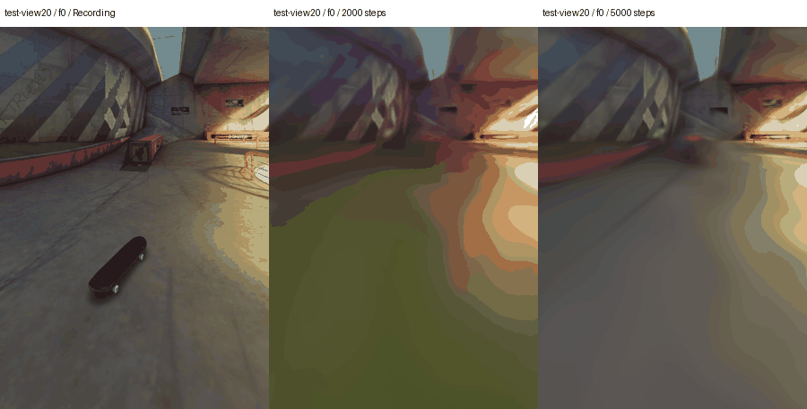
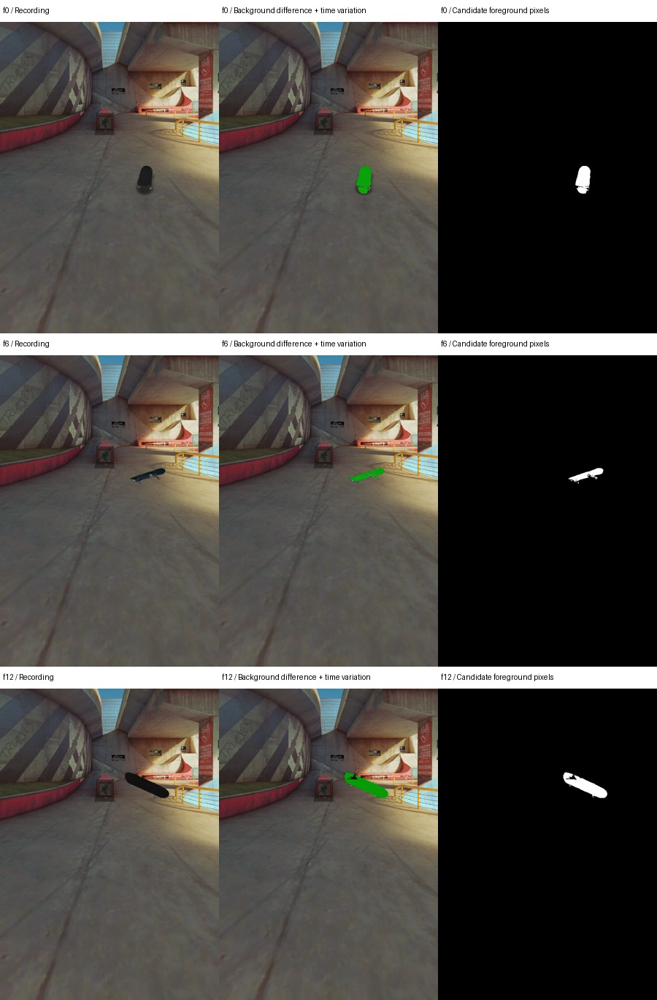

# New fixed-view capture: end-to-end trial — 24 November 2026

[Español](clean-pilot.es.md) · [Measured evidence](../evidence/clean-pilot-2026-11-24.json) · [Capture recovery](clean-capture.en.md)

The new recording now passes camera reconstruction, dataset loading, GPU training and rendering. The background becomes more recognizable, but **the skateboard remains unrecognizable in the inspected model renders**. Better inputs alone have not resolved the project’s main difficulty.



The animation shows lower-scene crops for readability; metrics use full images. Its 13 frames play at 250 ms each, approximately five times slower than the sampled action.

## Preparation and camera checks

The owner’s selection leaves 18 active replay views. view05 remains excluded; empty view18 is a background reference for active view19. All 18 replay views show the same **HARD FLIP / score 71** event. This event aligns 13 samples at 20 samples/second, from 1.0 to 0.4 seconds before scoring: a **0.6-second** action window. Three sampled phases were visually reviewed across all views. One interface event does not prove frame-perfect synchronization of the simulation.

view20 was reserved before mapping. Background medians and temporal-change masks yield **17/17 registered training cameras**, 2,823 measured sparse points and **0.470 px** mean reprojection error. A shared pinhole focal length is estimated; principal point stays at image center. Reserved view20 is localized against the frozen training map: **572/620 inliers**, median error **0.585 px**. These are consistency checks, not independent calibration ground truth.

The training dataset contains **221 images**, plus 13 validation images, at **563 × 1218**, preserving the full portrait framing. Initialization uses **2,337 observed background points**, with no synthetic resampling or object-specific seeds. [Score-event review](../assets/clean-pilot-score-events.jpg).

## Training and results

The RTX 4050 completed 200 coarse + 5,000 fine steps in **442.34 seconds (7 min 22 s)** of training-program time; loading/probe and rendering take additional time. Both saved fine checkpoints contain 4,871 Gaussians.

| Evaluated view | Steps | Full-image PSNR | SSIM | Changing-region PSNR |
|---|---:|---:|---:|---:|
| Reserved view20 | 2,000 | 22.53 dB | 0.872 | 20.00 dB |
| Reserved view20 | 5,000 | 27.05 dB | 0.906 | 20.35 dB |
| Training view19 | 2,000 | 21.96 dB | 0.868 | 18.20 dB |
| Training view19 | 5,000 | 28.20 dB | 0.902 | 19.31 dB |

[Validation comparison](../assets/clean-pilot-validation.jpg) · [Training comparison](../assets/clean-pilot-training.jpg) · [Progress curves](../assets/clean-pilot-progression.png). Targets are identical across checkpoints; 156 render/target/control PNGs decoded successfully. view20 is now a validation view used to assess results, not an untouched final test. Only one training view is evaluated here.

## What the empty view reveals

Subtracting empty view18 from replay view19, combined with temporal variation, gives candidate foreground masks averaging **0.294% of image pixels**. In those pixels, the 5,000-step model scores **11.79 dB**, compared with **11.56 dB** for simply showing the empty background; the 2,000-step model scores 12.44 dB. The global improvement therefore does not establish recovery of the board.



These reference-derived masks may contain shadows or appearance changes; they are not semantic ground truth. They were **not used in optimization**. The next focused experiment should test foreground weighting and object-specific initialization, after checking masks and synchronization. Longer unmodified training is not the immediate priority. This result does not isolate the effect of data quality relative to earlier trials: view count, action, image framing, initialization and sampled interval also changed. No 360° reconstruction or physical rotation measurement is demonstrated.

## Reproduction

Local videos and model files remain ignored by Git. Existing outputs are preserved; preparation helpers reject overwriting their output datasets. On the configured local environment, run these stages into fresh destinations if repeating the preparation:

```powershell
.venv/Scripts/python.exe scripts/sync_clean_replays.py
.venv/Scripts/python.exe scripts/prepare_clean_geometry.py
.venv/Scripts/python.exe scripts/localize_fixed_holdout.py --reference outputs/clean-replay-pipeline/geometry --output outputs/clean-replay-pipeline/holdout.json --query-id view20 --model-id 0 --mask outputs/clean-replay-pipeline/geometry/masks/view20.png.png
.venv/Scripts/python.exe scripts/prepare_clean_dynamic.py
.venv/Scripts/python.exe scripts/run_fixed_pilot.py --source data/processed/true-skate-clean-pilot --output outputs/clean-replay-pipeline/gpu --configs configs/experiments/true-skate-clean-pilot.py --checkpoints 2000 5000
.venv/Scripts/python.exe scripts/compare_fixed_duration.py --run outputs/clean-replay-pipeline/gpu --output outputs/clean-replay-pipeline/comparison --checkpoints 2000 5000
.venv/Scripts/python.exe scripts/evaluate_clean_foreground.py
```

The launcher reuses the installed WSL/CUDA environment and reports progress. Helper verification: **31 tests passed**; documentation links and compilation are checked separately. The original capture and previous datasets/models remain available locally.
