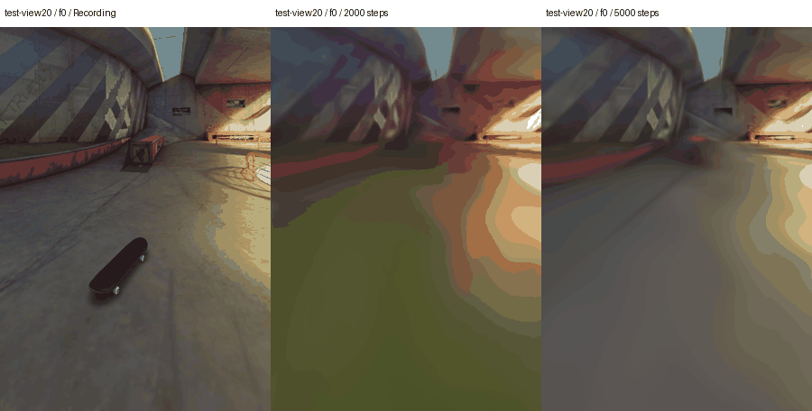
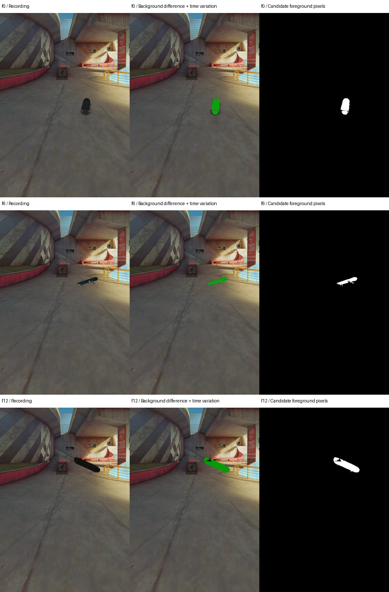

# Nueva captura fija: prueba completa — 24 de noviembre de 2026

[English](clean-pilot.en.md) · [Evidencia medida](../evidence/clean-pilot-2026-11-24.json) · [Recuperación de la captura](clean-capture.es.md)

La nueva grabación supera reconstrucción de cámaras, carga de datos, entrenamiento GPU y renderizado. El fondo resulta más reconocible, pero **la tabla sigue sin reconocerse en los renders inspeccionados**. Mejorar las entradas por sí solo no ha resuelto la dificultad principal del proyecto.

La animación muestra recortes inferiores para facilitar la lectura; las métricas usan las imágenes completas. Sus 13 fotogramas duran 250 ms cada uno, aproximadamente cinco veces más lento que la acción muestreada.

## Preparación y comprobación de cámaras

La selección del responsable deja 18 replays activos. view05 sigue excluida; view18 sin tabla sirve de fondo para view19. Las 18 vistas muestran el mismo evento **HARD FLIP / puntuación 71**. Se alinean 13 muestras a 20 muestras/segundo, entre 1,0 y 0,4 segundos antes de puntuar: una ventana de **0,6 segundos**. Se revisaron visualmente tres fases en todas las vistas. Un evento de interfaz no demuestra sincronización exacta de cada fotograma de la simulación.

view20 se reservó antes de construir el mapa. Las medianas del fondo y máscaras de cambio permiten registrar **17/17 cámaras de entrenamiento**, con 2.823 puntos dispersos medidos y error medio de reproyección de **0,470 px**. Se estima una focal compartida; el punto principal permanece en el centro. view20 se localiza contra el mapa de entrenamiento congelado: **572/620 inliers**, error mediano de **0,585 px**. Son comprobaciones de coherencia, no una calibración independiente de referencia.

Hay **221 imágenes de entrenamiento** y 13 de validación a **563 × 1218**, conservando el encuadre vertical completo. La inicialización utiliza **2.337 puntos observados del fondo**, sin remuestreo sintético ni puntos específicos de la tabla. [Revisión del evento](../assets/clean-pilot-score-events.jpg).

## Entrenamiento y resultados

La RTX 4050 completó 200 pasos gruesos + 5.000 finos en **442,34 segundos (7 min 22 s)** del programa de entrenamiento; la comprobación/carga y el renderizado requieren tiempo adicional. Ambos checkpoints finos contienen 4.871 gaussianas.

| Vista evaluada | Pasos | PSNR de imagen completa | SSIM | PSNR de región cambiante |
|---|---:|---:|---:|---:|
| Reservada view20 | 2.000 | 22,53 dB | 0,872 | 20,00 dB |
| Reservada view20 | 5.000 | 27,05 dB | 0,906 | 20,35 dB |
| Entrenamiento view19 | 2.000 | 21,96 dB | 0,868 | 18,20 dB |
| Entrenamiento view19 | 5.000 | 28,20 dB | 0,902 | 19,31 dB |

[Comparación de validación](../assets/clean-pilot-validation.jpg) · [Comparación de entrenamiento](../assets/clean-pilot-training.jpg) · [Curvas](../assets/clean-pilot-progression.png). Las referencias son idénticas entre checkpoints; se decodificaron correctamente 156 PNG de renders/referencias/controles. view20 ya es una vista de validación usada para analizar resultados, no una prueba final intacta. Aquí solo se evalúa una vista de entrenamiento.

## Lo que revela la vista vacía

Restar view18 sin tabla de view19 y combinarlo con variación temporal produce máscaras candidatas de primer plano que ocupan en promedio **0,294% de los píxeles**. En ellos, el modelo de 5.000 pasos obtiene **11,79 dB**, frente a **11,56 dB** de mostrar simplemente el fondo vacío; el modelo de 2.000 pasos obtiene 12,44 dB. La mejora global no demuestra reconstrucción de la tabla.

Estas máscaras pueden incluir sombras o cambios de apariencia; no son etiquetas semánticas de referencia. **No se usaron para optimizar**. El siguiente experimento debe probar ponderación del primer plano e inicialización específica del objeto, tras revisar máscaras y sincronización. Alargar el mismo entrenamiento no es la prioridad inmediata. La comparación con pruebas anteriores no aísla la calidad de los datos: también cambian número de vistas, acción, encuadre, inicialización e intervalo. No se demuestra reconstrucción de 360° ni medición física de rotaciones.

## Reproducción

Los vídeos y modelos locales permanecen excluidos de Git. Se conservan los resultados existentes; los preparadores rechazan sobrescribir sus conjuntos de salida. La [secuencia de comandos](clean-pilot.en.md#reproduction) usa el entorno local configurado; para repetir la preparación deben elegirse destinos nuevos y coherentes entre etapas. El lanzador reutiliza WSL/CUDA y muestra el progreso.

Verificación de herramientas: **31 pruebas superadas**; se comprueban aparte compilación y enlaces de documentación. La captura original y los conjuntos/modelos anteriores siguen disponibles localmente.
