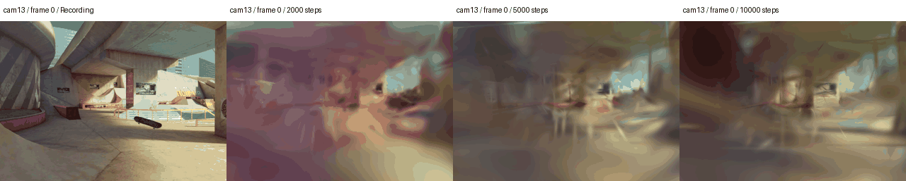
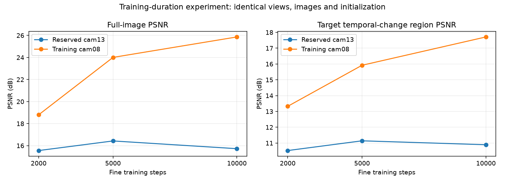

# Longer-training result — 24 November 2026

[Español](duration-result.es.md) · [Evidence](../evidence/duration-result-2026-11-24.json) · [Protocol and launcher](duration-control.en.md)

**The owner's longer run confirms that additional optimization improves the inspected training-view background. It does not yet reconstruct the skateboard recognizably, and the reserved view improves at 5,000 steps before degrading at 10,000.** A short training budget was a limitation, but duration alone has not resolved the dynamic reconstruction.

The animation shows all 13 reserved-view instants, spanning 0.4 seconds, approximately five times slower. Static comparisons: [reserved cam13](../assets/duration-heldout.jpg), [training cam08](../assets/duration-training.jpg).

## Measured progression

| Mean over 13 images | 2,000 steps | 5,000 steps | 10,000 steps |
|---|---:|---:|---:|
| Training cam08: full-image PSNR | 18.80 dB | 24.01 dB | 25.86 dB |
| Training cam08: SSIM | 0.729 | 0.774 | 0.794 |
| Training cam08: changing-region PSNR | 13.32 dB | 15.92 dB | 17.71 dB |
| Reserved cam13: full-image PSNR | 15.56 dB | 16.43 dB | 15.73 dB |
| Reserved cam13: SSIM | 0.659 | 0.665 | 0.634 |
| Reserved cam13: changing-region PSNR | 10.53 dB | 11.14 dB | 10.89 dB |

The inspected training view gains 7.06 dB from 2,000 to 10,000 steps; its background becomes more recognizable. The reserved view gains 0.87 dB at 5,000, then loses 0.70 dB by 10,000. This pattern suggests limited generalization as training continues, but one trajectory and one reserved view cannot establish its cause. cam08 is one of eight training cameras; its full 13-image evaluation is not an average over all training views.

The **5,000-step model is retained as the preferred comparison checkpoint among these three on cam13**. Since cam13 is now used for checkpoint selection, it is a validation view, not an untouched final test. It also closely overlaps cam01. No broad novel-view or final benchmark claim follows from these scores.

## Motion remains unresolved

The board remains unrecognizable in the compared renders. At 5,000 steps, the full-image reserved-view frozen-time control scores 16.45 dB, versus 16.43 dB with evolving model time. Changing-region masks use target pixel variation, not semantic board labels; their improving scores do not establish correct board geometry or rotation.

The target-stable region of cam13 has interframe change of only 0.0058 RGB intensity units on a 0–255 scale. Model change there is 0.9174, 0.7660 and 1.7685 units at 2,000, 5,000 and 10,000 steps respectively. The stronger spurious background variation at 10,000 reinforces the need to inspect time behavior rather than relying on training appearance alone.

## Execution and controls

Training took **350.71 seconds (5 min 51 s)** on the RTX 4050, with 200 coarse + 10,000 fine steps; the three rendering/evaluation programs took 24.28, 23.45 and 25.34 seconds. The original 1,115-point initialization and input hashes matched the recorded protocol. Effective configuration differed from the pilot only in total fine iterations. Densification still ended at 1,300; all three checkpoints contain **2,327 Gaussians**. The original SH schedule activates degree 2 at 2,000 and degree 3 at 5,000/10,000.

The 26 target images (13 per evaluated camera) were checked for identical pixels across checkpoints; 234 target/render/frozen-control PNGs decoded successfully. This is a fresh trajectory: its 2,000-step checkpoint differs from the earlier separate pilot. Every table and curve here compares checkpoints within this new run. The source data and all saved models remain unchanged under `outputs/fixed-duration-20261124-212021-057866Z/`.

## Next controlled question

Keep the 5,000-step checkpoint for comparison, rather than assuming the last checkpoint is best. Next test static training at a single replay instant to check multi-view appearance/geometry fitting independently of learned temporal deformation. This differs from freezing the time of an already dynamic model. Then isolate board observations and test foreground initialization or weighting separately. No further training was launched during this review.
