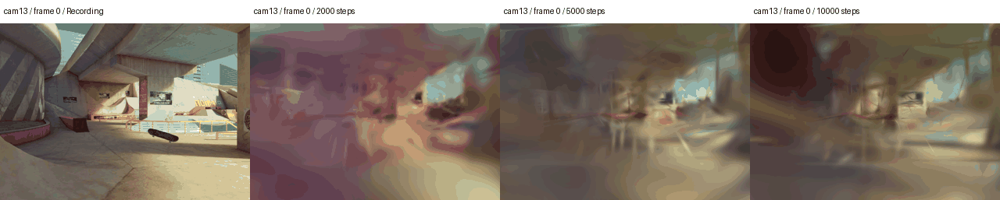
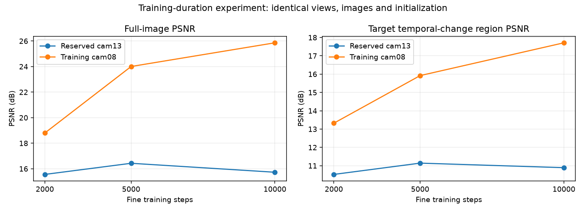

# Resultado del entrenamiento más largo — 24 de noviembre de 2026

[English](duration-result.en.md) · [Evidencia](../evidence/duration-result-2026-11-24.json) · [Protocolo y lanzador](duration-control.es.md)

**La ejecución del responsable confirma que optimizar más mejora el fondo de la vista de entrenamiento inspeccionada. Todavía no reconstruye la tabla de forma reconocible, y la vista reservada mejora a los 5.000 pasos antes de empeorar a los 10.000.** El entrenamiento corto era una limitación, pero la duración por sí sola no ha resuelto la reconstrucción dinámica.

La animación muestra los 13 instantes de la vista reservada, que abarcan 0,4 segundos, unas cinco veces más despacio. Comparaciones estáticas: [cam13 reservada](../assets/duration-heldout.jpg), [cam08 de entrenamiento](../assets/duration-training.jpg).

## Progresión medida

| Media de 13 imágenes | 2.000 pasos | 5.000 pasos | 10.000 pasos |
|---|---:|---:|---:|
| cam08 de entrenamiento: PSNR completo | 18,80 dB | 24,01 dB | 25,86 dB |
| cam08 de entrenamiento: SSIM | 0,729 | 0,774 | 0,794 |
| cam08 de entrenamiento: PSNR en región cambiante | 13,32 dB | 15,92 dB | 17,71 dB |
| cam13 reservada: PSNR completo | 15,56 dB | 16,43 dB | 15,73 dB |
| cam13 reservada: SSIM | 0,659 | 0,665 | 0,634 |
| cam13 reservada: PSNR en región cambiante | 10,53 dB | 11,14 dB | 10,89 dB |

La vista de entrenamiento inspeccionada gana 7,06 dB entre 2.000 y 10.000 pasos y su fondo se vuelve más reconocible. La vista reservada gana 0,87 dB a los 5.000 y pierde 0,70 dB al llegar a 10.000. El patrón sugiere generalización limitada al prolongar el entrenamiento, pero una trayectoria y una vista reservada no establecen la causa. cam08 es una de ocho cámaras de entrenamiento; su evaluación de 13 imágenes no promedia todas las vistas de entrenamiento.

Se conserva el **modelo de 5.000 pasos como referencia preferida entre estos tres para cam13**. Al utilizar cam13 para seleccionar el modelo, pasa a ser una vista de validación, no una prueba final intacta. Además, se solapa estrechamente con cam01. Estos valores no justifican una afirmación general sobre vistas nuevas ni una evaluación final independiente.

## El movimiento sigue sin resolverse

La tabla sigue sin ser reconocible en los renders comparados. A los 5.000 pasos, el control reservado con tiempo fijo obtiene 16,45 dB de PSNR completo, frente a 16,43 dB con tiempo variable. Las máscaras cambiantes proceden de variaciones de píxeles objetivo, no de etiquetas semánticas de la tabla; mejorar esas métricas no demuestra geometría ni rotación correctas de la tabla.

En la región estable del objetivo de cam13, el cambio entre imágenes consecutivas es de solo 0,0058 unidades RGB en escala 0–255. En el modelo es de 0,9174, 0,7660 y 1,7685 unidades a los 2.000, 5.000 y 10.000 pasos. El aumento de variación espuria del fondo a los 10.000 refuerza la necesidad de inspeccionar el comportamiento temporal además de la apariencia de entrenamiento.

## Ejecución y controles

El entrenamiento tardó **350,71 segundos (5 min 51 s)** en la RTX 4050, con 200 pasos coarse + 10.000 fine; los tres programas de renderizado/evaluación tardaron 24,28, 23,45 y 25,34 segundos. La inicialización original de 1.115 puntos y los hashes de entrada coincidieron con el protocolo. La configuración efectiva solo cambió el total de iteraciones fine. La densificación terminó en 1.300; los tres modelos contienen **2.327 Gaussianas**. El programa SH original activa grado 2 a los 2.000 y grado 3 a los 5.000/10.000.

Se verificaron píxeles idénticos en las 26 imágenes objetivo por cámara/fotograma entre modelos y se decodificaron 234 PNG de objetivos/renders/controles. Es una trayectoria nueva: su modelo de 2.000 pasos difiere del ensayo anterior independiente. Todas las tablas y curvas de esta página comparan modelos de esta nueva ejecución. Los datos y modelos permanecen intactos en `outputs/fixed-duration-20261124-212021-057866Z/`.

## Siguiente pregunta controlada

Conservar el modelo de 5.000 pasos como referencia, sin suponer que el último es el mejor. Después, probar entrenamiento estático en un solo instante del replay para comprobar el ajuste multivista de apariencia/geometría independientemente de la deformación temporal aprendida. Esto difiere de fijar el tiempo de un modelo ya dinámico. Luego, aislar observaciones de la tabla y probar inicialización del objeto o ponderación del error por separado. Esta revisión no lanzó más entrenamientos.
