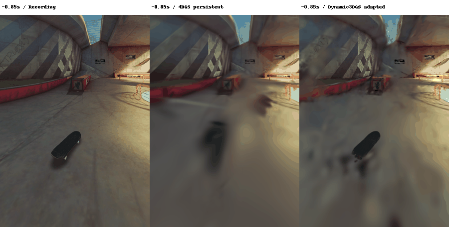

# Dynamic3DGaussians versus the current replay pipeline

Review date: **26 November 2026** · [Español](dynamic-comparison.es.md) · [Measured evidence](../evidence/dynamic-comparison-2026-11-26.json)

**The bounded Dynamic3DGaussians trial reconstructs the initial board better, but loses the airborne board. It does not justify replacing the current pipeline.** The shared ten-time 4DGS fit also remains visually inadequate. Neither model demonstrates reliable physical tracking or board rotations.



The ten timestamps are displayed at 250 ms each, approximately five times slower than capture time. **All ten times are supervised.** This is a validation-view comparison, not an unseen-time interpolation test. [Observed board close-ups](../assets/dynamic-comparison-validation.jpg) · [Training-view animation](../assets/dynamic-comparison-training.gif) · [Training close-ups](../assets/dynamic-comparison-training.jpg).

## What was tested

First, an appearance control retains the previous three-time actor-only dataset and 200+6,000-step budget, changing only `no_do=True` and `no_dshs=True`: opacity and spherical-harmonic appearance cannot deform over time, though their canonical parameters can still learn. Validation observed change-union PSNR rises **20.82 → 21.51 dB**, and seven intermediate-time scores rise **19.02 → 20.77 dB**. However, intermediate requested-time rendering remains worse than its own frozen-middle control (**21.50 dB**), and observed full-image PSNR falls **28.77 → 27.31 dB**. Persistence alone does not solve motion. These numbers use the earlier floating-point timeline evaluator; the common model comparison below uses quantized PNGs for both methods.

Second, a common dataset contains **11 training cameras × 10 instants**, plus ten reserved view20 images, over 0.45 seconds. Candidate masks are complete for those training cameras at every instant. view11 remains excluded from mask-based fitting, and view13/14 are excluded because their first masks are too small. Selection uses training masks only. Masks at the original three times are retained; the other masks use the existing median-background/change/largest-component procedure. Visual review shows imperfect coverage, particularly edge-on boards and wheels. Event alignment is not proven frame-perfect.

Both methods use byte-identical RGB targets and the **same untrained 2,337 background + 3,000 first-instant silhouette-volume seeds**, poses and scale 4. The inherited map and seeds were prepared using historical training cameras beyond the current eleven-camera subset; view20 did not initialize the board. There are no trained static weights in either initialization. The exporter verifies Dynamic3DGaussians' required mask encoding **0/1**, rather than 0/255, and seed RGB normalization. Saved inputs and targets are checked again after training.

## Results on common inputs

| Reserved view20, mean over ten supervised times | 4DGS, persistent appearance | Dynamic3DGaussians, adapted |
|---|---:|---:|
| Full-image PSNR | 29.79 dB | 25.03 dB |
| Temporal-change-union PSNR | 24.00 dB | 23.10 dB |
| Same region, frozen-middle control | 20.71 dB | 21.65 dB |
| Approximate deck PSNR at samples3 /8 /12 | 21.64 /16.34 /22.45 dB | 26.54 /14.92 /18.16 dB |
| Target-stable-region interframe MAE | 0.001280 | 0.004398 |

The target-stable-region reference is 0.000384. Better whole-image scores do not establish a recognizable moving board. Dynamic3DGaussians fits the first board well but loses later board shape in both validation and training views. The 4DGS fit retains broad dark artifacts. Existing deck envelopes are assistant-traced evaluation annotations, not owner labels or independent semantic truth.

Rendering seed ancestry as foreground contribution also gives low candidate-mask overlap. At threshold 0.1, mean view20 IoU is **0.008 for 4DGS /0.095 for Dynamic3DGaussians**. Both 0.1 and 0.5 thresholds are retained in the evidence. These are diagnostic proxies: ancestry is not a guaranteed physical board segmentation, and the target masks are approximate. They are not tracking accuracy.

## Adaptation, resources and limits

The Dynamic3DGaussians code is pinned at `7dbbd4dec404308524ff402756bdb8143a2589b0`; its separate rasterizer is pinned at `cb65e4b86bc3bd8ed42174b72a62e8d3a3a71110`. An isolated environment reuses the existing PyTorch 2.1.2 / CUDA 12.1 packages and installs its own renderer; the working 4DGS environment is preserved. The real Dynamic camera projection probe has maximum error **0.000015 pixels** and checks canonical actor-seed depths.

This is a **bounded adaptation, not reproduction of the paper**: 2,000 iterations at the first instant, then 400 at each subsequent instant, for 5,600 total. First-frame densification stops after iteration 1,200 and is only attempted below 20,000 points; a final growth event produces **22,425 points**, of which 3,168 have actor ancestry. The original rigidity, rotation, isometry, segmentation and background losses are retained; the floor loss is disabled because our world frame has no known floor plane. The Python near plane is set to 0.01 with the shared projection/seed-depth checks. RGB camera corrections are learned only from training views; view20 uses no fitted correction.

Dynamic optimization and per-frame loading take **416.15 seconds**. Peak PyTorch allocated memory is **527.39 MiB**, not total GPU-process memory. Its outer launcher timing was not captured in this first execution. The 4DGS model uses 200 coarse +6,000 fine steps and 8,769 final points. Different losses, density schedules, representations and budgets prevent treating this as an isolated causal ablation. One run per method, approximate inputs and repeated validation also limit generalization.

Verification: **60 Windows tests: 48 passes, 12 optional-dependency skips**. The four new common-data/evaluation tests and three actor-routing tests also pass in WSL; actual GPU backward, save/reload and rendering execute for both methods. Earlier unrelated WSL FFmpeg extraction incompatibilities remain outside this change. The evidence verifies 110 common optimization images, identical initial clouds, mask encoding and 40 source-matching evaluation targets.

**Decision:** retain both pilots and prioritize mask/timing inspection and first-frame surface completeness before larger experiments. Dynamic3DGaussians remains relevant to persistent tracking, but this trial does not show it solves our data. Its stated initial-visibility limitation is particularly relevant when the underside appears during a flip. No rotation measurement or successful flip is claimed. No training is currently running.

## Reproduction and sources

Use fresh output paths when repeating. Prepared captures and the existing WSL GPU environment are local prerequisites.

```powershell
# Three-time appearance control
.venv/Scripts/python.exe -u scripts/run_fixed_pilot.py --source data/processed/true-skate-joint-three-actor --output outputs/joint-three-persistent/gpu --configs configs/experiments/true-skate-joint-persistent.py --checkpoints 6000

# Shared ten-time dataset and isolated Dynamic3DGaussians environment
.venv/Scripts/python.exe scripts/prepare_dense_replay.py
.venv/Scripts/python.exe -u scripts/setup_dynamic_gpu.py
.venv/Scripts/python.exe -u scripts/run_dynamic_replay.py
.venv/Scripts/python.exe -u scripts/run_fixed_pilot.py --source data/processed/true-skate-dense-comparison --output outputs/dense-persistent/gpu --configs configs/experiments/true-skate-dense-persistent.py --checkpoints 6000

$evaluator = (wsl -d Ubuntu-22.04 -u root --exec wslpath -a -u "$PWD/scripts/evaluate_joint_replay.py").Trim()
wsl -d Ubuntu-22.04 -u root --exec /opt/skate4d/venv/bin/python $evaluator --source data/processed/true-skate-joint-three-actor --run outputs/joint-three-persistent/gpu --config configs/experiments/true-skate-joint-persistent.py --iteration 6000 --output outputs/joint-three-persistent/timeline-6000
wsl -d Ubuntu-22.04 -u root --exec /opt/skate4d/venv/bin/python $evaluator --source data/processed/true-skate-dense-comparison --run outputs/dense-persistent/gpu --config configs/experiments/true-skate-dense-persistent.py --iteration 6000 --output outputs/dense-persistent/timeline-6000
.venv/Scripts/python.exe scripts/review_dynamic_comparison.py
```

Primary sources: [4DGS paper, including tracking and limitations](https://arxiv.org/html/2310.08528v3), [Dynamic3DGaussians paper](https://dynamic3dgaussians.github.io/paper.pdf), [official Dynamic repository](https://github.com/JonathonLuiten/Dynamic3DGaussians), [pinned training implementation](https://github.com/JonathonLuiten/Dynamic3DGaussians/blob/7dbbd4dec404308524ff402756bdb8143a2589b0/train.py). The methods both need calibrated cameras; neither removes camera estimation. Published results on different datasets/GPU budgets are not a direct prediction of this pilot.
