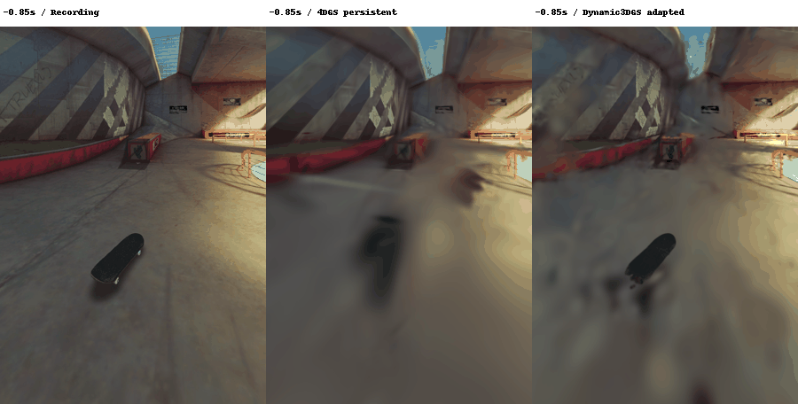

# Dynamic3DGaussians frente al flujo actual del replay

Revisión: **26 de noviembre de2026** · [English: detalles, comandos y fuentes](dynamic-comparison.en.md) · [Evidencia](../evidence/dynamic-comparison-2026-11-26.json)

**El ensayo limitado de Dynamic3DGaussians reconstruye mejor la tabla inicial, pero pierde la tabla en el aire. No justifica sustituir el flujo actual.** El ajuste4DGS de diez instantes también sigue siendo visualmente insuficiente. Ninguno demuestra seguimiento físico fiable ni medición de rotaciones.

Los diez instantes se muestran a250ms, unas cinco veces más despacio que la captura. **Todos están supervisados**; no es una prueba de interpolación temporal. [Ampliaciones reservadas](../assets/dynamic-comparison-validation.jpg) · [Animación de entrenamiento](../assets/dynamic-comparison-training.gif) · [Ampliaciones de entrenamiento](../assets/dynamic-comparison-training.jpg).

## Experimentos

El primer control conserva las entradas anteriores de tres instantes y200+6.000 pasos; únicamente desactiva la deformación temporal de opacidad y armónicos esféricos (`no_do=True`, `no_dshs=True`). Los parámetros canónicos siguen aprendiendo. El PSNR reservado de la unión cambiante observada sube20,82→21,51dB, y el intermedio19,02→20,77dB. Sin embargo, el control central congelado intermedio resulta mejor,21,50dB, y el PSNR completo observado baja28,77→27,31dB. No resuelve el movimiento.

Después, ambos métodos usan **once cámaras de entrenamiento y diez instantes**, más diez imágenes reservadas view20, sobre0,45s. Las110 imágenes de optimización, las poses, la escala4 y las2.337 semillas del fondo+3.000 del volumen inicial son idénticas. No se usan pesos estáticos entrenados. Las máscaras están disponibles en todos los instantes de esas once cámaras: view11 se excluye por su máscara incierta y view13/14 por máscaras iniciales pequeñas. La selección usa solo entrenamiento; view20 no inicializa la tabla. El mapa y las semillas se heredaron de cámaras históricas de entrenamiento más amplias.

Las máscaras siguen siendo aproximadas, especialmente de perfil, y no se demuestra sincronización exacta. Se comprueban RGB normalizado, etiquetas de procedencia y codificación de máscara0/1 para Dynamic3DGaussians. Los datos se verifican otra vez tras entrenar.

| Media de diez instantes supervisados en view20 |4DGS persistente|Dynamic3DGaussians adaptado|
|---|---:|---:|
|PSNR completo|29,79dB|25,03dB|
|PSNR en unión de cambio|24,00dB|23,10dB|
|Misma región, tiempo central congelado|20,71dB|21,65dB|
|PSNR aproximado del deck en muestras3/8/12|21,64/16,34/22,45dB|26,54/14,92/18,16dB|
|MAE entre imágenes en región estable del objetivo|0,001280|0,004398|

El objetivo estable tiene MAE0,000384. Se comparan PNG RGB cuantizados para ambos métodos. El primer instante de Dynamic3DGaussians es reconocible, pero se pierde la forma posterior también en entrenamiento.4DGS conserva manchas oscuras amplias. Las envolventes del deck son anotaciones aproximadas del asistente para evaluar, no verdad semántica independiente. La contribución renderizada de descendientes del objeto también tiene IoU bajo con las máscaras candidatas: a umbral0,1,0,008 para4DGS y0,095 para Dynamic3DGaussians. Los umbrales0,1/0,5 están en la evidencia. Procedencia de semillas no equivale a identidad física ni a precisión de seguimiento.

## Adaptación y límites

Dynamic se fija en commit`7dbbd4dec404308524ff402756bdb8143a2589b0`, con rasterizador separado`cb65e4b86bc3bd8ed42174b72a62e8d3a3a71110`. El entorno aislado reutiliza PyTorch2.1.2/CUDA12.1 sin modificar el entorno4DGS. La comprobación GPU de proyección da un error máximo0,000015píxeles y verifica profundidades de semillas iniciales.

Es un piloto adaptado, no reproducción del artículo:2.000 pasos iniciales+400 por instante posterior,5.600 totales; densificación inicial hasta1.200 y solo si hay menos de20.000 puntos antes de crecer. El resultado contiene22.425puntos,3.168 con procedencia de la tabla. Se mantienen pérdidas de rigidez, rotación, isometría, segmentación y fondo. Se desactiva la pérdida de suelo porque no conocemos ese plano en nuestro sistema de coordenadas; plano cercano Python0,01. Las correcciones RGB solo se ajustan en entrenamiento.

Optimización y carga por instante Dynamic:416,15s; máximo de memoria asignada por PyTorch527,39MiB, no memoria total del proceso GPU. No se capturó el tiempo exterior del primer lanzador.4DGS usa200+6.000 pasos y8.769puntos. Las pérdidas, representaciones y presupuestos difieren: no es una ablación causal aislada. Una ejecución por método, entradas aproximadas y view20 consultada repetidamente limitan las conclusiones.

Verificación:60 pruebas Windows,48 aprobadas y12 omitidas por dependencias; cuatro pruebas nuevas de datos/evaluación y tres de rutas del objeto también pasan en WSL. Ambos métodos completan cálculo de gradientes, guardado/carga y render GPU. Se verifican110 imágenes comunes, nube inicial idéntica, codificación de máscaras y40 objetivos de evaluación originales. Los errores anteriores de extracción por FFmpeg antiguo WSL quedan fuera del cambio.

**Decisión:** conservar los pilotos y revisar máscaras, tiempos y superficies visibles en la inicialización antes de ampliar el entrenamiento. La limitación de Dynamic sobre superficies visibles inicialmente es relevante para la cara inferior de la tabla. No se afirma flip fiel ni seguimiento de rotaciones. No hay entrenamiento en ejecución.

Los [comandos completos y fuentes primarias](dynamic-comparison.en.md#reproduction-and-sources) están en el informe inglés. Los puntos de cámara siguen siendo necesarios para ambas técnicas.
