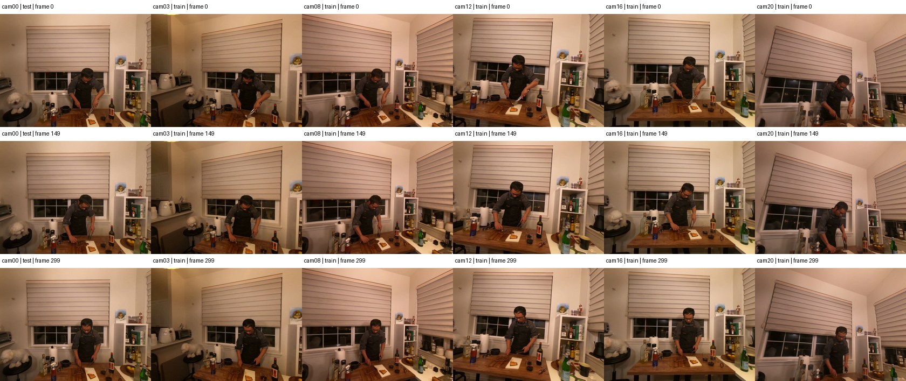

# DyNeRF reference experiment — 20 November 2026

**Later update:** the owner completed the [local RTX 4050 execution gate](local-gpu.en.md): 12 optimization steps, saved/reloaded model and 30 held-out renders. This document preserves the earlier CPU preparation and Colab proposal; Colab itself remains unverified.

[Español](dynerf.es.md) · [Colab notebook](../../notebooks/dynerf_reference.ipynb) · [Evidence](../evidence/dynerf-2026-11-20.json)

## Question and scope

Can the pinned 4DGaussians code load a calibrated real multi-view scene, optimize a dynamic representation, and render a camera excluded from optimization? Start with `cut_roasted_beef` from [Neural 3D Video](https://github.com/facebookresearch/Neural_3D_Video/releases/tag/v1.0), before changing True Skate capture or implementing a moving-camera loader.

This separates an execution test from capture-specific problems. Supplied calibration bypasses camera estimation during training; it does not validate our entire True Skate SfM/synchronization pipeline. A separate PnP diagnostic below checks one part of that geometry pipeline. No reconstruction quality or GPU execution is claimed yet.

## Executed locally

- Downloaded the official v1.0 archive: 1,143,395,383 bytes, SHA-256 `2f9d3bd8782b96425e8adb506fa4cbdfaab4ab753a8fdaf44b9b2468000b8c4f`. No publisher checksum was supplied; this hash identifies our download rather than proving an independent checksum match.
- Found 20 usable videos, each 300 frames at 30 FPS and 2704 × 2028 pixels. `cam04` is absent: calibration rows follow sorted existing filenames, not numeric camera IDs.
- Verified video/calibration count and dimensions, finite values, orthonormal bases, and positive ordered depth bounds. Authors provide synchronization and COLMAP calibration; these are reference estimates, not exact ground truth. Inspected six viewpoints at frames 0, 149 and 299.
- Reserved `cam00`. Triangulated SIFT correspondences from frame 0 of the other 19 cameras, at 1352 × 1014, with supplied poses and intrinsics fixed. Result: **3,390 points**, mean reprojection error **0.710 px**, mean track length **5.35**. Pose change was below `4e-16`. Registration count here means supplied camera poses were loaded, not independently recovered.
- Localized `cam00` frame 0 against this frozen map, using the existing correspondence/quality helpers and SIFT + PnP/RANSAC. Its supplied pose was read only after estimation. Result: **961/1038 inliers**, mean inlier error **0.806 px**, rotation difference **0.01094°**, camera-center difference **0.0726%** of the median query-to-training-camera baseline. This is one frame, using a rig whose author-provided calibration was jointly estimated; it is not independent ground-truth pose accuracy.



Source imagery and the compact initialization artifact are derived from Neural 3D Video Synthesis (Li et al., CVPR 2022), [dataset repository](https://github.com/facebookresearch/Neural_3D_Video), **CC-BY-NC-4.0**. The repository's code license does not replace that dataset license. The contact sheet adds labels/resizing; the NPZ stores triangulated positions/colors from training images. Raw videos and the full model/database stay outside Git.

## Reproduce the CPU preparation

From repository root, using the existing Windows helper `.venv` with its `[sfm]` dependencies and FFmpeg:

```powershell
New-Item -ItemType Directory -Force data/sample/dynerf | Out-Null
curl.exe --fail --location --continue-at - --output data/sample/dynerf/cut_roasted_beef.zip https://github.com/facebookresearch/Neural_3D_Video/releases/download/v1.0/cut_roasted_beef.zip
.\.venv\Scripts\python.exe scripts/inspect_dynerf.py --archive data/sample/dynerf/cut_roasted_beef.zip
.\.venv\Scripts\python.exe scripts/triangulate_dynerf.py
.\.venv\Scripts\python.exe scripts/localize_dynerf_holdout.py
```

Triangulation refuses to overwrite its output. Diagnostics and logs are under `outputs/dynerf-reference/`. The compact evidence snapshot preserves measured results and source hashes.

## Next execution: Colab

The notebook is prepared and syntax-checked, **not executed on a Colab GPU**. It uses an isolated Python 3.10 / PyTorch 2.1.2-cu121 / CUDA 12.1 environment rather than assuming Colab's current Python and CUDA are compatible with this older research code. This is a proposed compatibility environment, not an exact upstream-environment reproduction or validated lock. Setup and compilation may be the first failure; save the actual error instead of claiming success. Use a T4 GPU when available. GPU access and session duration depend on Colab availability.

The notebook downloads the official archive, verifies our recorded hash, restores the supplied sparse initialization, checks actual CUDA imports, and runs **2 coarse + 10 fine iterations** with the official model configuration and batch size 1. Then it renders only held-out frames **0, 149, 299**, avoiding upstream's full 300-frame render accumulation. Images use 1352 × 1014 and timestamps `frame_index / 300`, matching the pinned loader.

Sparse initialization is an intentional departure from upstream's dense COLMAP/downsampling recipe. It enables an initial execution experiment; do not compare it as an exact reproduction of published quality. `cam00` colors are excluded from the sparse map and optimization, while supplied full-rig calibration is retained. The localization diagnostic never replaces the supplied test pose for rendering. The notebook's prepared status, rather than a GPU result, is what is published today.

Pass gates: GPU available; compiler and PyTorch CUDA agree; extensions import; 5,700 training and 300 test image paths load; optimization saves iteration 10; three nonempty held-out render/target pairs exist. A 10-iteration result establishes execution only. A later, separately recorded longer run must assess PSNR/SSIM/LPIPS and visual quality before claiming useful reconstruction.

## What the student needs to explain

1. Why `cam00` is excluded, and what a new-view test measures.
2. What a camera pose and focal length contribute to projecting a 3D point into an image.
3. Why low reprojection error checks geometry but does not prove dynamic rendering quality.
4. Which stages were actually run, and why twelve optimization steps cannot establish convergence.

The scripts and notebook are AI-assisted preparation. Student understanding of them has not been assessed. The next working session should explain these four points using the contact sheet and a projection example.

## Why keep 4DGaussians for now?

[Dynamic 3D Gaussians](https://dynamic3dgaussians.github.io/paper.pdf) also takes camera intrinsics/extrinsics as inputs; its persistent Gaussian trajectories concern scene elements. It does not remove camera-pose estimation. It is a reasonable alternative if the main question becomes point tracking or locally rigid motion, but switching algorithms does not solve an incorrect moving-camera loader. Finish this one reference gate, then test True Skate's fixed mode and evaluate the moving-camera branch separately.
