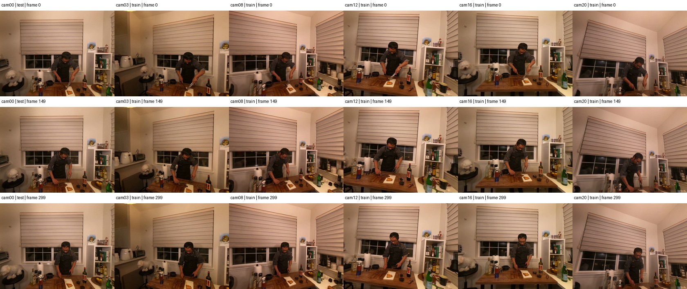

# Experimento de referencia DyNeRF — 20 de noviembre de 2026

**Actualización posterior:** el responsable completó la [prueba local RTX 4050](local-gpu.es.md): 12 pasos, modelo guardado/recargado y 30 renders reservados. Se conserva aquí la preparación CPU/propuesta Colab anterior; Colab sigue sin verificar.

[English](dynerf.en.md) · [Cuaderno Colab](../../notebooks/dynerf_reference.ipynb) · [Evidencias](../evidence/dynerf-2026-11-20.json)

## Pregunta y alcance

¿Puede la versión fijada de 4DGaussians cargar una escena real multivista calibrada, optimizar una representación dinámica y renderizar una cámara excluida de la optimización? Empezamos con `cut_roasted_beef` de [Neural 3D Video](https://github.com/facebookresearch/Neural_3D_Video/releases/tag/v1.0), antes de modificar la captura True Skate o implementar el cargador de cámaras móviles.

La calibración suministrada permite separar la ejecución de los problemas de captura. No valida toda nuestra cadena SfM/sincronización de True Skate. Un diagnóstico PnP independiente comprueba una parte de la geometría. Todavía no se afirma ejecución GPU ni calidad de reconstrucción.

## Trabajo ejecutado localmente

- Archivo oficial v1.0 descargado: 1.143.395.383 bytes; SHA-256 `2f9d3bd8782b96425e8adb506fa4cbdfaab4ab753a8fdaf44b9b2468000b8c4f`. El autor no proporcionó una suma de verificación; el hash identifica nuestra copia, sin constituir una verificación independiente del editor.
- 20 vídeos utilizables: 300 fotogramas a 30 FPS, 2704 × 2028. Falta `cam04`: las filas de calibración siguen los archivos existentes ordenados, no los identificadores numéricos.
- Comprobados recuentos, dimensiones, valores finitos, bases ortonormales y límites de profundidad positivos y ordenados. La sincronización y calibración COLMAP proceden de los autores; no son poses exactas de referencia absoluta. Inspección de seis vistas en los fotogramas 0, 149 y 299.
- `cam00` reservada. Triangulación SIFT del fotograma 0 de las otras 19 cámaras a 1352 × 1014, manteniendo fijas las poses e intrínsecos suministrados: **3.390 puntos**, error medio **0,710 px**, longitud media de pista **5,35**. Cambio de poses inferior a `4e-16`. Las cámaras se cargaron con poses suministradas; no se recuperaron de forma independiente.
- Localización del fotograma 0 de `cam00` contra el mapa congelado mediante SIFT + PnP/RANSAC y los auxiliares existentes. Su pose suministrada se leyó después de estimarla: **961/1038 inliers**, error medio **0,806 px**, diferencia angular **0,01094°**, diferencia del centro **0,0726%** de la distancia mediana entre cámara consulta y cámaras de entrenamiento. Solo se probó un fotograma y la calibración del conjunto fue estimada conjuntamente por los autores; no es exactitud frente a verdad terreno independiente.

Imágenes y NPZ de inicialización derivados de Neural 3D Video Synthesis (Li et al., CVPR 2022), [repositorio de datos](https://github.com/facebookresearch/Neural_3D_Video), **CC-BY-NC-4.0**. La licencia del código no sustituye la de los datos. La figura añade etiquetas y reduce resolución; el NPZ contiene posiciones/colores triangulados de imágenes de entrenamiento. Vídeos y modelo/base de datos completos quedan fuera de Git.

## Repetir la preparación CPU

Los comandos exactos están en la [versión inglesa](dynerf.en.md#reproduce-the-cpu-preparation). Se utiliza la `.venv` de Windows con dependencias `[sfm]` y FFmpeg. La triangulación rechaza sobrescribir su salida. Informes y registros: `outputs/dynerf-reference/`; el resumen versionado conserva resultados y hashes.

## Siguiente ejecución: Colab

Cuaderno preparado y comprobado sintácticamente, **sin ejecutar en GPU Colab**. Propone Python 3.10 / PyTorch 2.1.2-cu121 / CUDA 12.1 en un entorno aislado, diferente del entorno original de los autores. No es un bloqueo de dependencias validado ni reproducción exacta del entorno. La instalación/compilación puede fallar; conservar el error real. Elegir T4 cuando esté disponible; el acceso y duración de sesión dependen de Colab.

El cuaderno descarga el archivo oficial, compara el hash registrado, restaura la inicialización dispersa, comprueba CUDA y ejecuta **2 iteraciones coarse + 10 fine**, configuración oficial del modelo y lote 1. Después renderiza solo los fotogramas reservados **0, 149, 299**, evitando acumular los 300 renders. Resolución 1352 × 1014 y tiempo `índice / 300`, como el cargador fijado.

La inicialización dispersa sustituye deliberadamente la reconstrucción densa/submuestreo de COLMAP de los autores. Sirve para probar ejecución; no permite afirmar reproducción exacta de sus métricas. Los colores de `cam00` se excluyen del mapa y optimización, manteniendo la calibración completa suministrada. La estimación PnP de diagnóstico no sustituye la pose de prueba suministrada. Lo publicado hoy es la preparación, no un resultado GPU.

Criterios de aceptación: GPU disponible, compilador/PyTorch CUDA compatibles, extensiones importadas, 5.700 rutas de entrenamiento y 300 de prueba, modelo guardado en iteración 10 y tres pares render/objetivo no vacíos. Doce pasos solo verifican ejecución. Una ejecución posterior más larga deberá medir PSNR/SSIM/LPIPS y revisar calidad visual antes de afirmar reconstrucción útil.

## Comprensión que debe demostrar el estudiante

1. Por qué se reserva `cam00` y qué mide una vista no usada para entrenar.
2. Cómo pose y focal permiten proyectar un punto 3D en una imagen.
3. Por qué un error de reproyección bajo no prueba calidad de renderizado dinámico.
4. Qué etapas se ejecutaron realmente y por qué doce pasos no demuestran convergencia.

Scripts/cuaderno preparados con ayuda de IA; la comprensión del estudiante aún no se ha evaluado. La siguiente sesión debe explicar estos puntos con la figura y un ejemplo de proyección.

## Elección del método

[Dynamic 3D Gaussians](https://dynamic3dgaussians.github.io/paper.pdf) también recibe intrínsecos/extrínsecos de cámara; sus trayectorias gaussianas corresponden a elementos de la escena. No elimina estimación de cámaras. Puede ser una alternativa si el objetivo principal pasa a seguimiento o movimiento localmente rígido, pero cambiar de método no corrige un cargador que trata cámaras móviles como fijas. Primero completar esta referencia; después probar el modo fijo de True Skate y evaluar por separado la rama móvil.
