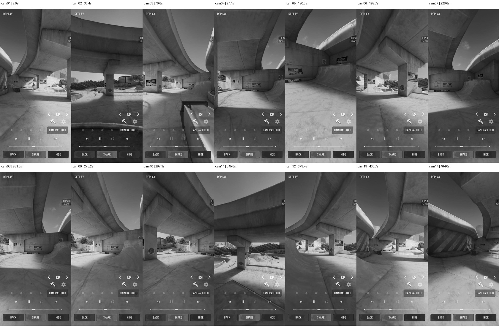

# Fixed-camera recording recovery — 23 November 2026

[Español](fixed-capture.es.md) — [Measured evidence](../evidence/fixed-capture-2026-11-23.json)

The owner supplied an unedited 479.51-second True Skate screen recording containing camera placement, menus and replay playback. Automatic processing recovered **14 replay clips of 10.65 seconds**, with **13 distinct candidate viewpoints** after detecting cam14 as a likely repeat of cam10. Manual cutting was not required.



Each thumbnail shows the replay midpoint, not a complete visibility assessment. Camera IDs follow recording order; they do not indicate azimuth or equal angular spacing. This is a new recording, separate from the earlier moving-camera dataset. Its cam07 does not inherit the earlier dataset's holdout designation. Images are owner-captured True Skate gameplay; game assets belong to their respective owners.

## Method and measured checks

1. Detect the replay interface and its timeline cursor at 10 analysis samples/second. Split at UI changes and backward cursor jumps; reject incomplete or inconsistent timeline intervals.
2. Refine each retained interval using three decoded source timestamps and full-resolution cursor positions. Use the same cursor interval (source x=164–904) across views. Maximum fitted cursor residual: 1.00 source pixel. Playback speed ratio, fastest/slowest: 1.003744.
3. Compare background SIFT features at three sampled instants per view, excluding the lower interface. All 14 candidates meet the sampled stability criterion: at least 80 matches, median displacement ≤0.75 pixels and 90th percentile ≤2.5 pixels, at a 480-pixel preview width. Observed minimum: 632 matches; maximum 90th percentile: 0.398 pixels. The same displacement criteria flag the cam14/cam10 repeat.
4. Export a common 639 frames per clip at 60 FPS, H.264, 1126×2436, without audio. Fully decode all 14 exports: 639 frames each, no decoder errors. Total clips: 20.05 MiB. Verify the original recording's SHA-256 after processing.

The source is variable-rate. Exporting at constant 60 FPS may duplicate or drop captured frames; it does not create new simulation observations. Timeline alignment is a candidate temporal alignment, **not proven frame-perfect synchronization**. Three samples do not prove camera stability throughout every frame. Calibration, lens/FOV consistency and board visibility remain unverified. The board is small or difficult to see in several midpoint previews; this limits what can be inferred about dynamic reconstruction quality.

## Local outputs and reproduction

Clips: `data/raw/true-skate-fixed-2026-11-23/cam01.mp4` through `cam14.mp4`. The local `cuts.json` stores all fits, timestamps, sampled checks and rejected intervals. The original recording is unchanged. Raw media, clips and analysis traces remain ignored by Git; the scripts, contact sheet and compact evidence are published.

These scripts target this recording's measured UI layout (1126×2436), not arbitrary games or screen sizes. They require the Windows helper environment (Python 3.11+, NumPy, Pillow, pycolmap 4.2.1), FFmpeg and NVIDIA CUDA decoding. The existing `skate4d` helper package is loaded through `_bootstrap`.

```powershell
.\.venv\Scripts\python.exe scripts/inspect_fixed_screenrecording.py "ScreenRecording_11-23-2026 19-51-20_1.mp4"
.\.venv\Scripts\python.exe scripts/recover_fixed_views.py "ScreenRecording_11-23-2026 19-51-20_1.mp4" --export
```

Recovery refuses to overwrite a directory containing a manifest. For a new run, choose fresh directories with `--output` on both scripts and `--inspection` on the recovery script. Inspection and recovery output directories have different roles; do not pass the same output path to both.

| Candidate | Source start (s) | Export end (s) | Likely repeat of |
|---|---|---|---|
| cam01 | 2.040 | 12.690 | — |
| cam02 | 35.390 | 46.040 | — |
| cam03 | 70.599 | 81.249 | — |
| cam04 | 97.138 | 107.788 | — |
| cam05 | 120.836 | 131.486 | — |
| cam06 | 192.684 | 203.334 | — |
| cam07 | 226.613 | 237.263 | — |
| cam08 | 250.968 | 261.618 | — |
| cam09 | 275.185 | 285.835 | — |
| cam10 | 297.097 | 307.747 | — |
| cam11 | 345.644 | 356.294 | — |
| cam12 | 379.437 | 390.087 | — |
| cam13 | 400.695 | 411.345 | — |
| cam14 | 464.024 | 474.674 | cam10 |

## Next experiment

Review board visibility through each clip, select a short shared action interval and verify synchronization with an observable action event. Then crop/mask the game interface, estimate one camera pose per retained fixed view from the shared static background, and reserve a view for evaluation. Attempt a bounded True Skate 4DGS run only after these checks pass. No new True Skate camera calibration or dynamic training was run at this checkpoint.
