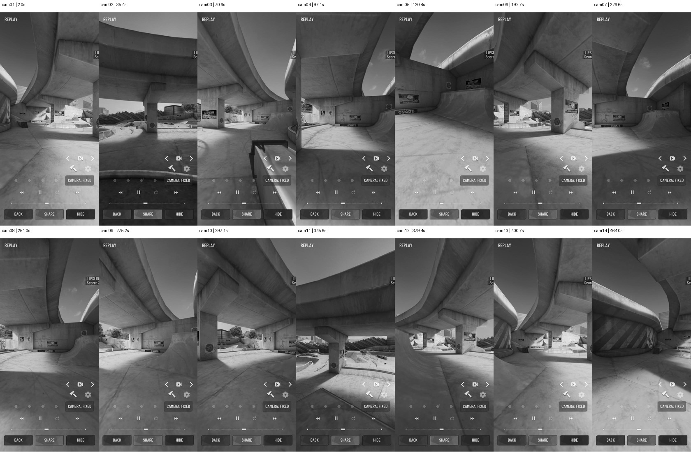

# Recuperación de vistas fijas — 23 de noviembre de 2026

[English](fixed-capture.en.md) — [Evidencia medida](../evidence/fixed-capture-2026-11-23.json)

El responsable aportó una grabación de pantalla de True Skate sin editar, de 479,51 segundos, con colocación de cámaras, menús y reproducción del replay. El procesamiento automático recuperó **14 clips de 10,65 segundos**, con **13 puntos de vista candidatos distintos** al detectar cam14 como probable repetición de cam10. No fue necesario recortarlos manualmente.



Cada miniatura muestra el punto medio, no una evaluación completa de visibilidad. Los identificadores siguen el orden de grabación; no representan azimuts ni separaciones angulares regulares. Es una grabación nueva, separada del conjunto anterior con cámaras móviles. Su cam07 no hereda la designación de validación del conjunto anterior. Las imágenes fueron capturadas por el responsable en True Skate; los recursos del juego pertenecen a sus respectivos titulares.

## Método y comprobaciones medidas

1. Detectar la interfaz del replay y el cursor temporal con 10 muestras de análisis por segundo. Separar en cambios de interfaz y saltos del cursor hacia atrás; descartar intervalos incompletos o inconsistentes.
2. Refinar cada intervalo mediante tres marcas temporales decodificadas y posiciones del cursor a resolución completa. Utilizar el mismo intervalo de cursor (x=164–904 en el original). Residuo máximo del ajuste: 1,00 píxel del original. Relación de velocidades, máxima/mínima: 1,003744.
3. Comparar características SIFT del fondo en tres instantes por vista, excluyendo la interfaz inferior. Los 14 candidatos cumplen el criterio de estabilidad muestreada: al menos 80 correspondencias, desplazamiento mediano ≤0,75 píxeles y percentil 90 ≤2,5 píxeles, con vistas previas de 480 píxeles de ancho. Mínimo observado: 632 correspondencias; máximo del percentil 90: 0,398 píxeles. Los mismos criterios indican la repetición cam14/cam10.
4. Exportar 639 fotogramas por clip a 60 FPS, H.264, 1126×2436, sin audio. Decodificar los 14 archivos completos: 639 fotogramas cada uno, sin errores del decodificador. Total: 20,05 MiB. Verificar el SHA-256 de la grabación original después del procesamiento.

El original tiene frecuencia variable. La exportación a 60 FPS constantes puede duplicar o descartar fotogramas capturados; no crea nuevas observaciones de la simulación. La alineación temporal basada en la interfaz **no demuestra sincronización exacta entre fotogramas**. Tres muestras tampoco prueban estabilidad durante toda la secuencia. Falta verificar calibración, coherencia de lente/FOV y visibilidad de la tabla. La tabla aparece pequeña o resulta difícil de ver en varias miniaturas, lo que limita las conclusiones sobre la reconstrucción dinámica.

## Archivos locales y reproducción

Clips: `data/raw/true-skate-fixed-2026-11-23/cam01.mp4` hasta `cam14.mp4`. El archivo local `cuts.json` conserva ajustes, tiempos, comprobaciones y rechazos. La grabación original permanece intacta. Los vídeos y trazas de análisis están excluidos de Git; se publican los scripts, la hoja de contacto y la evidencia compacta.

Los scripts corresponden a la interfaz medida de esta grabación (1126×2436), no a cualquier juego o tamaño de pantalla. Requieren el entorno auxiliar Windows (Python 3.11+, NumPy, Pillow, pycolmap 4.2.1), FFmpeg y decodificación NVIDIA CUDA. `_bootstrap` carga el paquete auxiliar existente `skate4d`.

```powershell
.\.venv\Scripts\python.exe scripts/inspect_fixed_screenrecording.py "ScreenRecording_11-23-2026 19-51-20_1.mp4"
.\.venv\Scripts\python.exe scripts/recover_fixed_views.py "ScreenRecording_11-23-2026 19-51-20_1.mp4" --export
```

La recuperación rechaza sobrescribir un directorio que contenga un manifiesto. Para repetirla, elegir directorios nuevos con `--output` en ambos scripts y `--inspection` en el segundo. Los directorios de inspección y recuperación tienen funciones distintas; no usar el mismo destino para ambos.

| Candidato | Inicio original (s) | Fin exportado (s) | Probable repetición de |
|---|---|---|---|
| cam01 | 2.040 | 12.690 | — |
| cam02 | 35.390 | 46.040 | — |
| cam03 | 70.599 | 81.249 | — |
| cam04 | 97.138 | 107.788 | — |
| cam05 | 120.836 | 131.486 | — |
| cam06 | 192.684 | 203.334 | — |
| cam07 | 226.613 | 237.263 | — |
| cam08 | 250.968 | 261.618 | — |
| cam09 | 275.185 | 285.835 | — |
| cam10 | 297.097 | 307.747 | — |
| cam11 | 345.644 | 356.294 | — |
| cam12 | 379.437 | 390.087 | — |
| cam13 | 400.695 | 411.345 | — |
| cam14 | 464.024 | 474.674 | cam10 |

## Próximo experimento

Revisar la visibilidad de la tabla en cada clip, seleccionar un intervalo corto de acción compartida y comprobar la sincronización mediante un evento observable. Después, recortar/enmascarar la interfaz, estimar una pose por vista fija a partir del fondo estático compartido y reservar una vista para evaluación. Ejecutar un entrenamiento acotado de True Skate con 4DGS solo después de estas comprobaciones. En este punto no se ejecutó una nueva calibración de cámaras de True Skate ni un entrenamiento dinámico.
