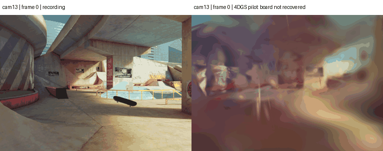

# First True Skate dynamic pilot — 24 November 2026

[Español](fixed-dynamic-pilot.es.md) · [Measured evidence](../evidence/fixed-dynamic-pilot-2026-11-24.json) · [Visibility review](board-visibility.en.md)

**The complete preparation/training/rendering chain now runs on the owner's fixed-camera recordings. Reconstruction quality has not passed: the background is blurred and the skateboard is not recognizable in the inspected training or reserved-view renders.** This is an execution result and a documented failure case, not a successful reconstruction of the trick.



The animation compares all 13 reserved-view images with their model renders at approximately five times slow motion. The endpoints span 0.4 seconds of replay time. Pixel changes in the rendered background do not prove correct object motion. [Three-frame comparison](../assets/fixed-pilot-comparison.jpg).

## Preparation and checks

- Score templates identify three UI events across the 13 candidate views. Raw onset spread is two frames at 60 FPS. Constant offsets of −1, 0 or +1 frame reduce the spreads to 1, 0 and 1 frames. A strict consecutive-frame detector initially misdated one animated label; inspected samples showed antialiasing variation, and the final detector requires three confirmations within five frames. This is UI-event alignment, not proof of exact simulation synchronization.
- cam13 was localized against the frozen training map using SIFT and PnP/RANSAC: 77 inliers from 146 correspondences, median reprojection error 0.992 source pixels, all inliers in front of the camera. The map hashes remained unchanged. cam13 does not enter geometry or dynamic optimization, but its viewpoint closely overlaps cam01, so this is a limited novel-view check.
- Final training views: cam01, cam02, cam03, cam06, cam07, cam08, cam10 and cam12. cam04/cam09 approach frame boundaries, cam05 loses the board, and the final crop cuts the board in cam11. These exclusions concern dynamic images; the original 12 training views remain part of background geometry.
- The first pilot narrows the candidate window to **8.7–9.1 seconds**, sampling 13 instants at 30 samples/second: **104 training images and 13 reserved images**. The crop is `(x=0,y=818,w=1126,h=800)`, resized to **563×400**. Its principal point is centered, preserving compatibility with the stock renderer while removing the score/buttons. Model times are normalized to 0–1; they do not represent a full second of replay.
- A runtime loader adapter retains the pinned upstream source unchanged. Actual loader checks verify dimensions, split, timestamps, 1,115 training-background initialization points and camera projection consistency (maximum difference 0.000027 pixels between the renderer matrix and analytical projection). This checks the adapter, not the accuracy of the estimated cameras.

## Bounded GPU result

The existing WSL2/CUDA environment was reused without package installation. Training took **85.92 seconds** on the RTX 4050: 200 coarse + 2,000 fine steps, producing **2,623 Gaussians**. Rendering/evaluation took 33.45 seconds. Prepared inputs occupy 36.70 MiB and run artifacts 22.99 MiB, excluding earlier preparation attempts and source videos. The checkpoint is local under `outputs/true-skate-fixed-pilot/model/point_cloud/iteration_2000/`.

| Evaluation | Reserved cam13 | Training cam08 |
|---|---:|---:|
| Mean full-image PSNR | 15.06 dB | 18.87 dB |
| Mean full-image SSIM | 0.635 | 0.741 |
| Full-image PSNR with model time frozen at 0.5 | 15.21 dB | 18.88 dB |
| PSNR in target temporal-change region | 10.81 dB | 14.70 dB |

All metrics use 13 images per reported camera. The temporal-change mask is computed from target pixel variation exceeding 45/255 across the interval; it includes effects such as shadows and is **not ground-truth board segmentation**. It covers 1.62% of cam13 pixels and 2.22% of cam08 pixels. Full-image metrics are dominated by the static background. They are not directly comparable to the earlier DyNeRF scene's scores. Reloaded rendering restores the SH degree used in training (degree 2).

The frozen-time comparison and visual inspection do not support a claim that the skateboard's movement was learned correctly. The short run, sparse background-only initialization and small changing region are plausible contributors; this experiment does not isolate their individual effects.

## Next research direction

First test whether a denser static initialization improves the background with camera poses and images fixed. Separately, identify the board in training images and investigate foreground initialization or loss weighting so the moving object contributes sufficiently to optimization. Compare each change on the same reserved view, including a board-region metric and a frozen-time control. A recognizable moving board and improvement over that control are required before claiming a dynamic trick reconstruction. Merely extending training is not yet a demonstrated solution.

## Reproduction

From repository PowerShell, using the existing helper and GPU environments:

```powershell
.\.venv\Scripts\python.exe scripts/check_fixed_events.py
.\.venv\Scripts\python.exe scripts/localize_fixed_holdout.py
.\.venv\Scripts\python.exe scripts/prepare_fixed_dynamic.py
.\.venv\Scripts\python.exe -u scripts/run_fixed_pilot.py
```

Outputs already exist locally; scripts refuse to overwrite them. The first two accept a fresh `--output`; preparation currently reads their documented default evidence paths. The last two accept `--output`, and the runner accepts `--source`. These scripts describe this bounded recording-specific experiment, not a general ingestion tool. Logs and metrics remain under the run directory; original clips are unchanged. Code, bilingual findings and small illustrations are published; training data and models remain local. The 25 existing helper tests passed, as did the actual GPU loader/projection checks; convergence and physical tracking remain unvalidated.
