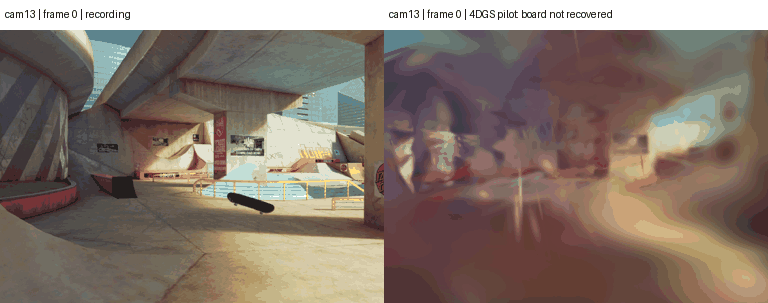

# Primera prueba dinámica de True Skate — 24 de noviembre de 2026

[English](fixed-dynamic-pilot.en.md) · [Evidencia medida](../evidence/fixed-dynamic-pilot-2026-11-24.json) · [Revisión de visibilidad](board-visibility.es.md)

**La cadena completa de preparación, entrenamiento y renderizado ya funciona con las grabaciones de cámaras fijas del responsable. La calidad no supera la revisión: el fondo está borroso y la tabla no es reconocible en los renders inspeccionados de entrenamiento ni de la vista reservada.** Es un resultado de ejecución y un caso de fallo documentado, no una reconstrucción lograda del truco.



La animación compara las 13 imágenes de la vista reservada con sus renders, aproximadamente cinco veces más despacio. Los extremos abarcan 0,4 segundos del replay. Los cambios de píxeles del fondo renderizado no prueban movimiento correcto del objeto. [Comparación de tres instantes](../assets/fixed-pilot-comparison.jpg).

## Preparación y comprobaciones

- Las plantillas de puntuación identifican tres eventos de interfaz en las 13 vistas candidatas. La dispersión original es de dos fotogramas a 60 FPS. Desplazamientos constantes de −1, 0 o +1 fotograma reducen las dispersiones a 1, 0 y 1. Un detector estricto de fotogramas consecutivos fechó tarde una etiqueta animada; la inspección mostró variaciones de antialiasing y el detector final exige tres confirmaciones en cinco fotogramas. Esto comprueba eventos de interfaz, no sincronización exacta de la simulación.
- Se localizó cam13 contra el mapa de entrenamiento congelado mediante SIFT y PnP/RANSAC: 77 inliers de 146 correspondencias, error mediano de 0,992 píxeles originales y todos los inliers delante de la cámara. Los hashes del mapa no cambiaron. cam13 no participa en la optimización geométrica ni dinámica, pero su vista se solapa estrechamente con cam01; la prueba de vista nueva es limitada.
- Vistas finales de entrenamiento: cam01, cam02, cam03, cam06, cam07, cam08, cam10 y cam12. cam04/cam09 se acercan a los bordes, cam05 pierde la tabla y el recorte final corta la tabla en cam11. Estas exclusiones afectan a las imágenes dinámicas; las 12 vistas originales de entrenamiento siguen formando la geometría del fondo.
- Se limita el primer ensayo a **8,7–9,1 segundos**, con 13 instantes a 30 muestras/segundo: **104 imágenes de entrenamiento y 13 reservadas**. El recorte es `(x=0,y=818,w=1126,h=800)`, reducido a **563×400**. Su punto principal queda centrado para conservar compatibilidad con el renderizador y eliminar puntuación/botones. El tiempo del modelo se normaliza a 0–1; no representa un segundo completo del replay.
- Un adaptador de carga en ejecución mantiene intacto el código upstream fijado. Se comprobaron dimensiones, separación de vistas, tiempos, 1.115 puntos iniciales del fondo de entrenamiento y coherencia de proyección (diferencia máxima de 0,000027 píxeles entre la matriz del renderizador y la proyección analítica). Esto comprueba el adaptador, no la precisión de las cámaras estimadas.

## Resultado GPU acotado

Se reutilizó el entorno WSL2/CUDA existente sin instalar paquetes. El entrenamiento tardó **85,92 segundos** en la RTX 4050: 200 pasos coarse + 2.000 fine, con **2.623 Gaussianas** finales. El renderizado/evaluación tardó 33,45 segundos. Los datos preparados ocupan 36,70 MiB y los resultados 22,99 MiB, sin contar intentos anteriores ni vídeos originales. El modelo está localmente en `outputs/true-skate-fixed-pilot/model/point_cloud/iteration_2000/`.

| Evaluación | cam13 reservada | cam08 de entrenamiento |
|---|---:|---:|
| PSNR medio de imagen completa | 15,06 dB | 18,87 dB |
| SSIM medio de imagen completa | 0,635 | 0,741 |
| PSNR completo con tiempo del modelo fijo en 0,5 | 15,21 dB | 18,88 dB |
| PSNR en región de cambio temporal del objetivo | 10,81 dB | 14,70 dB |

Cada cámara evaluada utiliza 13 imágenes. La máscara de cambio temporal procede de una variación de píxeles objetivo superior a 45/255 durante el intervalo; incluye efectos como sombras y **no es segmentación real de la tabla**. Cubre el 1,62% de los píxeles de cam13 y el 2,22% de cam08. El fondo estático domina las métricas globales. No son directamente comparables con las de la escena DyNeRF anterior. Al recargar el modelo se restablece el grado SH utilizado durante el entrenamiento (grado 2).

La comparación con tiempo fijo y la inspección visual no permiten afirmar que se haya aprendido correctamente el movimiento de la tabla. La ejecución corta, la inicialización dispersa solo del fondo y la pequeña región cambiante son posibles causas; esta prueba no aísla sus efectos individuales.

## Próxima dirección de investigación

Primero comprobar si una inicialización estática más densa mejora el fondo manteniendo fijas las poses y las imágenes. Por separado, identificar la tabla en las imágenes de entrenamiento e investigar inicialización del objeto o ponderación del error para que contribuya suficientemente a la optimización. Comparar cada cambio sobre la misma vista reservada, con una métrica de región de la tabla y un control de tiempo fijo. Se requiere una tabla reconocible en movimiento y una mejora frente a ese control antes de afirmar una reconstrucción dinámica del truco. Ampliar el entrenamiento por sí solo todavía no es una solución demostrada.

## Reproducción

Desde PowerShell en el repositorio, con los entornos auxiliar y GPU existentes:

```powershell
.\.venv\Scripts\python.exe scripts/check_fixed_events.py
.\.venv\Scripts\python.exe scripts/localize_fixed_holdout.py
.\.venv\Scripts\python.exe scripts/prepare_fixed_dynamic.py
.\.venv\Scripts\python.exe -u scripts/run_fixed_pilot.py
```

Los resultados ya existen localmente; los scripts rechazan sobrescribirlos. Los dos primeros aceptan un `--output` nuevo; la preparación lee actualmente sus rutas de evidencia predeterminadas. Los dos últimos aceptan `--output` y el ejecutor también `--source`. Son scripts para este experimento acotado y esta grabación, no una herramienta general de importación. Los registros y métricas quedan en la carpeta del ensayo; los clips originales no cambian. Se publican código, resultados bilingües e ilustraciones pequeñas; datos y modelos permanecen locales. Pasaron las 25 pruebas auxiliares existentes y las comprobaciones GPU de carga/proyección; no se validó convergencia ni seguimiento físico.
