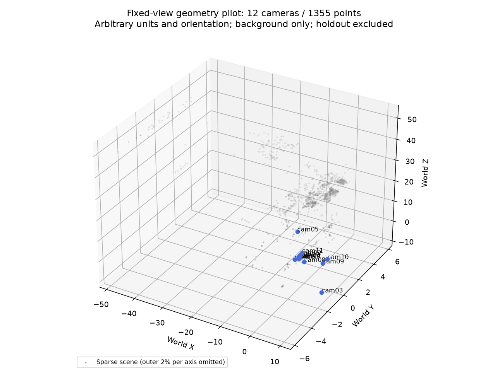

# Fixed-view geometry pilot — 24 November 2026

[Español](fixed-geometry.es.md) · [Evidence](../evidence/fixed-geometry-2026-11-24.json) · [Capture preparation](fixed-capture.en.md)

The new fixed-camera recording supports an initial static-background reconstruction. Of 13 distinct candidate views, cam13 was reserved before feature extraction/matching. All **12 training views** registered in one sparse model: **1,355 points**, mean reprojection error **0.562 pixels**, mean track length **3.80 observations**. Feature extraction, matching and mapping took 11.36 seconds on CPU, excluding frame preparation.



This estimates camera locations relative to shared background landmarks. It is not a dense skatepark or a reconstruction of the moving board. The figure omits the outer 2% of point coordinates per axis for readability; all points remain in the local model.

One image at clip time 5.3 seconds was used per view. The bottom interface was cropped away and upper HUD regions masked. The board was not explicitly masked. A shared SIMPLE_PINHOLE camera assumes the same lens/FOV across views; focal length was optimized from 2,040 to 846.60 pixels with principal point fixed at the original image center. These are assumptions, not supplied game calibration. The selected model has median/90th-percentile point errors of 0.374/1.287 pixels; median maximum triangulation angle per point is 23.19 degrees. These are internal fit diagnostics, not independent accuracy measurements.

The mapper also produced a five-image hypothesis with an implausible 38,927-pixel focal length and logged numerical solver warnings during that attempt. It was not selected. The reported model is the hypothesis registering the most training views; its physical accuracy still requires independent checks. cam13 was excluded from geometry estimation and has not yet been localized or rendered.

Reproduce with the existing Windows helper environment and FFmpeg:

```powershell
.\.venv\Scripts\python.exe scripts/probe_fixed_geometry.py
```

Outputs are local under `outputs/fixed-geometry-2026-11-24/`: images, mask, COLMAP database/models, `report.json`, `diagnostics.json`, and `geometry.png`. Choose a fresh `--output` to repeat the experiment. No True Skate dynamic training was launched.

The next gate is to inspect board visibility through time, choose a short action visible from enough cameras, and verify event alignment. Then localize the reserved view against the training geometry and prepare a small 4DGS run if those checks pass. Fixed cameras reduce the number of poses needed; they do not remove camera calibration or temporal synchronization.
