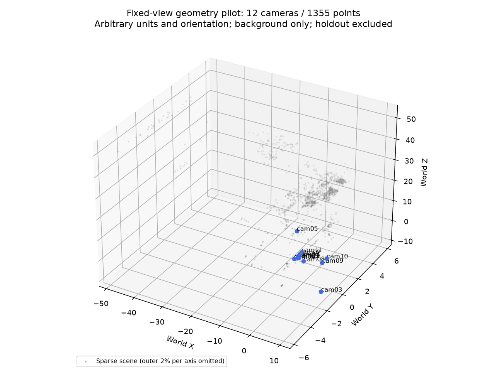

# Prueba de geometría con vistas fijas — 24 de noviembre de 2026

[English](fixed-geometry.en.md) · [Evidencia](../evidence/fixed-geometry-2026-11-24.json) · [Preparación de la captura](fixed-capture.es.md)

**Revisión posterior de la acción:** [visibilidad de la tabla entre 8,3 y 9,2 segundos](board-visibility.es.md), con intervalo candidato y selección preliminar de vistas para el siguiente experimento dinámico.

La nueva grabación con cámaras fijas permite una primera reconstrucción del fondo estático. De las 13 vistas candidatas distintas, cam13 se reservó antes de extraer y emparejar características. Las **12 vistas de entrenamiento** se registraron en un mismo modelo disperso: **1.355 puntos**, error medio de reproyección de **0,562 píxeles** y longitud media de trayectoria de **3,80 observaciones**. La extracción, el emparejamiento y la reconstrucción tardaron 11,36 segundos en CPU, sin contar la preparación de imágenes.



Esto estima las posiciones de cámara respecto a puntos compartidos del fondo. No es un skatepark denso ni una reconstrucción de la tabla en movimiento. La figura omite el 2% exterior de las coordenadas de puntos por eje para facilitar la lectura; el modelo local conserva todos los puntos.

Se utilizó una imagen por vista, en el segundo 5,3 del clip. Se recortó la interfaz inferior y se enmascararon zonas superiores del HUD. La tabla no se enmascaró explícitamente. Un modelo compartido SIMPLE_PINHOLE supone la misma lente/FOV en todas las vistas; la focal pasó de 2.040 a 846,60 píxeles durante la optimización, con el punto principal fijado en el centro de la imagen original. Son supuestos, no calibración suministrada por el juego. Los errores mediano/percentil 90 de los puntos del modelo seleccionado son 0,374/1,287 píxeles; la mediana del ángulo máximo de triangulación por punto es 23,19 grados. Son diagnósticos internos, no medidas independientes de precisión.

El programa también produjo una hipótesis de cinco imágenes con una focal poco plausible de 38.927 píxeles y emitió avisos numéricos del optimizador durante ese intento. No se seleccionó. El modelo presentado es la hipótesis con más vistas de entrenamiento registradas; falta comprobar su precisión física de forma independiente. cam13 no participó en la estimación geométrica y todavía no se ha localizado ni renderizado.

Reproducción con el entorno auxiliar Windows existente y FFmpeg:

```powershell
.\.venv\Scripts\python.exe scripts/probe_fixed_geometry.py
```

Los resultados locales están en `outputs/fixed-geometry-2026-11-24/`: imágenes, máscara, base/modelos COLMAP, `report.json`, `diagnostics.json` y `geometry.png`. Para repetir la prueba, elegir un `--output` nuevo. No se inició entrenamiento dinámico de True Skate.

El siguiente criterio es revisar la visibilidad de la tabla durante los clips, elegir una acción corta visible desde suficientes cámaras y comprobar la alineación de eventos. Después, localizar la vista reservada contra la geometría de entrenamiento y preparar una ejecución pequeña de 4DGS si se superan esas comprobaciones. Las cámaras fijas reducen el número de poses necesarias; no eliminan la calibración ni la sincronización temporal.
