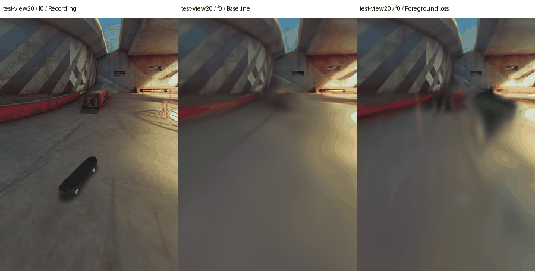
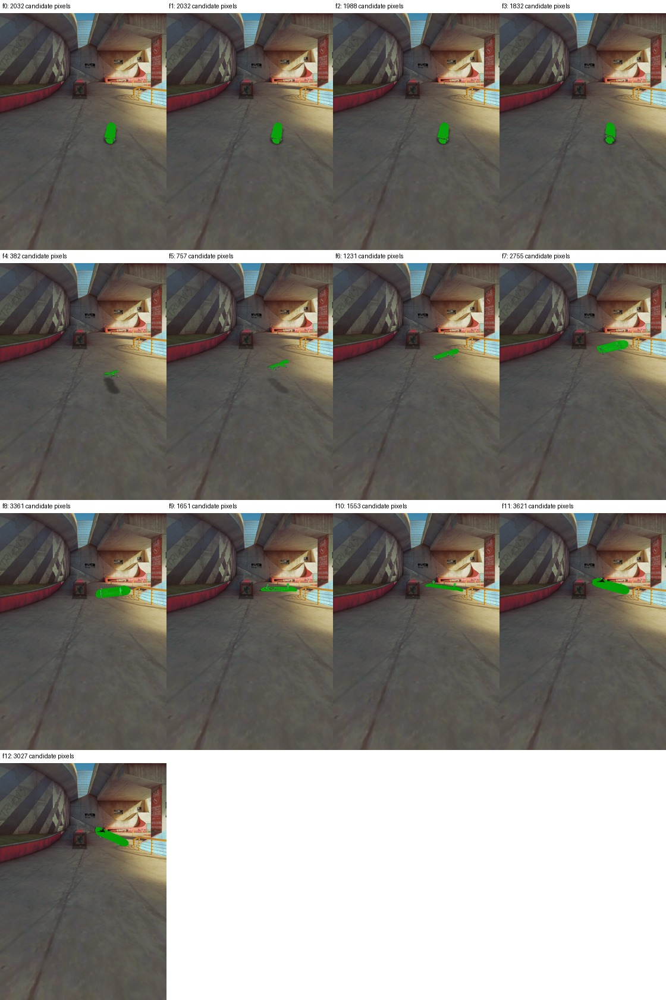
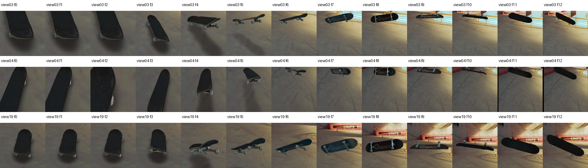

# Foreground-weighting control — 24 November 2026

[Español](foreground-trial.es.md) · [Previous baseline](clean-pilot.en.md)

**Result: the weighted model fits selected training pixels but produces a broad dark smear, not a recognizable skateboard.** This control does not validate a 4D board reconstruction. [Measured evidence](../evidence/foreground-trial-2026-11-24.json).



## Measured outcome

The RTX 4050 completed 200 coarse + 5,000 fine steps in **253.73 seconds** of training-program time, plus 17.79 seconds for the probe and 106.05 seconds for the two rendering stages. The weighted checkpoints contain 5,101 Gaussians versus 4,871 in the baseline; densification responds to the changed gradients.

| Metric at 5,000 fine steps | Baseline | Foreground weighting |
|---|---:|---:|
| view19 candidate foreground PSNR — training fit | 11.79 dB | 25.18 dB |
| view19 temporal-change union PSNR | 19.31 dB | 14.24 dB |
| view19 full-image PSNR | 28.20 dB | 27.69 dB |
| Reserved view20 full-image PSNR | 27.05 dB | 25.70 dB |
| Reserved view20 temporal-change union PSNR | 20.35 dB | 20.66 dB |

The selected mask pixels improve strongly, but the smear damages surrounding pixels. In view19's temporal-change union **outside each current-frame mask**, PSNR falls from **29.06 to 13.49 dB**. This region is a reference-derived diagnostic, not semantic background ground truth. The weighted frozen-time control scores 20.19 dB on training-mask pixels versus 25.18 dB at the requested times; temporal variation exists, but does not establish correct motion or geometry.

[Training comparison animation](../assets/foreground-trial-training.gif) · [Training stills](../assets/foreground-trial-training.jpg) · [Validation stills](../assets/foreground-trial-validation.jpg). Figures show lower-scene crops; metrics use their stated regions in the full images. GIFs play 13 samples at 250 ms each, approximately five times slower than the sampled action. All **52 evaluation target pairs** match between runs across two checkpoints and two views.

**Decision:** do not treat higher masked training PSNR as reconstruction success. Test the board at one fixed instant using several viewpoints, inspect multi-view masks and geometry, and assess object-specific initialization before returning to full motion. This experiment tests one weight in one training view; it does not rule out better balanced multi-view foreground losses. Residual synchronization and sparse background-only initialization remain hypotheses, not established causes.

## Question and controlled change

The previous model improved the background while missing the skateboard. In view19, candidate board pixels occupy only **0.294%** of the image on average. This experiment asks whether explicitly weighting those pixels helps, while keeping the same inputs and optimization budget.

The loss is **full-image mean absolute RGB error + candidate-foreground mean absolute RGB error** on masked view19 training images. Other training views retain the original full-image loss. The extra coefficient is 1.0; the foreground term averages over its selected pixels instead of the whole image. It applies in both coarse and fine stages. Sampling frequency, regularization and optimizer settings stay unchanged.

There are 13 masked images among 221 training images. The masks use the empty view18 reference and temporal variation in view19. They are approximate: thin board edges and wheels may be missed, and appearance changes/shadows are possible. They weight the error; they do not remove the background or add object geometry. **The reserved view20 supplies no training masks.**



## Synchronization review

All 18 views were reviewed at three phases; nearby views03, view04 and view19 were additionally compared at all 13 samples. Broad flip phases agree, but some orientation differences, especially view04, may reflect viewpoint or residual timing differences. No timing offset was changed for this control. This visual review does **not** establish frame-perfect synchronization.



Crops above are visualization aids, not calibration images or additional training masks. The dataset still uses the full 563 × 1218 images. All 234 targets, the 2,337-point initialization cloud, poses, intrinsics, time samples and split are unchanged from the baseline; file hashes were checked. The upstream implementation remains unmodified on disk; the local entry point instruments its single pinned L1 call in memory and refuses mismatched source structure.

## Reproduction

On the existing configured Windows/WSL GPU environment:

```powershell
.venv/Scripts/python.exe scripts/prepare_foreground_trial.py
.venv/Scripts/python.exe -u scripts/run_fixed_pilot.py --source data/processed/true-skate-foreground-pilot --output outputs/foreground-pilot/gpu --configs configs/experiments/true-skate-clean-pilot.py --checkpoints 2000 5000
.venv/Scripts/python.exe scripts/evaluate_clean_foreground.py --source data/processed/true-skate-foreground-pilot --run outputs/foreground-pilot/gpu --output outputs/foreground-pilot/foreground-evaluation.json
.venv/Scripts/python.exe scripts/compare_foreground_trial.py
```

Existing datasets/models are preserved: choose fresh, consistent destinations to repeat preparation/training. The comparison requires the previous baseline run and its foreground evaluation. Raw videos, prepared images and weights remain local and ignored by Git. Masked-region scores now measure **training fit**, because these masks guide optimization; reserved-view renders and visual inspection remain necessary. One run per setting cannot establish statistical robustness or physical board tracking.
