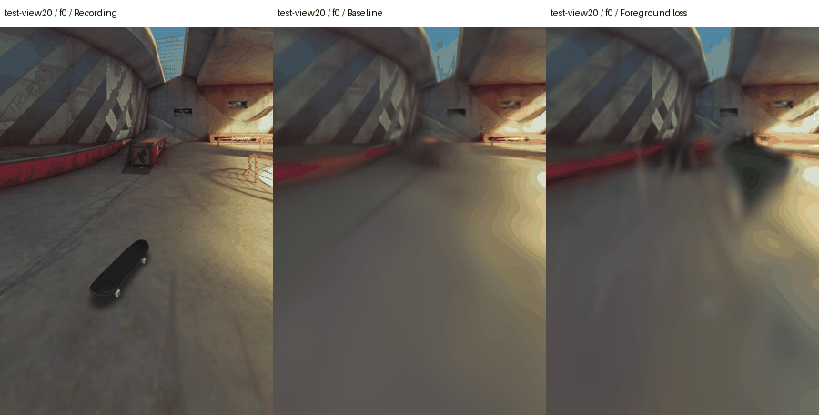
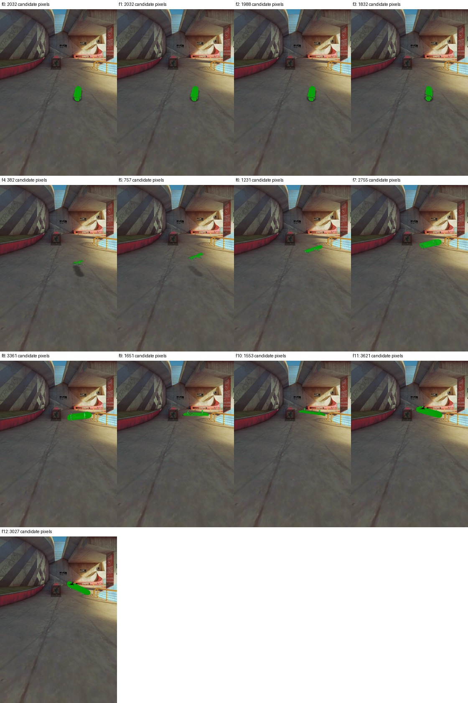
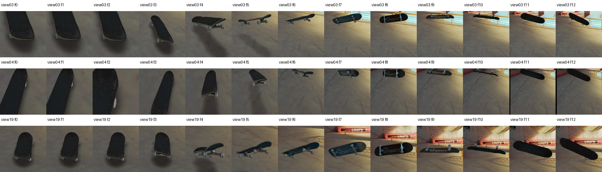

# Control de ponderación del primer plano — 24 de noviembre de 2026

[English](foreground-trial.en.md) · [Referencia anterior](clean-pilot.es.md)

**Resultado: el modelo ajusta los píxeles de entrenamiento seleccionados, pero genera una mancha oscura amplia; la tabla no es reconocible.** Este control no valida una reconstrucción 4D de la tabla. [Evidencia medida](../evidence/foreground-trial-2026-11-24.json).

## Resultado medido

La RTX 4050 completó 200 pasos gruesos + 5.000 finos en **253,73 segundos** del programa de entrenamiento, más 17,79 segundos de comprobación y 106,05 segundos de renderizado. Los checkpoints ponderados contienen 5.101 gaussianas frente a 4.871 en la referencia; la densificación responde a los gradientes modificados.

| Métrica a 5.000 pasos finos | Referencia | Ponderación del primer plano |
|---|---:|---:|
| PSNR del primer plano candidato view19 — ajuste de entrenamiento | 11,79 dB | 25,18 dB |
| PSNR de la unión de cambios temporales view19 | 19,31 dB | 14,24 dB |
| PSNR completo view19 | 28,20 dB | 27,69 dB |
| PSNR completo reservado view20 | 27,05 dB | 25,70 dB |
| PSNR de la unión de cambios temporales reservada view20 | 20,35 dB | 20,66 dB |

Los píxeles seleccionados mejoran mucho, pero la mancha degrada su entorno. En la unión de cambios temporales de view19 **fuera de la máscara de cada fotograma**, el PSNR cae de **29,06 a 13,49 dB**. Es un diagnóstico derivado de las referencias, no una etiqueta semántica del fondo. El control ponderado con tiempo congelado obtiene 20,19 dB en los píxeles de entrenamiento enmascarados frente a 25,18 dB en los instantes pedidos; hay variación temporal, sin demostrar movimiento o geometría correctos.

[Animación de entrenamiento](../assets/foreground-trial-training.gif) · [Comparación estática de entrenamiento](../assets/foreground-trial-training.jpg) · [Comparación estática de validación](../assets/foreground-trial-validation.jpg). Las figuras recortan la zona inferior; las métricas usan las regiones indicadas en las imágenes completas. Los GIF muestran 13 muestras a 250 ms, aproximadamente cinco veces más lento que la acción muestreada. Se verificaron **52 pares de referencias idénticos** entre ejecuciones, dos checkpoints y dos vistas.

**Decisión:** no interpretar el PSNR enmascarado de entrenamiento como éxito de reconstrucción. Probar la tabla en un instante fijo desde varios ángulos, revisar máscaras y geometría multivista y evaluar una inicialización específica del objeto antes de volver al movimiento completo. Esta prueba usa un peso en una sola vista de entrenamiento; no descarta pérdidas multivista mejor equilibradas. La sincronización residual y la inicialización exclusiva del fondo siguen siendo hipótesis, no causas demostradas.

## Pregunta y cambio controlado

El modelo anterior mejoraba el fondo sin reconstruir la tabla. En view19, los píxeles candidatos de la tabla ocupan en promedio solo **0,294%** de la imagen. Se prueba darles peso explícito, conservando entradas y presupuesto de optimización.

La pérdida es **error RGB absoluto medio de toda la imagen + error RGB absoluto medio del primer plano candidato** en las imágenes de entrenamiento enmascaradas de view19. Las otras vistas conservan la pérdida original. El coeficiente adicional es 1,0; el término de primer plano promedia únicamente sus píxeles seleccionados. Se aplica en las etapas gruesa y fina. Muestreo, regularización y optimizador no cambian.

Hay 13 imágenes enmascaradas entre 221 de entrenamiento. Las máscaras combinan el fondo vacío view18 con variación temporal en view19. Son aproximadas: pueden omitir bordes finos o ruedas e incluir cambios de apariencia/sombras. Ponderan el error; no eliminan el fondo ni añaden geometría del objeto. **La vista reservada view20 no aporta máscaras de entrenamiento.**

## Revisión de sincronización

Se revisaron tres fases en las 18 vistas y las 13 muestras completas de las vistas cercanas view03, view04 y view19. Las fases generales concuerdan, aunque algunas diferencias de orientación, especialmente en view04, pueden proceder del punto de vista o de desfases temporales. No se modificaron tiempos en este control. Esta revisión visual **no** demuestra sincronización exacta de cada fotograma.

Estos recortes sirven para inspección, no son imágenes de calibración ni máscaras adicionales. Se mantienen las imágenes completas de 563 × 1218. Las 234 referencias, la nube inicial de 2.337 puntos, poses, parámetros de cámara, instantes y partición son idénticos a la referencia; se comprobaron las huellas de archivos. La implementación original permanece intacta en disco: el ejecutor local modifica en memoria una única llamada L1 conocida y rechaza una estructura incompatible.

## Reproducción

La [secuencia de comandos](foreground-trial.en.md#reproduction) reutiliza el entorno Windows/WSL con GPU existente. Para repetir preparación/entrenamiento hay que elegir destinos nuevos y coherentes: se conservan los datos y modelos anteriores. La comparación requiere el experimento de referencia y su evaluación de primer plano. Vídeos originales, imágenes preparadas y pesos permanecen locales y excluidos de Git.

Las métricas enmascaradas ahora miden **ajuste de entrenamiento**, porque esas máscaras guían la optimización; siguen siendo necesarios los renders reservados y la inspección visual. Una ejecución por ajuste no demuestra robustez estadística ni seguimiento físico de la tabla.
