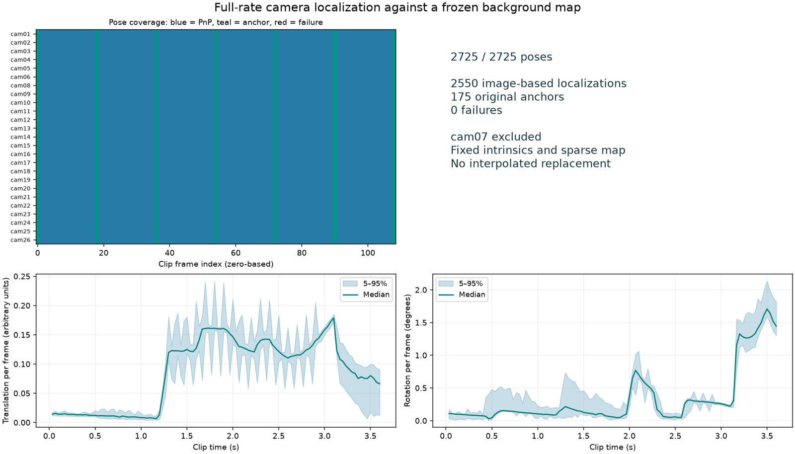

# Full-rate training-camera localization

[Español](fullrate.es.md) · Computer Vision — CVI 26-2 final project · 18 November 2026

## Measured result

**2725/2725 training frames now have accepted poses**: 175 original anchors plus 2550 new image-based localizations. The first pass accepted 2694 and explicitly rejected 31. Reviewed retry processing recovered all 31 with unchanged geometric thresholds. The average of per-frame mean inlier reprojection errors over the 2550 new estimates is **0.592 px**; its 95th percentile is **0.778 px**. This statistic differs from the sparse model's 0.473 px bundle-adjustment residual.

All original anchor matrices are preserved exactly, and the reference map/camera files match their fingerprints. No adjacent-frame change exceeds the review thresholds: maximum translation step is 0.283 arbitrary units and maximum rotation step is 2.506 degrees. **132 new estimates have fewer than 50 inliers** (minimum 30); these lower-support images merit targeted visual/intrinsics review even though they pass acceptance. Coverage is not a proof of ground-truth accuracy.

The successful main run took 431.7 s, plus 14.25 s of recorded retries; these timings exclude earlier stopped/startup attempts. `cam07` remains absent. [Machine-readable evidence](../evidence/fullrate-2026-11-18.json) retains the previous failure count and final checks.



## Estimation method

The sampled SfM experiment supplied seven poses for each of 25 training passages. This experiment targets all **25 × 109 = 2725 frames** while preserving the original background map, intrinsics and world coordinate frame. `cam07` remains excluded; localization of that held-out camera is a separate evaluation step.

The 175 original poses are inherited exactly. Each of the other 2550 images is decoded from the original video using its source-frame provenance, cropped identically, converted to grayscale for CPU SIFT and filtered with the same static-background mask. Descriptors are matched first against nearby temporal anchor images in the same passage. Their established 3D tracks supply 2D–3D correspondences. Conflicting point assignments and repeated 3D points are rejected. If support is insufficient, additional anchors and nearby passages are tried.

The main failure cause was insufficient static support around a dim ramp in cam11/cam12. Retrying increased the feature cap from 2048 to 8192, used native COLMAP grayscale, searched additional references by their known camera proximity, and tightened the conservative board/shadow rectangles. The score-overlay band is excluded only from index 97 onward: the independent event audit confirms the score is absent earlier, so masking it throughout had unnecessarily hidden useful static signage. The retry masks are saved separately and do not alter the reference map.

Thirty frames recovered directly with this change. For the last frame, cam11/frame_00046.png, validated 2D–3D inlier feature tracks from adjacent localized images were promoted as matching references. A new PnP solve then supplied that frame's own pose with 30 inliers. Neighboring **feature correspondences**, not neighboring pose interpolation, supplied additional support. The initial and final reports and pose files are retained separately.

PyCOLMAP estimates a camera pose using robust absolute-pose estimation (PnP/LO-RANSAC), then refines that pose with intrinsics fixed. Acceptance requires at least 30 inliers, inlier fraction ≥0.25, median reprojection error ≤2 px, mean error ≤3 px and positive depth for at least 95% of inlier points. The RANSAC error threshold is 4 px. These are geometric fit filters, not a guarantee of ground-truth pose accuracy. **No missing pose is replaced by temporal interpolation.**

The API is documented in the [official PyCOLMAP absolute-pose reference](https://colmap.github.io/pycolmap/pycolmap.html#pycolmap.estimate_and_refine_absolute_pose).

## Reproducibility and output

```powershell
.\.venv\Scripts\python.exe scripts/estimate_fullrate_poses.py --workers 4
.\.venv\Scripts\python.exe scripts/retry_fullrate_poses.py
.\.venv\Scripts\python.exe scripts/check_fullrate_poses.py outputs/replay-fullrate-poses
```

The destination must be new. `--resume` accepts the same configuration/source fingerprints and skips completed per-passage checkpoints. If the map, intrinsics, source, manifest, cuts or mask change, use a new destination. Each passage is saved atomically. The retry command also supports `--resume` for still-failed rows; it does not overwrite initial backups. A completed main run's resume preserves its timing and final retry results.

Outputs under ignored `outputs/replay-fullrate-poses/` include `poses.json`, `report.json`, `run-config.json`, `quality-checks.json`, per-passage JSON checkpoints and English/Spanish diagnostic figures. Pose records contain world-to-camera matrices, camera centers, frame/time/source indices, method and geometric support. Image paths are logical names: the frames were decoded in memory; this step does not materialize a full PNG training dataset. The sparse map and its original 8767 points are not retriangulated or updated.

The temporal audit checks frame coverage, rotation orthonormality, center conventions, exact anchor preservation and large adjacent-frame changes. Translation jumps >0.5 arbitrary world units or rotation jumps >10 degrees are flagged for review, not declared physically impossible. These heuristic checks do not establish metric scale, correct lens assumptions or exact simulation synchronization.

## Implementation lessons

- CPU SIFT rejected an RGB input bitmap despite the generic array wrapper accepting RGB; explicit grayscale conversion resolves this requirement.
- The first thread-based run used one CPU core effectively. It was intentionally stopped before its passage checkpoints completed and replaced by four independent processes.
- Simultaneous PyCOLMAP SQLite initialization caused a startup lock. Serializing only reference loading resolves it; independent image processing remains parallel. No reconstruction thresholds were weakened.

Attempt logs remain local as `outputs/fullrate-thread-attempt.log` and `outputs/fullrate-process-startup-attempt.log`; the active run log is `outputs/fullrate-localization.log`. The helper suite includes synthetic known-pose recovery with outliers, wrong-depth rejection, correspondence ambiguity and insufficient-support checks.

## Interpretation

Full image coverage is a camera-estimation milestone. It is not full dynamic scene reconstruction, a validated moving-camera 4DGS loader, or a held-out view score. Remaining work includes intrinsics sensitivity, difficult-frame visual review, official CUDA/4DGS reproduction and loader validation before training.
