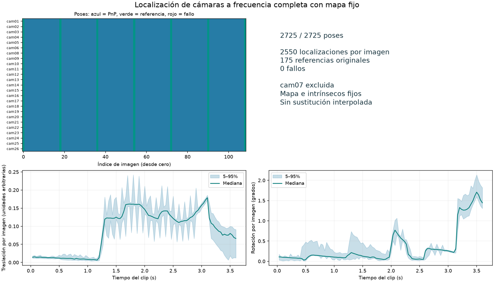

# Localización de cámaras a frecuencia completa

[English](fullrate.en.md) · Proyecto final de Computer Vision — CVI 26-2 · 18 de noviembre de 2026

## Resultado medido

**2725/2725 imágenes de entrenamiento tienen poses aceptadas**: 175 referencias originales y 2550 localizaciones nuevas. La primera pasada aceptó 2694 y rechazó explícitamente 31. La revisión recuperó las 31 sin relajar los umbrales geométricos. El promedio de los errores medios de reproyección de inliers por imagen es **0,592 px** en las nuevas poses; su percentil 95 es **0,778 px**. No es el mismo estadístico que el residuo de bundle adjustment de 0,473 px del modelo disperso.

Las matrices originales se conservan exactamente y los archivos del mapa/intrínsecos mantienen sus huellas. No hay saltos entre imágenes que superen los umbrales de revisión: máximo de traslación 0,283 unidades arbitrarias y de rotación 2,506 grados. **132 estimaciones tienen menos de 50 inliers** (mínimo 30); requieren revisión visual e intrínseca aunque superen los filtros. La cobertura no demuestra exactitud real.

La ejecución principal correcta tardó 431,7 s y los reintentos registrados 14,25 s; no se incluyen los intentos previos interrumpidos o fallidos al iniciar. `cam07` sigue ausente. La [evidencia estructurada](../evidence/fullrate-2026-11-18.json) conserva fallos iniciales y comprobaciones finales.



## Método de estimación

La prueba SfM aportó siete poses por cada uno de los 25 pasajes de entrenamiento. Este experimento busca cubrir **25 × 109 = 2725 imágenes**, conservando mapa del fondo, intrínsecos y sistema de referencia. `cam07` sigue excluida; localizar la vista reservada es otra etapa de evaluación.

Las 175 poses originales se conservan exactamente. Cada una de las otras 2550 imágenes se decodifica del vídeo original con sus índices de procedencia, recibe el mismo recorte, se convierte a gris para SIFT en CPU y se filtra con la misma máscara del fondo. Los descriptores se comparan primero con referencias temporales cercanas del mismo pasaje. Sus puntos 3D conocidos proporcionan correspondencias 2D–3D. Se excluyen asignaciones conflictivas y puntos 3D repetidos. Si falta soporte, se prueban otras referencias y pasajes próximos.

Los fallos se concentraron en una rampa oscura de cam11/cam12. El reintento aumentó el límite de características de 2048 a 8192, utilizó gris nativo de COLMAP, amplió referencias por proximidad de cámara y redujo los rectángulos conservadores de skate/sombra. La banda del marcador solo se excluye desde el índice 97: el control independiente confirma que antes no aparece y ocultaba innecesariamente carteles estáticos. Se conservan las máscaras nuevas sin modificar el mapa.

Treinta imágenes se recuperaron directamente. Para la última, cam11/frame_00046.png, se promovieron como referencias las correspondencias 2D–3D validadas de imágenes adyacentes ya localizadas. Un nuevo PnP estimó su propia pose con 30 inliers. Se utilizaron **correspondencias visuales vecinas**, no interpolación de poses. Se conservan por separado informes y poses iniciales y finales.

PyCOLMAP estima la pose absoluta con PnP/LO-RANSAC y la refina sin cambiar los intrínsecos. Se exigen al menos 30 inliers, fracción ≥0,25, error mediano ≤2 px, medio ≤3 px y profundidad positiva en al menos el 95% de los inliers. RANSAC usa un umbral de 4 px. Son filtros de ajuste geométrico, no una garantía de exactitud real. **No se sustituye una pose ausente por interpolación temporal.**

La API está documentada en la [referencia oficial de poses absolutas de PyCOLMAP](https://colmap.github.io/pycolmap/pycolmap.html#pycolmap.estimate_and_refine_absolute_pose).

## Reproducibilidad y salida

```powershell
.\.venv\Scripts\python.exe scripts/estimate_fullrate_poses.py --workers 4
.\.venv\Scripts\python.exe scripts/retry_fullrate_poses.py
.\.venv\Scripts\python.exe scripts/check_fullrate_poses.py outputs/replay-fullrate-poses
```

El destino debe ser nuevo. `--resume` exige las mismas huellas/configuración y omite pasajes completos. Si cambia el mapa, intrínsecos, fuente, manifiesto, cortes o máscara, utilizar otro destino. Cada pasaje se escribe de forma atómica. El reintento permite `--resume` para filas todavía fallidas sin sustituir las copias iniciales. Reanudar un cálculo completo conserva el tiempo registrado y los resultados de los reintentos.

En `outputs/replay-fullrate-poses/`, excluido de Git, se guardan poses, informe, configuración, controles, puntos de reanudación y figuras inglesas/españolas. Cada pose conserva matriz mundo-cámara, centro, índices de imagen/tiempo/origen, método y soporte geométrico. Las rutas de imagen son nombres lógicos: las imágenes se decodificaron en memoria; aquí no se genera todo el conjunto PNG de entrenamiento. El mapa y sus 8767 puntos no se retriangulan ni actualizan.

La auditoría comprueba cobertura, ortonormalidad, convención del centro, referencias intactas y cambios grandes entre imágenes. Traslaciones >0,5 unidades arbitrarias o rotaciones >10 grados se marcan para revisión, no como imposibilidades físicas. Estos controles no demuestran escala métrica, intrínsecos correctos ni sincronización exacta de simulación.

## Aprendizajes de implementación

- SIFT en CPU rechazó el bitmap RGB aunque el envoltorio genérico admite RGB; la conversión explícita a gris resuelve el requisito.
- La primera ejecución con hilos utilizaba efectivamente un núcleo. Se detuvo antes de completar sus pasajes y se sustituyó por cuatro procesos independientes.
- La inicialización SQLite simultánea de PyCOLMAP causó un bloqueo. Se serializó solo la carga de referencias; el cálculo de imágenes continúa en paralelo. No se relajaron umbrales.

Los intentos quedan en logs locales y la ejecución principal en `outputs/fullrate-localization.log`. Las pruebas incluyen recuperación de pose sintética con outliers, profundidad incorrecta, correspondencias ambiguas y soporte insuficiente.

## Interpretación

Cubrir todas las imágenes es un hito de cámaras, no una reconstrucción dinámica completa, un cargador 4DGS móvil validado ni una métrica reservada. Faltan sensibilidad intrínseca, revisión visual de imágenes difíciles, reproducción CUDA/4DGS oficial y validación del cargador antes del entrenamiento.
