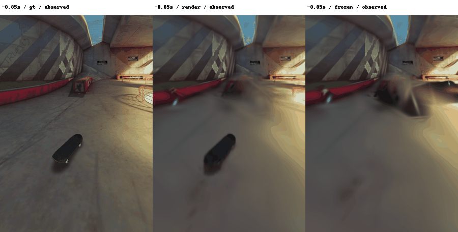
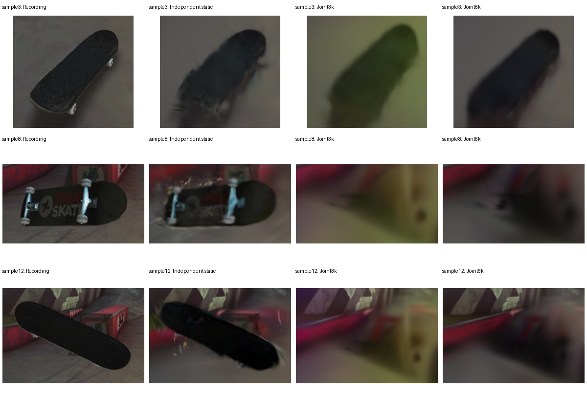

# One temporal model for three replay instants — 24 November 2026

Follow-up completed: [time-invariant background control](actor-only.en.md) reduces background variation but does not recover faithful board motion. This page preserves the preceding experiment.

[Español](joint-temporal.es.md) · [Previous independent static fits](multi-instant.en.md)

**One shared temporal model is trained, but a faithful reconstruction of the flip is not established.** Longer fitting improves observed images, while the middle board remains badly distorted and intermediate-time quality is barely better than frozen time. [Measured evidence](../evidence/joint-temporal-2026-11-24.json).



This animation shows ten requested timestamps from one checkpoint, including seven times excluded from its optimization targets. Frames are displayed at 250 ms each, approximately five times slower than capture timing. It is an actual temporal-model render, not the earlier sequence of independent static models.

## Results and decision

The initial 3,000-step pilot took **147.06 s** of training-program time. The separate 6,000-step duration run took **307.90 s**, excluding probes/rendering. Its 3,000 and 6,000 checkpoints both contain **10,079 Gaussians**. The table uses those **same-run checkpoints**; the original 3,000-step pilot follows a different optimization trajectory and is retained separately in the evidence.

| Validation view20 metric | 3,000 steps | 6,000 steps |
|---|---:|---:|
| Full-image PSNR, three observed times | 22.75 dB | 26.32 dB |
| Temporal-change union PSNR, observed times | 19.82 dB | 23.10 dB |
| Same region, frozen-time control, observed times | 17.54 dB | 19.33 dB |
| Temporal-change union PSNR, seven intermediate times | 19.71 dB | 20.52 dB |
| Same region, frozen-time control, intermediate times | 19.64 dB | 20.47 dB |

At 6,000 steps, approximate deck-envelope PSNR is **26.15 / 15.67 / 21.99 dB** at samples 3 /8 /12, versus **26.22 / 22.91 / 25.66 dB** from the independent static references. The middle board remains particularly poor. The static fits are a quality reference, not an equal-capacity causal ablation.



[Training-view comparison](../assets/joint-three-training.jpg) · [Training-view temporal animation](../assets/joint-three-training.gif). View19 also shows artifacts, so the problem extends beyond novel-view generalization.

The 6,000-step intermediate-time region score beats frozen time by only **0.05 dB**, while intermediate full-image SSIM is slightly worse (0.913 versus 0.915). This provides weak evidence for useful interpolation. Target-stable background interframe MAE in view20 rises from **0.00428 to 0.00569** between checkpoints, compared with **0.000381** in the targets. This pixel-variation proxy is not a semantic background mask, but it exposes unwanted scene changes that a full-image PSNR gain hides.

The spatial probe finds no near-plane crossing in its selected points for the two evaluated views/times. It is not an exhaustive visibility guarantee for all points/cameras. Initial canonical seeds pass the near-clip gate.

**Decision:** retain this as a measured first joint 4D attempt, not a successful flip or tracking result. Further duration alone is not justified by this control. Next tests should increase temporal supervision from the existing capture and constrain background motion, with separate evaluation of board appearance and stable-scene changes. Three sparse observations are a limitation, not a proven sole cause.

CPU helper verification: **53 Windows tests run, 44 passed, nine dependency skips**. The real GPU loader/deformation/render pipeline ran successfully; repeated checkpoint renders match saved images within one 8-bit level. **40 timeline targets** match original source pixels, **120 PNGs** decode, and frozen controls remain pixel-identical across timestamps. No training is currently running.

## Experiment

Three observed instants, nominally **−0.85 / −0.60 / −0.40 seconds** relative to scoring, are assembled into **one temporal scene**. Physical spacing maps to normalized times **0 / 0.5556 / 1**, not uniform indices. There are **42 RGB training images** from 14 fixed cameras and **three validation images** from reserved view20. Foreground L1 weighting of 0.1 applies to the 37 available training masks; tiny/uncertain masks remain omitted, with their RGB images retained.

Initialization uses the **untrained** 2,337 background + 3,000 silhouette-volume seeds from the first instant. No weights from the independent static fits initialize the temporal model. Scale 4, centered intrinsics, camera poses and coordinate system stay consistent across instants. Reserved pixels do not generate board seeds or training masks. The actual CUDA loader verifies projections and canonical board-seed depths; saved renders use the learned deformation branch.

The first pilot uses 200 coarse + 3,000 fine iterations. A duration-only control uses 200 coarse + 6,000 fine iterations and saves checkpoints at 3,000 and 6,000. Only the fine-iteration budget changes in the experiment configuration. The longer budget approximately matches the static fits' average optimization steps per image: 6,000/42 versus 2,000/14. That is an exposure comparison, not equal model complexity or proof of convergence.

## Evaluation protocol

Evaluation renders ten capture timestamps, samples 3 through 12, in validation view20 and training view19. Three timestamps were optimization targets; the other **seven intermediate target images were excluded from this model's optimization**. Wider capture images had already contributed to static camera/background/mask preparation, so these are not entirely untouched data throughout the pipeline. view20 has also been used repeatedly for validation.

At each timestamp, compare the requested-time render with the **same model frozen at the observed middle time 0.5556**. Both use the same viewpoint. Compare full images, the target temporal-change union, and approximate deck envelopes at the three observed times. The envelopes are the existing assistant-traced evaluation polygons, not owner labels or independent semantic ground truth. They never guide optimization.

A separate background diagnostic measures consecutive rendered changes in pixels that are comparatively stable in the targets. A spatial near-clip probe examines deformed points selected near the canonical board volume; that spatial crop is not a material identity or semantic segmentation. Repeated checkpoint renders must match earlier saved renders within one 8-bit level.

## Reproduction

```powershell
.venv/Scripts/python.exe scripts/prepare_joint_replay.py
.venv/Scripts/python.exe -u scripts/run_fixed_pilot.py --source data/processed/true-skate-joint-three --output outputs/joint-three/gpu --configs configs/experiments/true-skate-joint-three.py --checkpoints 3000
.venv/Scripts/python.exe -u scripts/run_fixed_pilot.py --source data/processed/true-skate-joint-three --output outputs/joint-three-duration/gpu --configs configs/experiments/true-skate-joint-three-duration.py --checkpoints 3000 6000
```

Use fresh destinations to repeat; existing source datasets and models are retained. `scripts/evaluate_joint_replay.py` runs in the installed WSL GPU Python with Linux paths. Evaluate both duration-run checkpoints into `outputs/joint-three-duration/timeline-3000` and `timeline-6000`, then run `scripts/review_joint_replay.py`. Raw inputs, prepared datasets and weights remain local and ignored by Git. Published animations are recorded model renders, not an interactive server hosted by GitHub.
