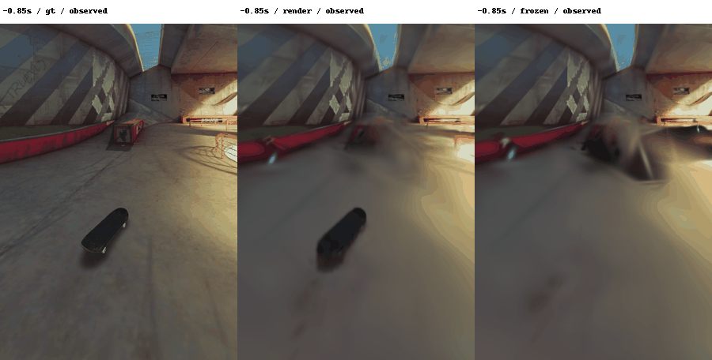
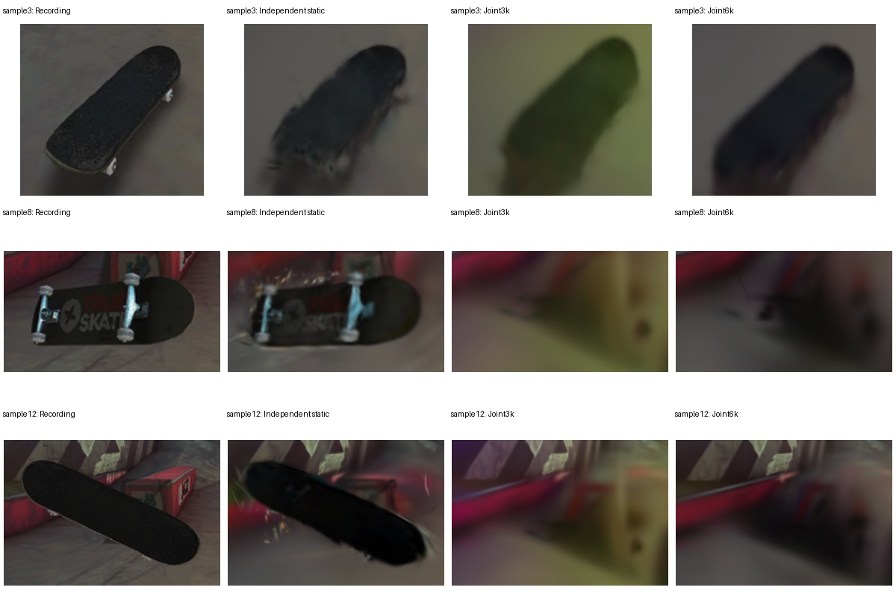

# Un modelo temporal para tres instantes del replay — 24 de noviembre de 2026

Prueba posterior completada: [control de fondo invariable en el tiempo](actor-only.es.md) reduce la variación del fondo, pero no recupera fielmente el movimiento de la tabla. Esta página conserva el experimento anterior.

[English](joint-temporal.en.md) · [Ajustes estáticos independientes anteriores](multi-instant.es.md)

**Se entrenó un modelo temporal compartido, pero no se demuestra una reconstrucción fiel del truco.** Más entrenamiento mejora las referencias observadas, mientras la tabla intermedia sigue deformada y los tiempos intermedios apenas superan al control congelado. [Evidencia medida](../evidence/joint-temporal-2026-11-24.json).

La animación muestra diez tiempos pedidos al mismo checkpoint, siete excluidos de sus referencias de optimización. Cada fotograma dura 250 ms, aproximadamente cinco veces más lento que la captura. Son renders de un modelo temporal, no la secuencia anterior de modelos estáticos independientes.

## Resultados y decisión

El piloto inicial de 3.000 pasos tardó **147,06 s** de entrenamiento. La ejecución separada de 6.000 tardó **307,90 s**, sin comprobaciones/renderizado. Sus checkpoints de 3.000 y 6.000 contienen **10.079 gaussianas**. La tabla compara checkpoints de **esa misma trayectoria**; el piloto original de 3.000 sigue otra trayectoria y queda separado en la evidencia.

| Métrica de validación view20 | 3.000 pasos | 6.000 pasos |
|---|---:|---:|
| PSNR completo, tres tiempos observados | 22,75 dB | 26,32 dB |
| PSNR en unión de cambios temporales, tiempos observados | 19,82 dB | 23,10 dB |
| Misma región y tiempos, control congelado | 17,54 dB | 19,33 dB |
| PSNR de esa unión, siete tiempos intermedios | 19,71 dB | 20,52 dB |
| Misma región intermedia, control congelado | 19,64 dB | 20,47 dB |

A 6.000 pasos, el PSNR aproximado del deck es **26,15 /15,67 /21,99 dB** en muestras 3 /8 /12, frente a **26,22 /22,91 /25,66 dB** de los modelos estáticos independientes. El instante central sigue siendo especialmente malo. Los modelos estáticos son referencia de calidad, no una comparación causal de igual capacidad.

[Comparación de entrenamiento](../assets/joint-three-training.jpg) · [Animación temporal de entrenamiento](../assets/joint-three-training.gif). view19 también muestra artefactos: no es solo generalización a una cámara nueva.

La mejora intermedia sobre tiempo congelado a 6.000 pasos es solo **0,05 dB** en esa región; SSIM completo es algo peor (0,913 frente a 0,915). La evidencia de interpolación útil es débil. El MAE entre fotogramas en píxeles estables de view20 sube de **0,00428 a 0,00569**, frente a **0,000381** de las referencias. No es una máscara semántica del fondo, pero expone cambios indeseados que oculta el PSNR completo.

La comprobación espacial no encuentra cruces del plano cercano entre sus puntos seleccionados en las dos vistas evaluadas. No garantiza visibilidad de todos los puntos/cámaras. Las semillas canónicas iniciales superan el control de recorte.

**Decisión:** conservarlo como primer intento 4D conjunto medido, no como truco reconstruido o seguimiento logrado. El control no justifica únicamente aumentar duración. Probar más tiempos supervisados de la captura existente y restringir movimiento del fondo, evaluando aparte tabla y estabilidad de escena. Tres observaciones dispersas son una limitación, no una causa única demostrada.

Windows: **53 pruebas ejecutadas, 44 superadas y nueve omitidas por dependencias**. La ejecución real GPU de carga/deformación/renderizado pasa; renders repetidos coinciden dentro de un nivel de 8 bits. **40 referencias temporales** coinciden con sus fuentes; se decodifican **120 PNG** y los controles congelados permanecen idénticos. No hay entrenamiento en curso.

## Experimento

Se reúnen tres instantes nominales, **−0,85 / −0,60 / −0,40 segundos** respecto a la puntuación, en **una sola escena temporal**. El espaciado físico se normaliza a **0 / 0,5556 / 1**, no a índices uniformes. Hay **42 imágenes RGB de entrenamiento**, 14 cámaras fijas y **tres imágenes de validación** de view20. Las 37 máscaras disponibles reciben un término L1 adicional de peso 0,1; se omiten máscaras pequeñas/inciertas, conservando sus imágenes RGB.

La inicialización utiliza **sin entrenar** 2.337 puntos del fondo y 3.000 semillas volumétricas de siluetas del primer instante. No se reutilizan pesos de los modelos estáticos. Escala 4, parámetros centrados, poses y coordenadas son coherentes entre instantes. La vista reservada no genera semillas de la tabla ni máscaras de entrenamiento. El cargador CUDA comprueba proyecciones y profundidad de semillas canónicas; los renders usan la rama de deformación aprendida.

El primer piloto ejecuta 200 pasos gruesos + 3.000 finos. Un control de duración ejecuta 200 + 6.000, guardando checkpoints a 3.000 y 6.000. Solo cambia el presupuesto fino de la configuración. El presupuesto largo aproxima las actualizaciones medias por imagen de las pruebas estáticas:6.000/42 frente a 2.000/14. No implica igual complejidad ni convergencia.

## Protocolo de evaluación

Se renderizan diez tiempos de captura, muestras 3–12, en view20 de validación y view19 de entrenamiento. Tres tiempos son referencias de optimización; las **siete referencias intermedias no se usan para optimizar este modelo**. Las capturas amplias sí contribuyeron previamente a cámaras/fondo/máscaras estáticos, así que no son datos totalmente intactos en toda la preparación. view20 también se ha usado repetidamente como validación.

En cada tiempo se compara el render pedido con **el mismo modelo congelado en el tiempo central observado 0,5556**, desde la misma cámara. Se evalúan imagen completa, unión de cambios temporales de las referencias y envolventes aproximadas del deck en los tres instantes observados. Estas últimas son los polígonos existentes trazados por el asistente, no etiquetas del responsable ni referencia semántica independiente; no guían la optimización.

Un diagnóstico mide cambios renderizados entre imágenes en píxeles relativamente estables de las referencias. Otra comprobación observa el recorte cercano de puntos deformados seleccionados espacialmente junto al volumen canónico; no son identidades materiales ni segmentación semántica. Repetir renders del checkpoint debe coincidir con los guardados dentro de un nivel de 8 bits.

## Reproducción

La [secuencia de comandos](joint-temporal.en.md#reproduction) reutiliza Windows/WSL existente. Elegir destinos nuevos al repetir; datos y modelos anteriores se conservan. `scripts/evaluate_joint_replay.py` usa Python GPU de WSL y rutas Linux: evaluar los checkpoints largos en `outputs/joint-three-duration/timeline-3000` y `timeline-6000`, después ejecutar `scripts/review_joint_replay.py`.

Vídeos, conjuntos preparados y pesos permanecen locales y excluidos de Git. Las animaciones publicadas son renders grabados; GitHub no aloja un servidor interactivo del modelo.
