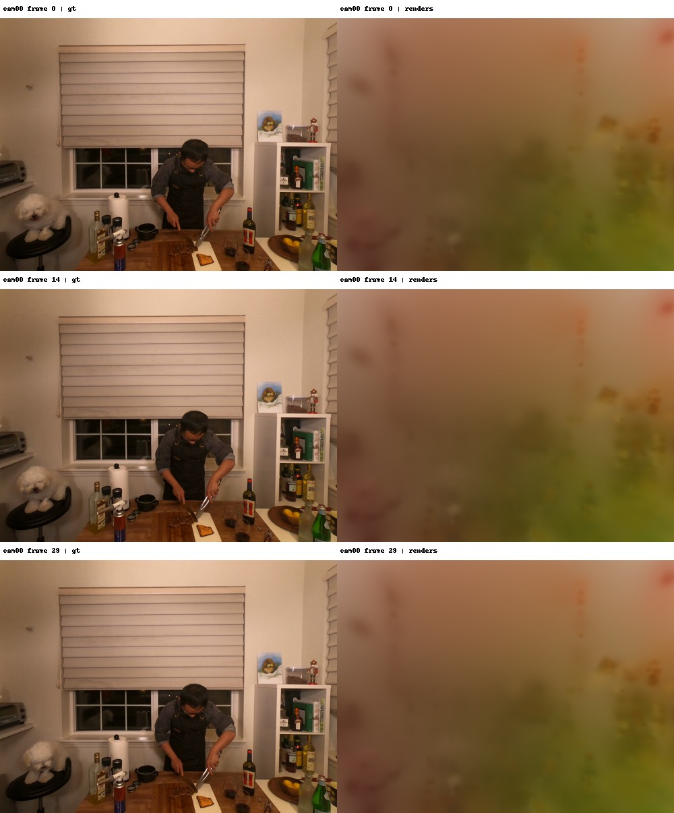

# Local GPU execution — 20 November 2026

[Español](local-gpu.es.md)

## Verified result after the owner's terminal run

**GPU execution passed.** Run `dynerf-local-20261120-234731Z` completed on 20 November (Bogotá). Python dependencies and both CUDA extensions work; the actual loader verified 120 training and 30 test samples, excluding cam00 from training. Two coarse plus ten fine steps saved the point cloud and deformation model. All 30 held-out render/target PNG pairs exist at 1352 × 1014. Training-program elapsed time: **25.52 s**; render-program elapsed time: **17.09 s**, including loading/writing. These are not pure kernel timings or estimates for a converged run. [Measured checkpoint](../evidence/local-gpu-2026-11-20.json).



Visual review: renders are very blurred. This establishes installation/loading/optimization/save/reload/render execution, not useful reconstruction or motion accuracy. The input still contains four optimization cameras and the first second only; initialization remains the sparse training-only map. This is not a full-scene reproduction. Original target imagery and derived renders: Neural 3D Video Synthesis (Li et al., CVPR 2022), [source](https://github.com/facebookresearch/Neural_3D_Video), CC-BY-NC-4.0; the figure adds labels and resizes images.

Before a longer quality experiment, review distant initialization points and deformation bounds: depth 99th percentile is 20.71 scene units, while the maximum is 319.07. This is a diagnostic, not proof of erroneous points or the cause of blur. No points have been removed. Then define a longer optimization budget with unchanged holdout, enable appropriate densification, and evaluate quality. No longer training was launched.

## Earlier setup checkpoint and launcher

Colab did not work for the owner (the error was not supplied). The owner selected the local RTX 4050 instead. Initially WSL existed without a Linux distribution. Ubuntu 22.04 was installed in WSL2; the Windows NVIDIA driver was retained. CUDA 12.1 compiler/header packages and Python 3.10 were installed inside Linux. A native CUDA kernel compiled for sm_89 returned the expected checksum (285), and PyTorch 2.1.2-cu121 detected the RTX 4050.

At the earlier setup checkpoint, 4DGaussians training had not started. The owner then used the foreground launcher below to complete those stages, producing the verified result above. NumPy 1.26.4 resolved the temporary NumPy 2 incompatibility. This is a compatibility port, not the original upstream environment.

From a PowerShell terminal in the repository:

```powershell
powershell -NoProfile -ExecutionPolicy Bypass -File .\scripts\Start-LocalGPU.ps1
```

This changes execution policy only for that child PowerShell process. The launcher resumes setup, reuses an installed PyTorch or completed installer where available, builds extensions, verifies the actual loader, and runs 2 coarse + 10 fine steps followed by 30 held-out renders. It streams logs and displays elapsed time every 15 seconds, with approximate duration ranges rather than a promised completion time. It prevents two launcher instances. On failure it stops and names the log. `-CheckOnly` verifies WSL, compiler/GPU access and launcher paths without starting setup/training; this check passed locally.

The reduced input already exists: cam01, cam05, cam12 and cam20 train; cam00 is held out; source frames 0–29 at 1352 × 1014, preserving original time `index / 300`. The initialization uses the previous 3,390-point training-only sparse map. Original videos are hard-linked, avoiding duplicate storage. Source stays under `/root/skate4d/project` for compilation; data and results remain in the Windows repository.

Each launch writes a new `outputs/dynerf-local-<UTC timestamp>/` directory. `setup.log` and `execution.log` capture installation/execution. A successful run will additionally produce `report.json`, `comparison.jpg` and detailed stage logs. These artifacts do not exist until those stages succeed. Twelve steps test execution, not convergence or useful reconstruction quality.

Helper syntax, live-output streaming, nonzero-exit handling, timeout handling and the check-only launcher were verified. The bounded GPU sequence has now also passed. The script runs in the user's terminal rather than leaving a long installation dependent on an assistant tool session.
