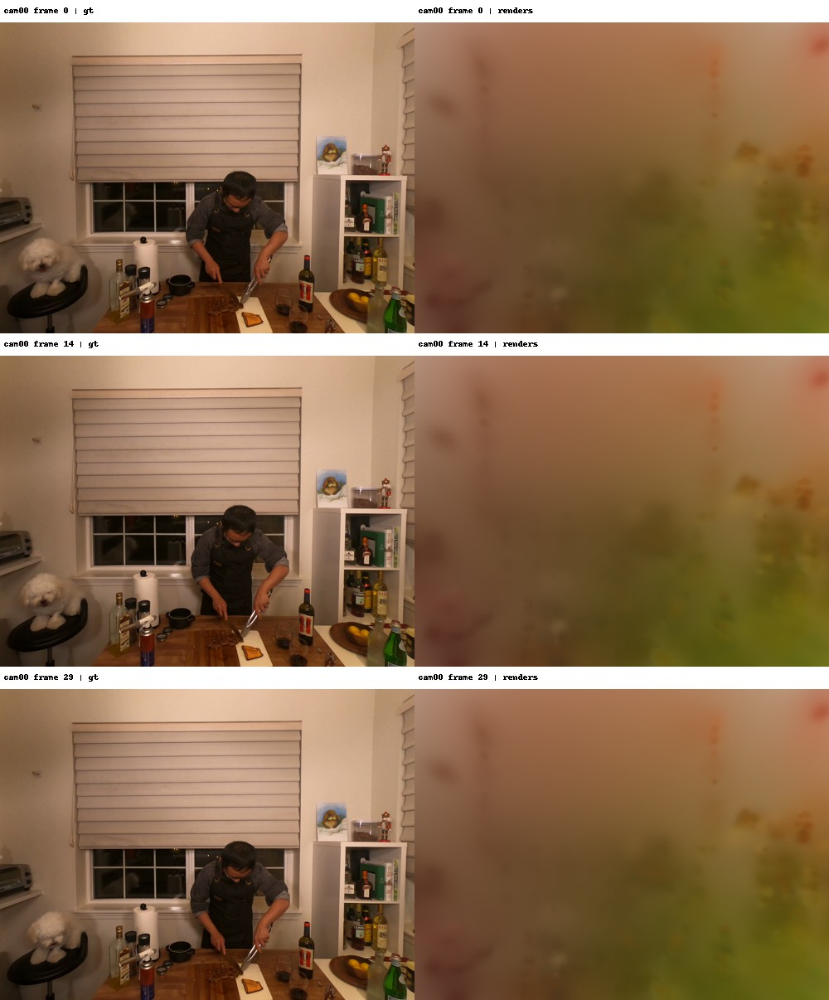

# Ejecución GPU local — 20 de noviembre de 2026

[English](local-gpu.en.md)

## Resultado verificado tras la ejecución del responsable

**Prueba de ejecución GPU superada.** `dynerf-local-20261120-234731Z`, 20 de noviembre (Bogotá): dependencias y ambas extensiones CUDA funcionan; cargador verificado con 120 muestras de entrenamiento y 30 de prueba, sin cam00 en entrenamiento. Dos pasos coarse y diez fine guardaron nube y deformación. Existen los 30 pares PNG render/objetivo a 1352 × 1014. Tiempo del programa de entrenamiento: **25,52 s**; renderizado: **17,09 s**, incluyendo carga/escritura. No son tiempos puros de kernel ni estimaciones de convergencia. [Evidencias](../evidence/local-gpu-2026-11-20.json).



Revisión visual: renders muy borrosos. Se verifica instalación/carga/optimización/guardado/recarga/renderizado, no reconstrucción útil ni exactitud del movimiento. Cuatro cámaras de optimización, primer segundo e inicialización dispersa: no es reproducción de la escena completa. Imágenes objetivo y renders derivados: Neural 3D Video Synthesis (Li et al., CVPR 2022), [fuente](https://github.com/facebookresearch/Neural_3D_Video), CC-BY-NC-4.0. La figura añade etiquetas y reduce tamaño.

Antes de entrenar más, revisar puntos muy lejanos y límites de deformación: percentil 99 de profundidad 20,71 unidades, máximo 319,07. No demuestra puntos erróneos ni explica por sí solo el desenfoque. No se eliminaron puntos. Después definir presupuesto más largo, densificación y evaluación con la misma cámara reservada. No se lanzó otro entrenamiento.

## Preparación anterior y lanzador

Colab no funcionó para el responsable (no se aportó el error). Se eligió la RTX 4050 local. WSL estaba instalado sin distribución Linux. Se instaló Ubuntu 22.04 en WSL2, conservando el controlador NVIDIA de Windows. Compilador/cabeceras CUDA 12.1 y Python 3.10 instalados en Linux. Un kernel CUDA compilado para sm_89 devolvió el resultado esperado (285); PyTorch 2.1.2-cu121 detectó la RTX 4050.

En el corte anterior aún no había entrenamiento. El responsable ejecutó después el lanzador y completó las etapas indicadas arriba. NumPy 1.26.4 resolvió la incompatibilidad temporal. Entorno de compatibilidad diferente del original.

Desde PowerShell en el repositorio:

```powershell
powershell -NoProfile -ExecutionPolicy Bypass -File .\scripts\Start-LocalGPU.ps1
```

La política de ejecución se modifica solo para ese proceso hijo. El lanzador retoma la instalación, reutiliza PyTorch o el instalador completo si están disponibles, compila extensiones, comprueba el cargador y ejecuta 2 pasos coarse + 10 fine, seguidos de 30 renders reservados. Muestra registros y tiempo transcurrido cada 15 segundos. Las estimaciones son aproximadas. Impide dos lanzamientos simultáneos y se detiene ante errores indicando el registro. La opción `-CheckOnly`, probada localmente, verifica WSL/compilador/GPU/rutas sin instalar ni entrenar.

Entrada reducida preparada: entrenar con cam01, cam05, cam12 y cam20; reservar cam00. Fotogramas 0–29 a 1352 × 1014, conservando tiempo `índice / 300`. Inicialización dispersa previa de 3.390 puntos, sin cam00. Vídeos enlazados sin duplicar almacenamiento. Código en `/root/skate4d/project` para compilar; datos/resultados en el repositorio Windows.

Cada ejecución escribe `outputs/dynerf-local-<fecha UTC>/`, con `setup.log` y `execution.log`. Solo tras éxito se producirán `report.json`, `comparison.jpg` y registros detallados. Doce pasos comprueban ejecución, no convergencia ni calidad útil.

Se comprobaron sintaxis, salida en directo, propagación de errores, tiempo límite y lanzador de solo verificación. La secuencia GPU limitada también se completó. El terminal del usuario mantiene el proceso sin depender de una sesión de herramientas del asistente.
