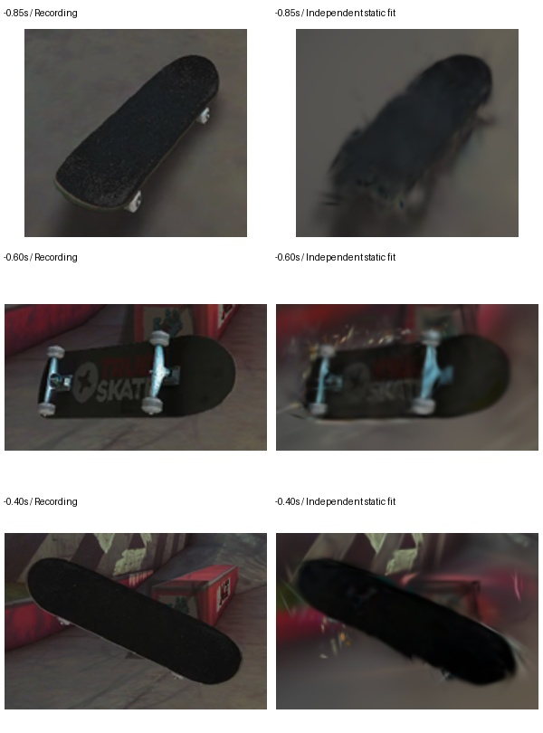
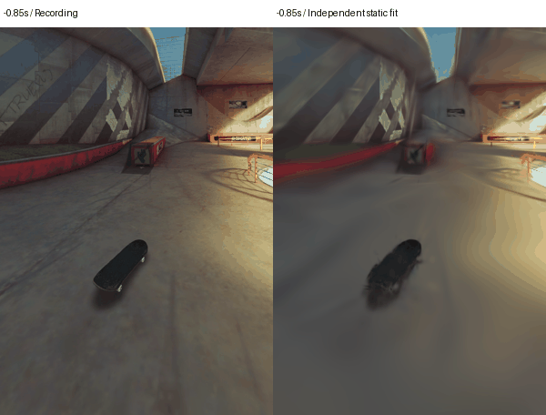

# Three static instants before joint 4D fitting — 24 November 2026

[Español](multi-instant.es.md) · [Measured evidence](../evidence/multi-instant-2026-11-24.json) · [Near-clip correction](near-clip-fix.en.md)

**The board remains recognizable in the repeated validation view at three instants of the flip.** Two new independent static fits extend the earlier successful instant. Blur, distorted edges and floating artifacts remain. This establishes a broader static feasibility check, not a shared 4D representation.



[Training view19 comparison](../assets/multi-instant-training.jpg) · [Larger validation scene crops](../assets/multi-instant-validation-scene.jpg).

## Fixed protocol and measured results

The new samples were selected before evaluating their model renders: sample3 at **−0.85 s** and sample12 at **−0.40 s** relative to the score event. The existing sample8 at **−0.60 s** provides the middle checkpoint. These are nominal capture times; frame-perfect simulation synchronization is not established. Their span is **0.45 seconds**.

Every fit uses the same 14 training cameras, one validation camera (view20), full **563 × 1218** images, 2,337 observed background points, static undeformed rendering, and the same 200 coarse + 2,000 fine iteration configuration. The safe world-scale factor is **4** in all three datasets. Initial board-seed visibility and actual camera projections pass the GPU gates.

| Sample / nominal time | Board seed points | Weighted training masks | Validation full-image PSNR | Approximate validation deck PSNR |
|---|---:|---:|---:|---:|
| 3 / −0.85 s | 3,000 | 11 | 28.27 dB | 26.22 dB |
| 8 / −0.60 s | 3,000 | 13 | 28.92 dB | 22.91 dB |
| 12 / −0.40 s | 1,062 | 13 | 29.91 dB | 25.66 dB |

The two new training programs took **73.17 s** and **71.53 s**, excluding preparation, probes and rendering. Final Gaussian counts are 9,561 / 13,171 / 9,079 for samples3 /8 /12. These are separate fits with different initial silhouette volumes and appearance difficulty; differences between their scores are not a controlled effect of time alone.

## Small-mask handling and geometry

The first sample3 preparation rejected an insufficient mask in a distant training view. An explicit, opt-in policy now keeps RGB training images but omits masks of **20 pixels or fewer** from silhouette carving and foreground-weighted loss. At sample3 this affects view13 and view14. Their candidate-region scores are **unavailable (`null`)**, not zero or NaN. view11 remains RGB-only for weighted loss at all three instants, as before. Thus sample3 keeps all 14 RGB views but uses 11 carving/loss masks. The validation view never selects the usable training-mask set.

The strict training-silhouette intersections contain **4,457 / 6,051 / 1,062 voxels** at samples3 /8 /12. Initialization samples at most 3,000 voxels per instant and retains the same observed background points. These board seeds remain **synthetic volume hypotheses**, not measured surface points. Views07/08/09 stay excluded from optimization; their earlier inconsistencies are unresolved, and they still contributed to the inherited background map.

Candidate masks are imperfect, particularly on dark decks and partially hidden views. For a more consistent object comparison, approximate deck envelopes were visually traced for evaluation only in views19 and20. They exclude protruding wheels/shadows and may be inaccurate. They were not used for initialization, training or calibration. The analysis is exploratory and unblinded; these are not owner annotations or independent semantic ground truth. [New annotations](../../data/annotations/multi-instant-deck-2026-11-24.json) · [Existing sample8 annotations](../../data/annotations/static-deck-2026-11-24.json).

## Interpretation and next experiment



The GIF displays **three independent reconstructions**, each held for 800 ms, with no intermediate frames. It does not demonstrate interpolation or real-time motion reconstruction. There is no persistent Gaussian identity across these models and no rotation or physical tracking measurement. view20 is repeatedly used validation, not a fresh untouched test. The reserved camera remains outside model optimization and board initialization.

The next bounded experiment should combine these instants in **one temporal model** with the same safe scale, stable cameras and training masks. Initialize from a documented canonical instant, encode the real sample spacing, and evaluate the same validation images plus a frozen-time control. Success requires a recognizable board at all three times in that one model; plausible in-between renders would require additional evaluation rather than being assumed from this snapshot display.

## Reproduction and checks

Use fresh output paths: existing data and models are preserved. For sample3:

```powershell
.venv/Scripts/python.exe scripts/static_board_geometry.py --sample 3 --output outputs/multi-instant/sample03-geometry-v2 --exclude-views view07 view08 view09 --skip-carving-views view11 --skip-small-masks
.venv/Scripts/python.exe scripts/prepare_static_board_trial.py --geometry outputs/multi-instant/sample03-geometry-v2 --output data/processed/true-skate-static-sample03
.venv/Scripts/python.exe scripts/prepare_safe_static_scale.py --source data/processed/true-skate-static-sample03 --output data/processed/true-skate-static-sample03-safe
.venv/Scripts/python.exe -u scripts/run_fixed_pilot.py --source data/processed/true-skate-static-sample03-safe --output outputs/multi-instant/sample03-gpu --configs configs/experiments/true-skate-static-board.py --checkpoints 2000
```

Repeat for sample12 with its corresponding fresh paths; it does not require small-mask filtering. `scripts/review_multi_instant.py` assembles the three completed fits and checks equal configurations/camera sets and **45 exact source/target pairs**. It exports valid JSON with unavailable regions explicitly marked. Prepared datasets, raw footage and model weights remain local and ignored by Git.

Windows verification: **50 tests run, 41 passed, nine dependency skips**. The three new region-evaluation tests pass in the WSL Torch environment, including empty/tiny-mask handling and known masked error. Actual GPU loading, projection, near-clip and rendering checks pass for both new fits.
