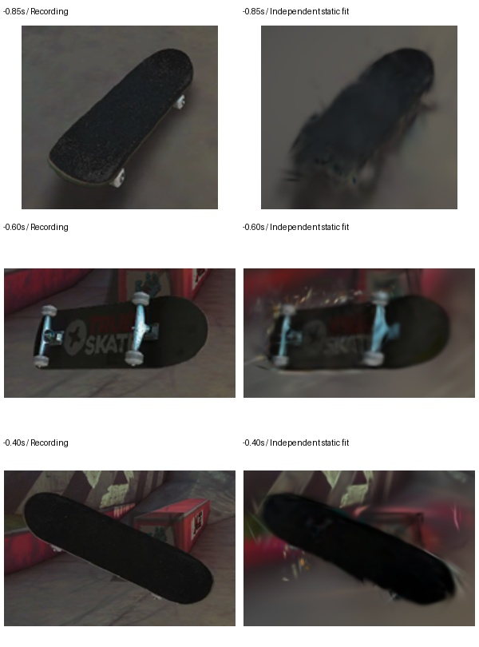
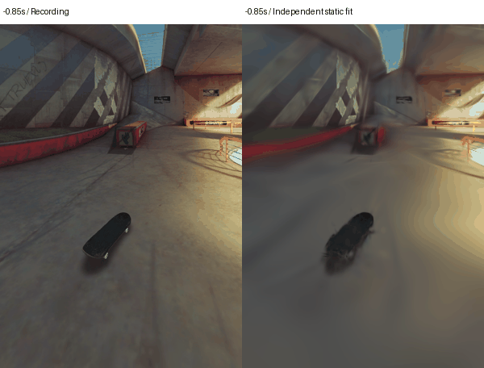

# Tres instantes estáticos antes del ajuste 4D conjunto — 24 de noviembre de 2026

[English](multi-instant.en.md) · [Evidencia medida](../evidence/multi-instant-2026-11-24.json) · [Corrección del recorte cercano](near-clip-fix.es.md)

**La tabla sigue siendo reconocible en la vista de validación en tres instantes del truco.** Dos ajustes estáticos independientes amplían el instante anterior. Persisten desenfoque, bordes deformados y artefactos flotantes. Es una comprobación estática más amplia, no una representación 4D compartida.

[Comparación de entrenamiento view19](../assets/multi-instant-training.jpg) · [Recortes amplios de validación](../assets/multi-instant-validation-scene.jpg).

## Protocolo y resultados medidos

Las muestras nuevas se eligieron antes de evaluar sus renders: muestra3 a **−0,85 s** y muestra12 a **−0,40 s** respecto a la puntuación. La muestra8 existente a **−0,60 s** es el corte intermedio. Son tiempos nominales de captura; no se demuestra sincronización exacta de la simulación. Cubren **0,45 segundos**.

Cada ajuste utiliza las mismas 14 cámaras de entrenamiento, una de validación (view20), imágenes completas de **563 × 1218**, 2.337 puntos observados del fondo, renderizado estático sin deformación y la misma configuración de 200 pasos gruesos + 2.000 finos. La escala segura es **4** en los tres conjuntos. Las semillas y proyecciones reales superan las comprobaciones GPU.

| Muestra / tiempo nominal | Semillas de la tabla | Máscaras ponderadas de entrenamiento | PSNR completo de validación | PSNR aproximado del deck reservado |
|---|---:|---:|---:|---:|
| 3 / −0,85 s | 3.000 | 11 | 28,27 dB | 26,22 dB |
| 8 / −0,60 s | 3.000 | 13 | 28,92 dB | 22,91 dB |
| 12 / −0,40 s | 1.062 | 13 | 29,91 dB | 25,66 dB |

Los dos programas nuevos de entrenamiento tardaron **73,17 s** y **71,53 s**, sin preparación, comprobaciones ni renderizado. Las gaussianas finales son 9.561 / 13.171 / 9.079 para muestras3 /8 /12. Cambian volumen inicial y dificultad de apariencia entre instantes; las diferencias de métricas no aíslan el efecto del tiempo.

## Máscaras pequeñas y geometría

La primera preparación de muestra3 rechazó una máscara insuficiente de una vista lejana. Una opción explícita conserva las imágenes RGB pero omite máscaras de **20 píxeles o menos** del volumen y de la pérdida ponderada. En muestra3 afecta a view13 y view14. Sus métricas candidatas quedan **no disponibles (`null`)**, no cero ni NaN. view11 sigue usando solo pérdida RGB completa en los tres instantes. Así, muestra3 conserva 14 vistas RGB y 11 máscaras para volumen/pérdida. La vista reservada no decide qué máscaras de entrenamiento se aceptan.

Las intersecciones estrictas contienen **4.457 / 6.051 / 1.062 vóxeles** en muestras3 /8 /12. Se muestrean como máximo 3.000 por instante y se mantienen los puntos observados del fondo. Las semillas de la tabla siguen siendo **hipótesis volumétricas sintéticas**, no puntos de superficie medidos. view07/view08/view09 permanecen fuera de optimización; sus incoherencias siguen sin resolverse y contribuyeron al mapa del fondo heredado.

Las máscaras candidatas son imperfectas, especialmente sobre decks oscuros o parcialmente ocultos. Se trazaron envolventes aproximadas del deck en view19/view20 para evaluar, excluyendo ruedas sobresalientes/sombras. No se usaron para inicializar, entrenar ni calibrar. Son anotaciones del asistente, exploratorias y no ciegas a resultados; no son anotaciones del responsable ni etiquetas semánticas independientes. [Anotaciones nuevas](../../data/annotations/multi-instant-deck-2026-11-24.json) · [Anotaciones de muestra8](../../data/annotations/static-deck-2026-11-24.json).

## Interpretación y siguiente experimento

El GIF muestra **tres reconstrucciones independientes**, durante 800 ms cada una, sin fotogramas intermedios. No demuestra interpolación ni movimiento reconstruido en tiempo real. No hay identidad persistente de gaussianas entre modelos ni medición de rotación o seguimiento físico. view20 es validación repetida, no una prueba nueva intacta. Sigue excluida de optimización e inicialización de la tabla.

El siguiente experimento limitado debe reunir estos instantes en **un modelo temporal único**, manteniendo escala segura, cámaras y máscaras. Inicializar desde un instante canónico documentado, codificar el espaciado temporal real y evaluar estas referencias más un control con tiempo congelado. El criterio de éxito es una tabla reconocible en los tres tiempos del mismo modelo; los instantes intermedios necesitan evaluación adicional.

## Reproducción y verificaciones

La [secuencia de comandos](multi-instant.en.md#reproduction-and-checks) reutiliza Windows/WSL GPU y conserva salidas existentes: elegir destinos nuevos al repetir. Repetir para muestra12 con sus rutas correspondientes; no requiere filtrar máscaras pequeñas. `scripts/review_multi_instant.py` reúne los resultados y comprueba igual configuración/cámaras y **45 pares de referencias idénticos**. Exporta JSON válido con regiones no disponibles explícitas. Vídeos, conjuntos preparados y pesos permanecen locales y excluidos de Git.

Windows: **50 pruebas ejecutadas, 41 superadas y nueve omitidas por dependencias**. Las tres pruebas nuevas de regiones pasan en WSL con Torch, incluyendo máscaras vacías/pequeñas y error conocido. Ambos ajustes nuevos superan comprobaciones reales GPU de carga, proyección, recorte cercano y renderizado.
