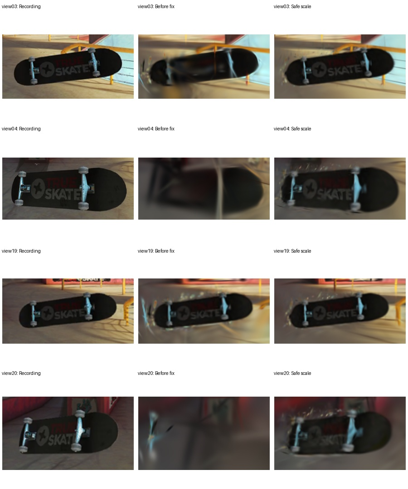
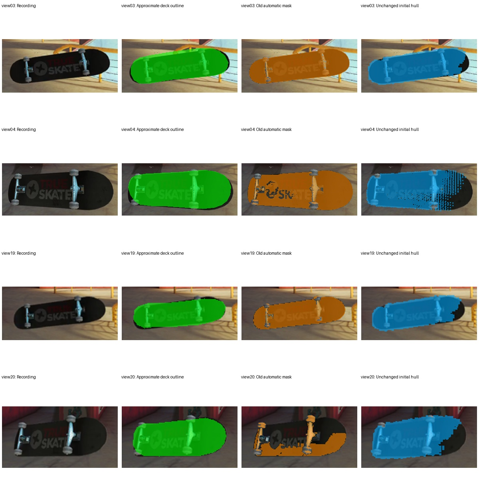

# Board disappearance: normalization and near-clip fix — 24 November 2026

[Español](near-clip-fix.es.md) · [Measured evidence](../evidence/near-clip-fix-2026-11-24.json) · [Earlier static experiment](static-board.en.md)

**The board is now recognizable in validation view20 after a corrected static training run.** The main confirmed fault was an integration error: our world normalization put board seeds inside the CUDA rasterizer's fixed near cutoff. This revises the interpretation of the earlier failed static trial. It remains one instant, a restricted 14-view training set and one repeatedly inspected validation camera.



[Scene-scale comparison](../assets/near-clip-scene.jpg). These enlarged crops show the same nominal instant, not reconstructed motion.

## Checks that changed the diagnosis

The background in view20 is stable between calibration imagery and the selected frame: median SIFT displacement **0.062 px** at working resolution. On 168 background correspondences withheld from a conditional pose refit, the original pose has **0.302 px** median reprojection error. Refitting pose or pose plus focal length does not improve that median, and shifts the initial board-volume projection by only **0.34–0.37 px**. This is consistency against the existing map, not surveyed calibration truth; no camera modification was accepted.

The old view20 automatic mask covers only **39%** of an approximate, visually traced deck envelope. Against that envelope, the unchanged initial volume's overlap is **0.758**, versus **0.255** against the fragmented automatic mask. A two-pixel annotation sensitivity check gives 0.702–0.778. These polygons were traced by the assistant for evaluation, not by the owner; they approximate the deck envelope and exclude protruding wheels. They are not independent semantic ground truth and were **not used for training, seed generation or camera fitting**. [Annotations](../../data/annotations/static-deck-2026-11-24.json).



Render-only checks then showed that the initial board seeds themselves were almost invisible from view20, despite correct 2D projection. The [pinned CUDA source](https://github.com/ingra14m/depth-diff-gaussian-rasterization/blob/e49506654e8e11ed8a62d22bcb693e943fdecacf/cuda_rasterizer/auxiliary.h#L154) rejects points with camera-space `z <= 0.2`. The [Python Camera](https://github.com/hustvl/4DGaussians/blob/843d5ac636c37e4b611242287754f3d4ed150144/scene/cameras.py) uses `znear = 0.01`; our projection-only checks missed the CUDA cutoff.

At the old world scale, **99.93% of the 3,000 initial board seeds** lie behind that cutoff in view20; all are clipped in training views04 and06. This is not evidence that those board surfaces were impossible to reconstruct.

## Correction and controlled rendering

The safe dataset scales world points and camera translations uniformly by **4**, preserving rotations, intrinsics, images and masks. The maximum computed pinhole projection change is **0 pixels**. The factor is selected from the minimum **training** seed depth, targeting at least 0.3 units; validation annotations do not select it. All initial board seeds then pass the CUDA cutoff in all 15 prepared views.

Without training, the initial-seed opacity in the view20 deck envelope rises **0.0034 → 0.7941** after the same similarity transform. In the already-safe view19, it stays **0.7884 → 0.7884**. This isolates the visibility fault. Scaling an already-trained, clipped model alone does not repair what it learned, so a fresh bounded run was completed.

The launcher now checks board-seed depth in static datasets and **refuses an unsafe input before training**, with a preparation command in the error message. The upstream implementation and CUDA environment were not modified or reinstalled.

## Retraining result

Same 14 training images, 13 original training masks, one validation image, 5,337 initial points and experiment configuration; same 200 coarse + 2,000 fine iterations with the undeformed renderer. Coordinate units and derived scene extent change consistently with the scale. Training-program time: **72.89 seconds**; final Gaussians: 13,171. All **30 source/target comparisons** match exactly across the before/after runs.

| Validation view20 metric | Before | Safe-scale retraining |
|---|---:|---:|
| Approximate deck-envelope PSNR | 15.75 dB | **22.91 dB** |
| Approximate deck-envelope MAE, RGB range 0–1 | 0.1279 | **0.0391** |
| Full-image PSNR | 26.72 dB | **28.92 dB** |
| Full-image SSIM | 0.911 | **0.925** |

Blur and artifacts remain. This supports a useful **single-instant static reconstruction example**, not full-scene completeness, 360° quality, dynamic reconstruction or rotation measurement. view20 has guided repeated diagnosis and is validation, not a fresh untouched test. Views07/08/09 remain excluded from optimization; their geometric inconsistencies are not solved by this scale correction. The inherited background map still comes from all 17 original training views.

Next proposed gate: repeat the corrected static check at two other instants, then add motion gradually. Do not interpret the earlier clipped training failures as clean evidence that the footage is unusable.

## Reproduction and checks

```powershell
.venv/Scripts/python.exe scripts/prepare_safe_static_scale.py
.venv/Scripts/python.exe -u scripts/run_fixed_pilot.py --source data/processed/true-skate-static-board-safe --output outputs/static-board-safe/gpu --configs configs/experiments/true-skate-static-board.py --checkpoints 2000
.venv/Scripts/python.exe scripts/review_near_clip_fix.py
```

Existing data/models are retained; choose fresh, consistent destinations to repeat. Raw footage, prepared datasets and weights remain local and ignored by Git. `audit_reserved_camera.py` and `audit_deck_masks.py` reproduce the CPU checks. `debug_static_visibility.py` and `check_static_near_clip.py` run with the installed WSL GPU Python and Linux paths; they render existing models without fitting or changing saved weights. The latter similarity control is for **undeformed static rendering only**.

Windows verification: **47 tests run, 41 passed, six dependency skips**. Four scale tests also pass in WSL, including the Torch similarity/covariance test. The CUDA controls reproduce the earlier checkpoint images exactly, verify unchanged checkpoint hashes, and the corrected real loader passes projection and seed-visibility gates.
