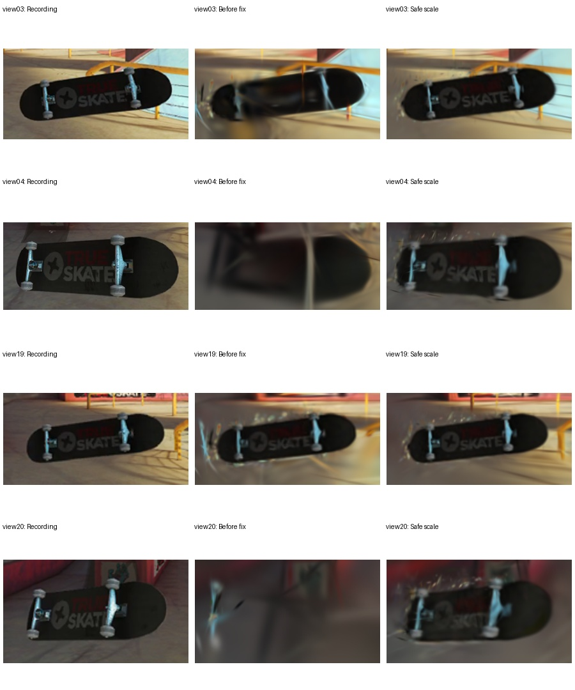
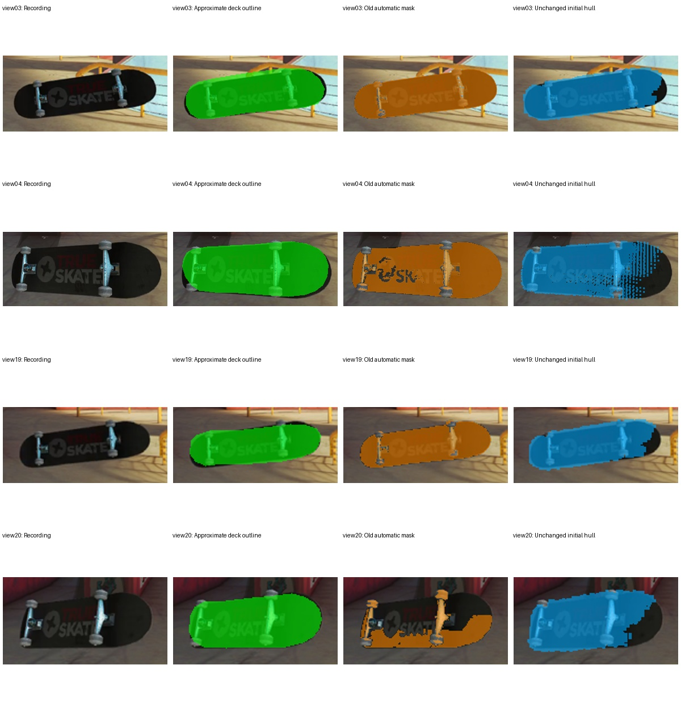

# Desaparición de la tabla: corrección de escala y recorte cercano — 24 de noviembre de 2026

[English](near-clip-fix.en.md) · [Evidencia medida](../evidence/near-clip-fix-2026-11-24.json) · [Experimento estático anterior](static-board.es.md)

**La tabla ya es reconocible en view20 de validación tras reentrenar con la escala corregida.** El fallo principal confirmado era de integración: nuestra normalización colocaba las semillas de la tabla dentro del recorte cercano fijo del rasterizador CUDA. Esto cambia la interpretación del fracaso estático anterior. Sigue siendo un instante, un subconjunto de 14 vistas y una cámara de validación examinada repetidamente.

[Comparación de la escena](../assets/near-clip-scene.jpg). Los recortes muestran un mismo instante nominal, no movimiento reconstruido.

## Comprobaciones que cambiaron el diagnóstico

El fondo de view20 permanece estable entre calibración y fotograma elegido: desplazamiento SIFT mediano de **0,062 px** a resolución de trabajo. En 168 correspondencias del fondo apartadas de un reajuste condicional de pose, la pose original tiene error mediano de **0,302 px**. Reestimar pose o pose/focal no mejora esa mediana y solo desplaza la proyección del volumen **0,34–0,37 px**. Es coherencia con el mapa existente, no calibración medida independientemente. No se aceptaron cambios de cámara.

La máscara automática de view20 solo cubre **39%** de una envolvente aproximada del deck trazada visualmente. Frente a esa envolvente, el volumen inicial sin modificar obtiene solapamiento **0,758**, frente a **0,255** con la máscara automática fragmentada. La sensibilidad a dos píxeles de cambio en la anotación da 0,702–0,778. Los polígonos fueron trazados por el asistente para evaluar, no por el responsable; aproximan el deck sin ruedas sobresalientes. No son etiquetas semánticas independientes y **no se usaron para entrenar, inicializar puntos ni ajustar cámaras**. [Anotaciones](../../data/annotations/static-deck-2026-11-24.json).

Las pruebas de renderizado mostraron después que las semillas iniciales casi no eran visibles desde view20, aunque su proyección 2D era correcta. El [CUDA fijado](https://github.com/ingra14m/depth-diff-gaussian-rasterization/blob/e49506654e8e11ed8a62d22bcb693e943fdecacf/cuda_rasterizer/auxiliary.h#L154) rechaza puntos con `z <= 0.2` en coordenadas de cámara. La [Camera de Python](https://github.com/hustvl/4DGaussians/blob/843d5ac636c37e4b611242287754f3d4ed150144/scene/cameras.py) usa `znear = 0.01`; nuestras comprobaciones de proyección no detectaban el corte CUDA.

Con la escala anterior, **99,93% de las 3.000 semillas iniciales de la tabla** quedan cortadas en view20; todas quedan cortadas en view04 y view06 de entrenamiento. Esto no demuestra que esas superficies fueran imposibles de reconstruir.

## Corrección y control de renderizado

El conjunto seguro multiplica puntos y traslaciones de cámara por **4**, conservando rotaciones, parámetros de cámara, imágenes y máscaras. El cambio máximo calculado de proyección es **0 píxeles**. El factor se elige a partir de la profundidad mínima de semillas en **entrenamiento**, buscando al menos 0,3 unidades; no lo eligen las anotaciones reservadas. Las semillas pasan después el recorte CUDA en las 15 vistas preparadas.

Sin entrenar, la opacidad de las semillas iniciales en el deck de view20 pasa de **0,0034 a 0,7941** tras la misma transformación. En view19, ya segura, permanece **0,7884 → 0,7884**. Esto aísla el fallo de visibilidad. Escalar un modelo ya entrenado con recorte no repara lo aprendido, por lo que se completó un entrenamiento nuevo y limitado.

El ejecutor ahora comprueba la profundidad de las semillas en conjuntos estáticos y **rechaza entradas inseguras antes de entrenar**, indicando cómo prepararlas. No se modificó ni reinstaló la implementación original ni el entorno CUDA.

## Resultado del nuevo entrenamiento

Mismas 14 imágenes de entrenamiento, 13 máscaras originales, una imagen de validación, 5.337 puntos iniciales y configuración; 200 pasos gruesos + 2.000 finos sin deformación. Las unidades y la extensión derivada de la escena cambian coherentemente con la escala. Entrenamiento: **72,89 segundos**; gaussianas finales: 13.171. Las **30 comparaciones de referencias** coinciden exactamente entre ejecuciones.

| Métrica de validación view20 | Antes | Entrenamiento con escala segura |
|---|---:|---:|
| PSNR de envolvente aproximada del deck | 15,75 dB | **22,91 dB** |
| MAE de esa envolvente, RGB 0–1 | 0,1279 | **0,0391** |
| PSNR completo | 26,72 dB | **28,92 dB** |
| SSIM completo | 0,911 | **0,925** |

Persisten desenfoque y artefactos. Es un ejemplo útil de **reconstrucción estática de un instante**, no escena completa, calidad de 360°, reconstrucción dinámica ni medición de rotaciones. view20 es validación usada repetidamente, no una prueba nueva intacta. view07/view08/view09 siguen fuera de la optimización; sus incoherencias geométricas no quedan resueltas por cambiar la escala. El mapa del fondo heredado sigue procediendo de las 17 vistas originales.

Siguiente comprobación propuesta: repetir el control estático corregido en otros dos instantes y después introducir movimiento gradualmente. Los fallos anteriores con recorte no deben interpretarse como evidencia limpia de que los vídeos sean inutilizables.

## Reproducción y verificaciones

La [secuencia de comandos](near-clip-fix.en.md#reproduction-and-checks) reutiliza el entorno GPU Windows/WSL existente. Elegir destinos nuevos y coherentes al repetir; se conservan datos/modelos anteriores. Vídeos, conjuntos preparados y pesos permanecen locales y excluidos de Git.

`audit_reserved_camera.py` y `audit_deck_masks.py` reproducen comprobaciones CPU. `debug_static_visibility.py` y `check_static_near_clip.py` usan Python GPU de WSL con rutas Linux y solo renderizan, sin ajustar ni modificar pesos guardados. El control de similitud se limita al **renderizado estático sin deformación**.

Windows: **47 pruebas ejecutadas, 41 superadas y seis omitidas por dependencias**. Cuatro pruebas de escala pasan también en WSL, incluida la similitud/covarianza con Torch. Los controles CUDA reproducen exactamente imágenes anteriores, verifican huellas intactas y el cargador real corregido supera proyección y visibilidad inicial.
