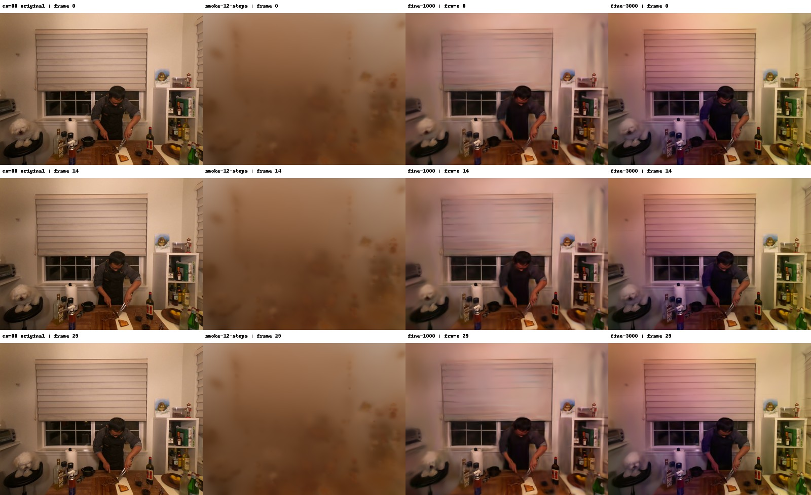

# DyNeRF bounded quality pilot — 20 November 2026

[Español](quality-pilot.es.md)

## Verified result

Completed on the RTX 4050: **200 coarse + 3,000 fine**, training program **325.11 s**; two original render programs **31.42 s** total. Models contain **8,213 gaussians at 1000** and **10,799 at 3000**. The complete run folder, including original and corrected reload diagnostics, occupies **255.08 MiB**; approximately **16.02 GiB** remained free when checked. No new dataset or environment download was needed. [Machine-readable evidence](../evidence/quality-pilot-2026-11-20.json).

| Saved model, rendered with its trained color degree | Mean PSNR (dB) | Mean SSIM |
|---|---|---|
| Earlier 12-step smoke, color degree 0 | 14.958 | 0.687 |
| Quality fine 1000, color degree 1 | 24.971 | 0.835 |
| Quality fine 3000, color degree 3 | 24.983 | 0.879 |

All values use the same 30 full-frame cam00 targets and the protocol below. The scene is recognizable; color shifts, soft detail and motion imperfections remain. PSNR changes little between 1000 and 3000 while structural similarity improves. This is evidence of a useful small reference experiment, not proof of convergence, physical point tracking or full-scene reproduction.



Original imagery and derived renders: Neural 3D Video Synthesis (Li et al., CVPR 2022), [dataset source](https://github.com/facebookresearch/Neural_3D_Video), CC-BY-NC-4.0. The figure labels and resizes source/derived images.

## Checkpoint reload correction

The pinned upstream loader forces the maximum spherical-harmonic color degree (3) when loading PLY, while training increases it every 1000 steps. The deformation decoder can emit higher-degree coefficients before those degrees have been trained. This makes an early reloaded checkpoint differ from its in-training rendering. A controlled frame-0 check of the **same step-1000 weights** gave **21.008 dB at loaded degree 3** and **24.967 dB at trained degree 1**. This explains why the first reloaded full-frame mean (21.011 dB) disagreed with the training diagnostic (~25 dB); frame sampling alone did not explain the gap.

[render_reference_checkpoint.py](../../scripts/render_reference_checkpoint.py) restores the active degree from the pinned, from-scratch coarse/fine schedule and calls the official renderer. No upstream source or trained weights were edited. Smoke was re-rendered at degree 0 and step 1000 at degree 1 in separate `consistent-sh/` directories; step 3000 already uses degree 3 and is unchanged. Original files and `metrics-upstream-reload.json` / `progression-upstream-reload.jpg` are preserved. Corrective rendering/evaluation took another **72.08 s**. The table uses corrected renders; the earlier smoke checkpoint retains its historical default-loader measurements. This correction affects rendering evaluation, not training.

## Frozen protocol

Improve on the [twelve-step execution test](local-gpu.en.md), using the same four optimization cameras, held-out cam00, first 30 contiguous source frames and 1352 × 1014 images. No new data download or image copy. Timestamps remain `index / 300`.

Initialization selection uses training geometry only: keep points with at least three observations and mean reprojection error at most 2 pixels. This retains **3,103/3,390 points** and reduces the maximum world Z from **319.07 to 28.18**. The six points above Z=30 all had two observations; this motivates the support criterion, but does not prove those points were physically wrong. Original geometry and smoke input are preserved. The selected cloud still uses the 19 original training views; only four views enter dynamic optimization. This is not an isolated four-camera capture benchmark.

The [configuration](../../configs/experiments/dynerf-quality.py) specifies **200 coarse + 3,000 fine steps**, batch size 1. Densification is permitted at fine steps 300, 600, 900 and 1200; additional point growth is disabled. Under the current clone/split rules this bounds the point count by 3,103 × 16 = 49,648, rather than depending on the upstream 360,000-point trigger. The actual count is still checked in logs/artifacts. Only fine models 1000 and 3000 are saved; no optimizer checkpoints or training-preview image streams. The launcher requires 6 GiB free at startup and stops training if free output-disk space falls below 5 GiB. It skips installation and reuses the built CUDA extensions.

From a repository PowerShell terminal:

```powershell
powershell -NoProfile -ExecutionPolicy Bypass -File .\scripts\Start-LocalGPU.ps1 -Quality
```

The owner authorized this run; a visible terminal was launched for progress. Folder timestamps use UTC (`20261121-002150Z`); the local date is 20 November in Bogotá. The run is `outputs/dynerf-quality-20261121-002150Z/`. Do not launch a second copy while it is active. Check the actual report/logs for completion; this protocol alone is not a result.

## Evaluation

Render all 30 cam00 frames from models at fine steps 1000 and 3000. Compare each against its original target and the smoke output, checking identical target pixels and dimensions across runs. Save a visual progression at frames 0, 14 and 29, and per-frame/mean PSNR and SSIM on full RGB PNG images. PSNR uses normalized RGB MSE; SSIM uses scikit-image's Gaussian window (sigma 1.5, channel axis 2, population covariance, range 1). No masks or linear color conversion. LPIPS is not measured; no network weights are downloaded.

cam00 is excluded from optimization but already inspected and monitored, so it is a **validation camera**, not a fresh independent final test. Longer optimization, initialization selection and densification change together: improvement cannot be attributed to any one change. A controlled ablation would require separate runs. This remains a reduced-scene compatibility experiment, not reproduction of the paper's benchmark.

Scripts/checks: `prepare_quality_reference.py` preserves identical images/calibration via hard links; actual upstream loader checks the split/shape/time; the low-disk guard was verified with a subprocess that stops on an intentionally impossible reserve. Syntax/check-only checks passed before launch.
