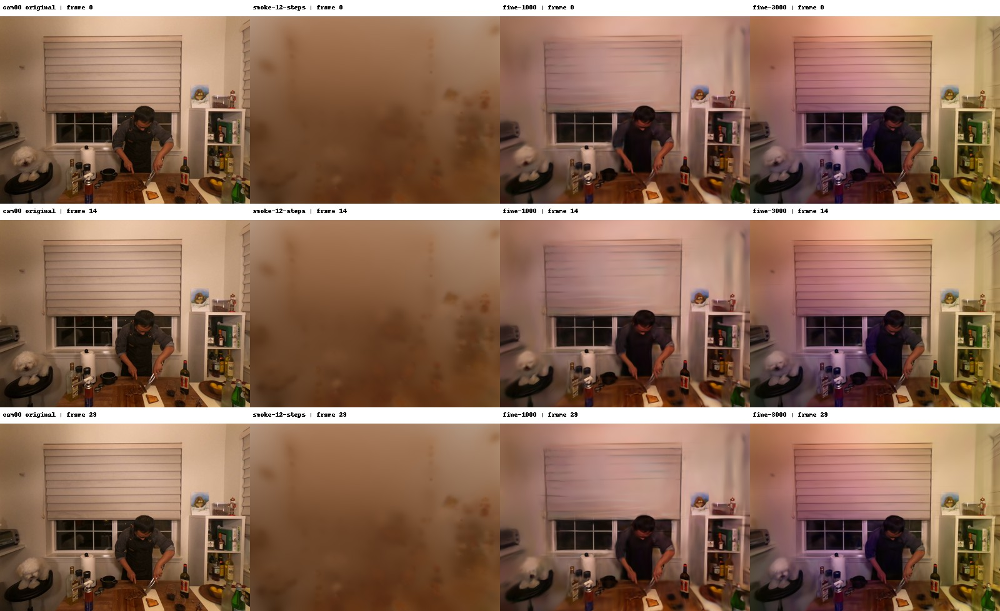

# Prueba limitada de calidad DyNeRF — 20 de noviembre de 2026

[English](quality-pilot.en.md)

## Resultado verificado

RTX 4050: **200 pasos coarse + 3.000 fine**, programa de entrenamiento **325,11 s**; dos programas de renderizado originales **31,42 s**. Modelos con **8.213 gaussianas en 1000** y **10.799 en 3000**. Carpeta completa, incluidos diagnósticos y renders corregidos: **255,08 MiB**; quedaban aproximadamente **16,02 GiB** libres. Sin descargar datos ni entorno. [Evidencias](../evidence/quality-pilot-2026-11-20.json).

| Modelo guardado con su grado de color entrenado | PSNR medio (dB) | SSIM medio |
|---|---|---|
| Prueba previa de 12 pasos, grado 0 | 14,958 | 0,687 |
| Fine 1000, grado 1 | 24,971 | 0,835 |
| Fine 3000, grado 3 | 24,983 | 0,879 |

Mismos 30 objetivos completos de cam00. Escena reconocible; persisten diferencias de color, suavidad y errores de movimiento. PSNR cambia poco entre 1000 y 3000, mientras SSIM mejora. Referencia pequeña útil, sin demostrar convergencia, seguimiento físico ni reproducción completa.



Imágenes y renders derivados: Neural 3D Video Synthesis (Li et al., CVPR 2022), [fuente](https://github.com/facebookresearch/Neural_3D_Video), CC-BY-NC-4.0. Figura etiquetada y redimensionada.

## Corrección de recarga

El cargador original fuerza el grado máximo de color por armónicos esféricos (3), aunque el entrenamiento lo aumenta cada 1000 pasos. El decodificador de deformación puede producir coeficientes superiores antes de entrenarlos. Con los **mismos pesos de la etapa 1000**, el fotograma 0 dio **21,008 dB con grado 3** frente a **24,967 dB con grado 1**. Esto explica la diferencia entre la primera recarga (media 21,011 dB) y el diagnóstico durante entrenamiento (~25 dB); no se explicaba solo por muestreo de fotogramas.

[render_reference_checkpoint.py](../../scripts/render_reference_checkpoint.py) restaura el grado según la secuencia coarse/fine desde cero y utiliza el renderer oficial. No modifica código original ni pesos. Prueba inicial regenerada con grado 0 y etapa 1000 con grado 1 en `consistent-sh/`; etapa 3000 con grado 3 permanece igual. Se conservan originales y `metrics-upstream-reload.json` / `progression-upstream-reload.jpg`. Corrección y evaluación: **72,08 s** adicionales. La tabla usa renders corregidos; el corte inicial conserva sus medidas históricas. La corrección afecta evaluación, no entrenamiento.

## Protocolo fijado

Mejorar la [prueba de doce pasos](local-gpu.es.md) con las mismas cuatro cámaras de optimización, cam00 reservada, 30 primeros fotogramas consecutivos y 1352 × 1014. Sin descargar datos ni copiar imágenes. Tiempo `índice / 300`.

Selección de inicialización usando solo geometría de entrenamiento: al menos tres observaciones y error medio de reproyección ≤2 píxeles. **3.103/3.390 puntos**; Z máximo pasa de **319,07 a 28,18**. Los seis puntos con Z>30 tenían dos observaciones, sin que esto pruebe que fueran físicamente incorrectos. Se conservan geometría e entrada anteriores. El mapa procede de las 19 vistas originales de entrenamiento; cuatro cámaras entran en optimización dinámica. No es un benchmark de captura con solo cuatro cámaras.

[Configuración](../../configs/experiments/dynerf-quality.py): **200 pasos coarse + 3.000 fine**, lote 1. Densificación fine en pasos 300, 600, 900 y 1200, sin crecimiento adicional. Las reglas actuales limitan el máximo teórico a 3.103 × 16 = 49.648 gaussianas; se comprueba el recuento real. Solo modelos fine 1000 y 3000, sin checkpoints del optimizador ni series de previsualización. Exige 6 GiB libres al comenzar y detiene el entrenamiento si quedan menos de 5 GiB. Reutiliza entorno y extensiones, sin reinstalar.

Desde PowerShell en el repositorio:

```powershell
powershell -NoProfile -ExecutionPolicy Bypass -File .\scripts\Start-LocalGPU.ps1 -Quality
```

Ejecución autorizada y lanzada en terminal visible. Carpeta `outputs/dynerf-quality-20261121-002150Z/`: fecha UTC en nombre, 20 de noviembre en Bogotá. No iniciar otra copia mientras esté activa. El protocolo no demuestra finalización: comprobar informe y registros reales.

## Evaluación

Renderizar los 30 fotogramas de cam00 para modelos 1000/3000. Comparar objetivos originales y resultado inicial, comprobando píxeles objetivo y dimensiones idénticos. Figura para fotogramas 0, 14, 29; PSNR/SSIM por fotograma y promedio, RGB PNG completo. PSNR: MSE RGB normalizado. SSIM: scikit-image, ventana gaussiana sigma 1,5, eje de canales 2, covarianza poblacional, rango 1. Sin máscaras ni conversión lineal. LPIPS no medido; no se descargan pesos.

cam00 está fuera de optimización, pero ya fue inspeccionada y monitorizada: es **validación**, no prueba final independiente. Cambian conjuntamente duración, selección de inicialización y densificación; una mejora no puede atribuirse a un factor individual sin ablaciones. Experimento reducido de compatibilidad, no reproducción de las métricas del artículo.

Preparación conserva imágenes/calibración mediante enlaces; el cargador real comprueba separación, forma y tiempo. Se verificó la protección de disco con un subproceso y una reserva deliberadamente imposible. Sintaxis y lanzador de solo comprobación validados antes de iniciar.
