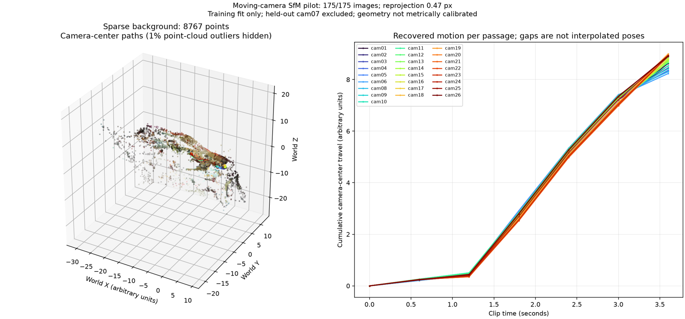

# Progress report — English

**Checkpoint:** 18 November 2026 · **Project:** skate-trick-4dgs · [Versión española](report.es.md)

**Course:** Computer Vision — CVI 26-2 · **Assignment:** final course project. The supplied 46-page *CVI 26-2 Prompts* notes are linked to the project in the [page-referenced course map](course-alignment.en.md). They establish topic context, not a final-project grading rubric.

## 1. Research objective

The objective is to reconstruct one deterministic skate replay as a time-dependent 3D representation and render it from cameras not used for optimization. The research question is whether repeated game-camera observations provide sufficient synchronization, geometry and appearance information for 4D Gaussian Splatting. The current experiment addresses data preparation and camera estimation, not final image synthesis.

In static 3D Gaussian Splatting, anisotropic Gaussian primitives encode scene geometry and appearance. The selected dynamic implementation adds a time-conditioned deformation representation. That model still needs valid camera parameters for each observed image; it cannot compensate for incorrectly treating a moving camera as fixed.

## 2. Scope and contribution

This inverse camera/scene estimation problem is followed by forward image synthesis. It connects the notes' linear algebra and Viewing sections (PDF pp. 3–4, 12–15), raster and signal sampling (pp. 5–6, 18–27), graphics pipeline (pp. 15–18) and curves (pp. 40–44). The course map distinguishes demonstrated applications from proposed learning demonstrations.

The official hustvl/4DGaussians repository is pinned as an unchanged Git submodule. The project contributes capture tools, validation, controlled preprocessing, a moving-camera SfM pilot and reproducibility documentation. It does not claim a new Gaussian optimization method. AI assistance was used for coding and documentation. Recorded results and limitations, rather than the amount of generated material, are the basis for assessing technical progress.

## 3. Data and synchronization

The owner supplied one 118.633-second mobile game recording containing successive viewpoints of the same saved replay. Its resolution is 720 × 1280 at 30 FPS. Manual cutting was slow and produced unequal clip lengths. A project tool instead detects backward jumps of the visible replay cursor, fits forward cursor motion, and proposes a common replay interval. It exported 26 candidate passages with 109 frames each. These identifiers indicate passage order; exact azimuths and uniqueness have not been verified.

Two checks support approximate alignment: visual comparison of the board at selected frames, and persistent appearance of the green score overlay at clip index 97 or 98 in all 26 passages. This one-frame event spread is about 33 ms. It does not prove synchronization at every replay state; no corrective time warp or independent resampling was applied. An exploratory audio-envelope comparison was inconclusive and was not used to alter the data.

*Figure 1. Supplied game images at frames 73 and 109. These are observations, not synthesized outputs.*

## 4. Camera model and experiment

Source inspection established that upstream MultipleView estimates calibration from the first frame and reuses a sequence-level pose. The actual capture follows the board, requiring `R[c,t], T[c,t]`. The chosen experiment estimates independent image poses from the static background using CPU PyCOLMAP 4.2.1.

Frames are decoded from the original recording. A common crop `(64,100,592,820)` removes borders and controls without resizing. Feature masks exclude a conservative board/shadow region and the possible score-overlay band. Masks affect calibration features, not the saved training image colors. The assumed original principal point `(360,640)` becomes `(296,540)` after cropping. A shared SIMPLE_PINHOLE model refines focal length, producing 443.825 px; centered projection and fixed FOV remain hypotheses to test.

| Run | Passages / images | Registered | Points | Mean error |
|---|---|---|---|---|
| Initial pilot | 6 / 42 | 33/42 | 1,651 | 0.403 px |
| Added intermediate views | 25 / 175 | 175/175 | 8,767 | 0.473 px |

Adding intermediate viewpoints resolved partial registration without relaxing mapper thresholds. Seven indices per passage were used: `[0,18,36,54,72,90,108]`. The expanded run completed in approximately 101.5 s in one world frame. Of its points, 8,377 have observations from at least two passages. This supports cross-view linkage. The higher error in the larger run is not evidence of worse novel-view quality: the observations and coverage differ.

*Figure 2. Sparse static background and recovered camera motion, with arbitrary SfM scale. This is not a dynamic board reconstruction.*

## 5. Evidence and reproducibility

The [checkpoint JSON](../evidence/checkpoint-2026-11-18.json) records metrics, the implementation commit, dependency SHA and source-recording fingerprint. The [technical run report](../pose-pilot-2026-11-18.md) provides commands and assumptions. Native databases, full images and PLY models stay outside Git; the small review figures and sanitized evidence remain versioned. Nineteen helper tests passed again during documentation preparation. A clean clone can run synthetic helper tests; reproducing real-data metrics additionally requires the original recording.

## 6. Limitations and evaluation boundary

There are poses for seven samples per training passage, not all 109 images. Scale is arbitrary; a low residual does not prove ground-truth geometry. Conservative masks may remove useful background, while missed dynamic pixels can still bias SfM. Synchronization is checked at a limited set of events. Only sparse background reconstruction is demonstrated.

`cam07` is reserved and absent from feature extraction, matching and mapping. It was included in synchronization inspection, which does not optimize the scene geometry. Future evaluation will localize it against the training reconstruction, render at matched times, and compare with the real game images using documented PSNR, SSIM and LPIPS conventions. No held-out metric has been computed.

Official 4DGS reproduction, CUDA extension builds, dynamic training and rendering remain unexecuted. The Windows CPU helper environment works; the proposed WSL training environment remains to be provisioned and tested. There is no basis yet to claim successful free-viewpoint replay.

## 7. Next review gates

1. Establish the CUDA environment and complete bounded training/rendering on an official scene.
2. Estimate and validate poses across the full replay, especially fast motion and possible FOV changes.
3. Validate a per-frame loader or converter using known camera matrices and explicit view splits.
4. Train a first dynamic model, localize cam07 and report reproducible held-out results.

Each gate needs recorded commands, outputs, failures and a dated update. See the [roadmap](roadmap.en.md) and [work log](work-log.en.md). These gates are project management criteria, not an invented course grading rubric.
