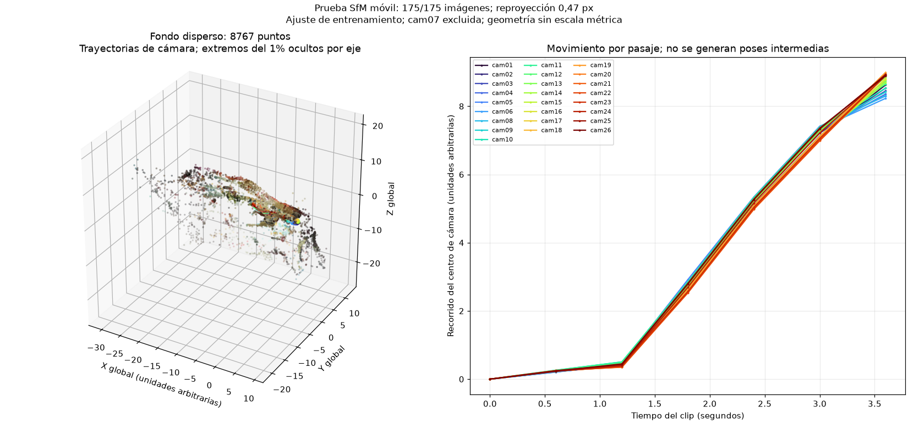

# Informe de avance — Español

**Corte:** 18 de noviembre de 2026 · **Proyecto:** skate-trick-4dgs · [English version](report.en.md)

**Curso:** Computer Vision · **Actividad:** proyecto final. Los apuntes *apuntes del curso*, de 46 páginas, se relacionan con el proyecto en el [mapa del curso con páginas de referencia](course-alignment.es.md). Aportan contexto temático, no una rúbrica del proyecto final.

**Último avance:** la [localización completa](fullrate.es.md) aporta **2725/2725 poses aceptadas**: 175 referencias y 2550 estimaciones nuevas, sin interpolación. Se recuperaron 31 fallos iniciales mediante reintentos documentados. El error medio por imagen de PnP es 0,592 px; 132 poses tienen menos de 50 inliers y requieren revisión específica. La comparación dispersa siguiente conserva el experimento anterior, no el límite actual de cobertura. La batería actual supera 25 pruebas.

## 1. Objetivo de investigación

El objetivo es reconstruir una repetición determinista de skate como una representación 3D que depende del tiempo y renderizarla desde cámaras no utilizadas en la optimización. La pregunta es si las observaciones repetidas desde las cámaras del juego aportan suficiente sincronización, geometría y apariencia para 4D Gaussian Splatting. El experimento actual estudia la preparación de datos y la estimación de cámaras, no la síntesis final de imágenes.

En 3D Gaussian Splatting estático, primitivas gaussianas anisotrópicas representan la geometría y la apariencia. La implementación dinámica elegida añade una representación de deformación condicionada por el tiempo. El modelo sigue necesitando parámetros de cámara correctos para cada imagen; no puede compensar la suposición errónea de que una cámara móvil es fija.

## 2. Alcance y contribución

La estimación inversa de cámaras/escena se conecta con la síntesis directa. Se aplica álgebra y Viewing (PDF pp. 3–4, 12–15), imágenes ráster y muestreo (pp. 5–6, 18–27), pipeline gráfico (pp. 15–18) y curvas (pp. 40–44). El mapa distingue aplicaciones demostradas y demostraciones de aprendizaje propuestas.

El repositorio oficial hustvl/4DGaussians está fijado como submódulo de Git sin modificaciones. El proyecto aporta herramientas de captura, validación, preprocesamiento controlado, una prueba de SfM con cámaras móviles y documentación reproducible. No propone un nuevo método de optimización de Gaussianas. Se utilizó asistencia de IA para programación y documentación. El avance técnico debe valorarse mediante los resultados y sus límites, no por la cantidad de material generado.

## 3. Datos y sincronización

El responsable aportó una grabación móvil de 118,633 segundos con puntos de vista sucesivos de la misma repetición guardada. Tiene resolución 720 × 1280 a 30 FPS. El corte manual era lento y generaba clips de distinta duración. Una herramienta del proyecto detecta los retrocesos del cursor visible, ajusta su movimiento hacia delante y propone un intervalo común. Se exportaron 26 pasajes candidatos de 109 fotogramas. Los nombres indican el orden de los pasajes; no se han verificado sus azimuts exactos ni que todos sean distintos.

Dos controles respaldan una alineación aproximada: la comparación visual del skate en fotogramas seleccionados y la aparición persistente de la puntuación verde en el índice 97 o 98 de los 26 pasajes. La diferencia de una imagen equivale a unos 33 ms. No demuestra sincronización en todos los estados del replay; no se aplicó deformación temporal ni remuestreo independiente. Una comparación exploratoria de la envolvente de audio no fue concluyente y no modificó los datos.

*Figura 1. Imágenes del juego en los fotogramas 73 y 109. Son observaciones, no resultados sintetizados.*

## 4. Modelo de cámara y experimento

La inspección del código confirmó que MultipleView calibra con la primera imagen y reutiliza una pose por secuencia. La captura real sigue al skate y necesita `R[c,t], T[c,t]`. El experimento estima poses independientes mediante el fondo estático con PyCOLMAP 4.2.1 en CPU.

Las imágenes se decodifican de la grabación original. Un recorte común `(64,100,592,820)` elimina bordes y controles sin cambiar la escala. Las máscaras excluyen una región conservadora del skate y su sombra, y la franja donde aparece la puntuación. Solo afectan a las características de calibración, no a los colores guardados. El punto principal original supuesto `(360,640)` pasa a `(296,540)`. El modelo compartido SIMPLE_PINHOLE ajusta la distancia focal a 443,825 px; la proyección centrada y el campo visual constante siguen siendo hipótesis.

| Ejecución | Pasajes / imágenes | Registradas | Puntos | Error medio |
|---|---|---|---|---|
| Prueba inicial | 6 / 42 | 33/42 | 1651 | 0,403 px |
| Con vistas intermedias | 25 / 175 | 175/175 | 8767 | 0,473 px |

Las vistas intermedias resolvieron el registro incompleto sin relajar los umbrales del estimador. Se utilizaron siete índices por pasaje: `[0,18,36,54,72,90,108]`. La ejecución ampliada terminó en unos 101,5 s y un único sistema de referencia. De sus puntos, 8377 tienen observaciones desde al menos dos pasajes, lo que respalda la conexión entre vistas. El aumento del error no demuestra menor calidad de síntesis: las observaciones y su cobertura son diferentes.

*Figura 2. Fondo estático disperso y movimiento de cámara recuperado, en escala arbitraria de SfM. No es una reconstrucción dinámica del skate.*

## 5. Evidencias y reproducibilidad

El [JSON del corte](../evidence/checkpoint-2026-11-18.json) guarda métricas, commit de implementación, SHA de la dependencia y huella de la grabación. El [informe técnico, en inglés](../pose-pilot-2026-11-18.md) incluye comandos e hipótesis. Las bases de datos, imágenes completas y modelos PLY quedan fuera de Git; las figuras pequeñas y las evidencias sin rutas personales sí se versionan. Las diecinueve pruebas volvieron a superarse al preparar esta documentación. Un clon limpio puede ejecutar pruebas sintéticas; reproducir las métricas reales exige la grabación original.

## 6. Limitaciones y alcance de la evaluación

Se resolvió el límite de siete poses: las 109 imágenes de cada pasaje de entrenamiento tienen estimaciones aceptadas. No hay poses reales conocidas ni escala métrica. Un residuo bajo no demuestra exactitud; 132 estimaciones de soporte menor necesitan revisión. Las máscaras pueden ocultar fondo útil o dejar contaminación dinámica. La sincronización solo se comprobó en ciertos eventos. Se demuestran geometría estática dispersa y localización, no reconstrucción dinámica.

`cam07` está reservada y no participa en extracción de características, correspondencias ni reconstrucción. Sí se inspeccionó su sincronización, sin optimizar con ella la geometría. Se prevé localizarla contra el modelo de entrenamiento, renderizar en instantes coincidentes y comparar con el juego mediante convenciones documentadas de PSNR, SSIM y LPIPS. No se ha calculado ninguna métrica de prueba.

Siguen pendientes la reproducción oficial de 4DGS, la compilación CUDA, el entrenamiento dinámico y el renderizado. El entorno auxiliar de Windows en CPU funciona; el entorno de entrenamiento propuesto en WSL debe instalarse y validarse. Aún no se puede afirmar que exista una repetición con punto de vista libre.

## 7. Próximos criterios de revisión

1. Preparar CUDA y completar entrenamiento y renderizado breves sobre una escena oficial.
2. Validar las poses completas, especialmente imágenes de soporte menor, movimiento rápido y posibles cambios de campo visual.
3. Validar un cargador o conversor por imagen con matrices conocidas y separación explícita de vistas.
4. Entrenar un primer modelo dinámico, localizar cam07 y documentar la evaluación reservada.

Cada etapa exige comandos, resultados, fallos y una actualización fechada. Véanse la [hoja de ruta](roadmap.es.md) y la [bitácora](work-log.es.md). Son criterios de gestión del proyecto, no una rúbrica de evaluación inventada.
