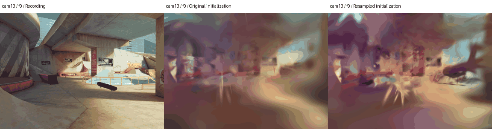

# Owner-executed initialization experiment — 24 November 2026

[Español](resampling-result.es.md) · [Measured evidence](../evidence/resampling-result-2026-11-24.json) · [Launcher and method](next-initialization.en.md)

**The owner ran the terminal experiment successfully on the RTX 4050. Interpolating the initialization to 8,920 points did not produce a usable improvement: the skateboard remains unrecognizable in the inspected renders.** The small reserved-view PSNR increase is accompanied by worse structural similarity and worse error in the changing region.

The columns show recording / first pilot / resampled initialization. Thirteen frames span 0.4 seconds of replay, displayed approximately five times slower. Static comparisons: [reserved cam13](../assets/resampling-heldout.jpg) and [training cam08](../assets/resampling-training.jpg).

## What was controlled

The original 1,115 background points were retained and interpolated to 8,920 initialization samples. The final model has 11,487 Gaussians, versus 2,623 in the first pilot. Interpolated samples do not add measured geometry. Both the number and the spatial/color distribution of initial samples change.

The 117 input files, all frame records/poses/timestamps, crop, intrinsics, world normalization and configuration hash were checked against the baseline. All 26 reported evaluation targets have identical pixels. Both runs use 104 training images, 13 reserved images, and 200 coarse + 2,000 fine steps. The new training took **85.36 seconds**, rendering/evaluation 24.97 seconds. This is one initialization variant at one seed and budget, not a convergence study.

| Metric (mean over 13 images) | First pilot | Resampled | Change |
|---|---:|---:|---:|
| Reserved cam13: full-image PSNR | 15.057 dB | 15.229 dB | +0.172 dB |
| Reserved cam13: SSIM | 0.635 | 0.623 | −0.012 |
| Reserved cam13: changing-region PSNR | 10.807 dB | 10.367 dB | −0.440 dB |
| Training cam08: full-image PSNR | 18.869 dB | 18.020 dB | −0.849 dB |
| Training cam08: changing-region PSNR | 14.703 dB | 13.035 dB | −1.668 dB |

Higher PSNR/SSIM indicates a better match for the same images. The changing-region mask is based on target temporal pixel variation, not semantic board ground truth. The new frozen-time control reaches 15.216 dB on full reserved images, close to the dynamic model's 15.229 dB. Together with visual inspection, this does not demonstrate correct skateboard dynamics.

## Temporal failure diagnostic

Across all 13 reserved frames, 98.2% of target pixels have a maximum RGB-channel range of at most 8/255. In this target-stable region, the mean absolute change between consecutive frames is **0.0058 intensity units** in the recording but **1.2573 units** in the new model renders, on a 0–255 scale. In the target-changing region it is 24.14 versus 1.76 units. This locates substantial model variation in areas that remain stable in the recording, while the target's moving region is poorly reproduced. Pixel differences alone cannot identify a physical trajectory or exact cause.

Reproduce this diagnostic with `scripts/analyze_fixed_motion.py --renders <run>/renders-2000 --output <fresh-report.json>`. Existing models, source videos and baseline outputs remain unchanged.

## Decision and next gate

Do not treat the resampled variant as an improved reconstruction or multiply interpolated points again on the strength of the global score. This result does not rule out denser *observed* geometry, other initializations or longer optimization; those were not tested.

The next useful diagnostic is a **single-timestamp static reconstruction**, with a single-view fitting control, before another dynamic run. This separates difficulty fitting appearance/geometry from difficulty fitting time. After that check, identify the board in training views and test foreground initialization or loss weighting separately. Those follow-up experiments have not been executed in this review.
