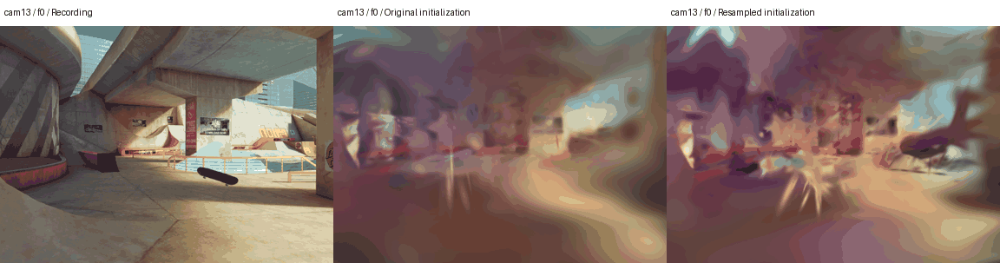

# Experimento de inicialización ejecutado por el responsable — 24 de noviembre de 2026

[English](resampling-result.en.md) · [Evidencia medida](../evidence/resampling-result-2026-11-24.json) · [Lanzador y método](next-initialization.es.md)

**El responsable ejecutó correctamente el experimento en la RTX 4050. Interpolar la inicialización hasta 8.920 puntos no produjo una mejora utilizable: la tabla sigue sin ser reconocible en los renders inspeccionados.** El pequeño aumento del PSNR de la vista reservada va acompañado de peor similitud estructural y peor error en la región cambiante.

Columnas: grabación / primer ensayo / inicialización remuestreada. Los 13 fotogramas abarcan 0,4 segundos del replay y se muestran unas cinco veces más despacio. Comparaciones estáticas: [cam13 reservada](../assets/resampling-heldout.jpg) y [cam08 de entrenamiento](../assets/resampling-training.jpg).

## Controles del experimento

Se conservaron los 1.115 puntos originales del fondo y se interpolaron hasta 8.920 muestras de inicialización. El modelo final tiene 11.487 Gaussianas, frente a las 2.623 del primer ensayo. Las muestras interpoladas no aportan geometría medida adicional. Cambian tanto el número de muestras iniciales como su distribución espacial/de color.

Se verificaron contra la referencia los 117 archivos de entrada, registros de imágenes/poses/tiempos, recorte, parámetros internos, normalización y hash de configuración. Los 26 objetivos de evaluación tienen píxeles idénticos. Ambos ensayos usan 104 imágenes de entrenamiento, 13 reservadas y 200 pasos coarse + 2.000 fine. El nuevo entrenamiento tardó **85,36 segundos** y el renderizado/evaluación 24,97 segundos. Es una variante con una semilla y un presupuesto, no un estudio de convergencia.

| Métrica (media de 13 imágenes) | Primer ensayo | Remuestreo | Cambio |
|---|---:|---:|---:|
| cam13 reservada: PSNR completo | 15,057 dB | 15,229 dB | +0,172 dB |
| cam13 reservada: SSIM | 0,635 | 0,623 | −0,012 |
| cam13 reservada: PSNR en región cambiante | 10,807 dB | 10,367 dB | −0,440 dB |
| cam08 de entrenamiento: PSNR completo | 18,869 dB | 18,020 dB | −0,849 dB |
| cam08 de entrenamiento: PSNR en región cambiante | 14,703 dB | 13,035 dB | −1,668 dB |

Valores mayores de PSNR/SSIM indican mejor ajuste para las mismas imágenes. La máscara cambiante procede de variaciones temporales de píxeles objetivo, no de segmentación real de la tabla. El nuevo control con tiempo fijo alcanza 15,216 dB en imágenes completas de la vista reservada, cerca de los 15,229 dB del modelo dinámico. Junto con la inspección visual, esto no demuestra dinámica correcta de la tabla.

## Diagnóstico del fallo temporal

En los 13 fotogramas reservados, el 98,2% de los píxeles objetivo tiene un rango máximo entre canales RGB de como mucho 8/255. En esa región estable del objetivo, el cambio absoluto medio entre imágenes consecutivas es de **0,0058 unidades** en la grabación y **1,2573 unidades** en los nuevos renders, en una escala de 0–255. En la región cambiante es de 24,14 frente a 1,76 unidades. Así se observa variación del modelo en zonas estables de la grabación, mientras se reproduce mal la región móvil. Las diferencias de píxeles no identifican una trayectoria física ni una causa exacta.

El diagnóstico se reproduce con `scripts/analyze_fixed_motion.py --renders <run>/renders-2000 --output <informe-nuevo.json>`. Se conservan modelos existentes, vídeos originales y resultados de referencia.

## Decisión y siguiente comprobación

No considerar el remuestreo una reconstrucción mejorada ni multiplicar otra vez los puntos interpolados basándose en el resultado global. Este experimento no descarta geometría *observada* más densa, otras inicializaciones u optimización más larga; no se probaron esas alternativas.

El siguiente diagnóstico útil es una **reconstrucción estática de un solo instante**, con un control de ajuste de una sola vista, antes de otro ensayo dinámico. Así se separa la dificultad de ajustar apariencia/geometría de la de ajustar el tiempo. Después, identificar la tabla en las vistas de entrenamiento y probar inicialización del objeto o ponderación del error por separado. Estas pruebas posteriores no se ejecutaron durante esta revisión.
