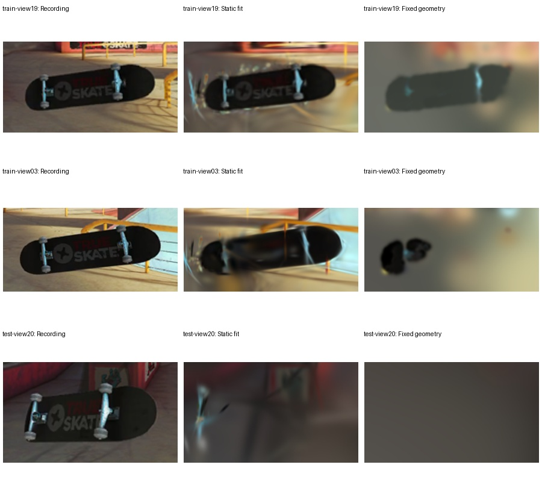
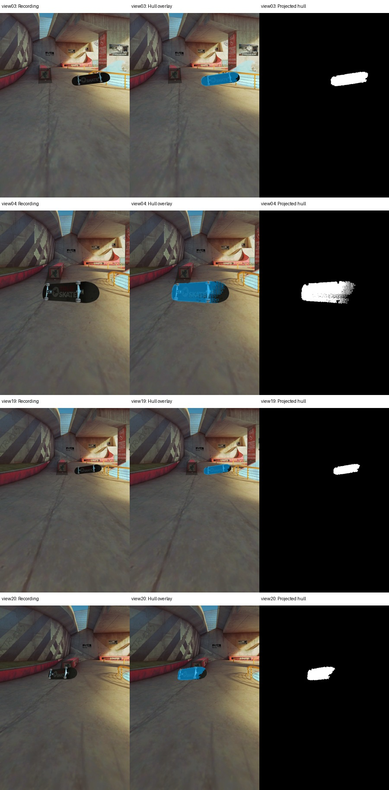

# Single-instant board reconstruction — 24 November 2026

[Español](static-board.es.md) · [Measured evidence](../evidence/static-board-2026-11-24.json) · [Previous foreground trial](foreground-trial.en.md)

**The board is now recognizable in inspected training views, but the reserved view remains poor.** This is a restricted static feasibility result. It does not demonstrate reliable novel-view reconstruction, motion or board tracking.



These are enlarged crops of the same single instant in each view, not frames of reconstructed motion. [Larger scene comparisons](../assets/static-board-scene.jpg).

## Geometry checks before training

The selected nominal instant is sample **8**, **0.6 seconds before the detected score event**. This is a capture-time alignment, not verified simulation time. Initial masks based on whole-clip background medians selected ghosts of the board's stationary start position. Replacing those medians with medians of the moving 13-sample action window corrected that extraction problem. view19 still uses the actual empty view18 reference.

The full 17-view check then found no common silhouette volume in a 128³ search grid with two-pixel mask dilation. Because a finite grid cannot prove global inconsistency, a second check used linear constraints for generous board bounding boxes, including manually reviewed boxes for the incomplete masks in view07/view11. With the current poses, intrinsics and nominal instant, the numerical solver found **no common positive-depth 3D point**, even with two extra pixels around these already generous boxes. Approximately **32.48 pixels** of uniform additional padding were needed. This concerns approximate observations and the present calibration; it is not proof that the physical scene is impossible.

Three investigations were retained:

- In seven checked views, static-background feature displacement between calibration imagery and sample8 has a median of **0.035–0.091 pixels** at working resolution. The cameras appear stable within those takes; this does not validate their 3D calibration.
- A training-only timing search for view07/view08/view09, from −18 to +30 capture frames around sample8, still leaves candidate-centroid distances of approximately **123 / 83 / 35 pixels** from the projected core estimate. Those timing offsets were **not accepted**.
- Allowing an independent focal per training view registers 17/17 cameras and reduces mean background reprojection error from 0.470 to 0.420 px, but view09 reaches an implausible **475,066-pixel focal length** at native resolution. That calibration is **rejected**. A lower background fitting error alone is insufficient.

[Questioned views with pixel coordinates](../assets/static-board-questioned-views.jpg) · [Rejected timing candidates](../assets/static-board-timing.jpg).

## Restricted static dataset

The exploratory optimization excludes view07/view08/view09. It keeps **14 training images** and one reserved image, view20. view11 remains a training image but supplies no carving/loss mask because its mask is incomplete. The other **13 masks** produce a common volume containing **6,051 voxels**. Median silhouette-centroid reprojection discrepancy is 3.36 px; centroids are approximate proxies, not matched physical keypoints.



Initialization retains the **2,337 observed background points** and adds **3,000 sampled volume voxels** with median colors from the 13 training views. These board seeds are **synthetic silhouette-volume hypotheses, not measured surface points**. Reserved imagery does not contribute to carving, seed positions or colors. The inherited background map/points were originally built from all 17 training views: excluding three views here does not undo their earlier contribution to that map.

The initial volume's candidate-mask overlap is approximately 0.87 in training view03, 0.79 in view19, 0.66 in view04, and **0.25 in reserved view20**. These imperfect masks are not semantic ground truth, but the reserved discrepancy already limits confidence in the initialization.

All images preserve the full **563 × 1218** framing. Every time value is zero, and both training and evaluation explicitly use the renderer's **undeformed** branch. The loop still performs 200 coarse + 2,000 fine iterations; “fine” is the loop name here, not learned motion. Loss: full-image L1 plus 0.1 times candidate-foreground mean L1 in the 13 masked training views.

## Two completed GPU controls

| Metric | Static fit | Fixed geometry / view-independent color |
|---|---:|---:|
| Training-program time | 73.53 s | 69.98 s |
| Final Gaussians | 13,421 | 5,337 |
| Mean full-image training PSNR, 14 views | 29.51 dB | 16.58 dB |
| Mean candidate-region training PSNR, 14 views | 27.88 dB | 17.20 dB |
| Reserved full-image PSNR | 26.72 dB | 13.87 dB |
| Reserved candidate-region PSNR | 12.85 dB | 12.77 dB |

The first fit recovers a recognizable board in inspected training view19, including parts of its graphic and wheel assemblies. It fails on reserved view20. The second control freezes positions, scales and rotations, disables densification and uses degree-zero color, learning only appearance/opacity. All **5,337 positions were verified unchanged**. It does not fix reserved-view quality and greatly degrades the background. Because several settings change together, this does not isolate position drift as the cause of failure.

All **30 render targets** match the prepared source images exactly. The 40 distinct helper tests pass across Windows/WSL: Windows passes 35 and skips five dependency-specific tests; nine selected WSL tests pass, including the skipped functionality. Projection gates pass for both actual GPU runs.

## Decision and reproduction

Before adding time again, validate near-board camera geometry and the reserved view, and replace the uncertain masks with inspected full-board silhouettes. Compare static object shape against an additional reserved angle. The present result supports this smaller geometric investigation; it does not justify extending the failed dynamic training. One nominal instant, a selected subset and approximate masks remain material limits. Multiple factors changed from the prior dynamic trial, so its metrics are not a data-only or initialization-only ablation.

The three questions to explain in a demo are: why the reserved view matters; why fitting the background does not validate the board; and why a silhouette-derived volume differs from observed 3D surface points.

Local data/models remain ignored by Git. Existing outputs are preserved; use fresh destinations to repeat preparation. Core commands, using the existing Windows/WSL CUDA environment:

```powershell
.venv/Scripts/python.exe scripts/static_board_geometry.py --output outputs/static-board-geometry-v2
.venv/Scripts/python.exe scripts/diagnose_static_timing.py
.venv/Scripts/python.exe scripts/check_independent_focals.py --output outputs/static-independent-focals-v2
.venv/Scripts/python.exe scripts/static_board_geometry.py --output outputs/static-board-core --exclude-views view07 view08 view09 --skip-carving-views view11
.venv/Scripts/python.exe scripts/prepare_static_board_trial.py
.venv/Scripts/python.exe -u scripts/run_fixed_pilot.py --source data/processed/true-skate-static-board --output outputs/static-board-pilot/gpu --configs configs/experiments/true-skate-static-board.py --checkpoints 2000
.venv/Scripts/python.exe -u scripts/run_fixed_pilot.py --source data/processed/true-skate-static-board --output outputs/static-board-fixed/gpu --configs configs/experiments/true-skate-static-board-fixed.py --checkpoints 2000
.venv/Scripts/python.exe scripts/review_static_board_trial.py
```

The global bounding-box diagnostic is `scripts/check_static_boxes.py`; it uses SciPy available in the existing WSL environment. Pass Linux paths and invoke it with `/opt/skate4d/venv/bin/python`. Its stored bounds/manual overrides and outcomes are included in the measured evidence.
