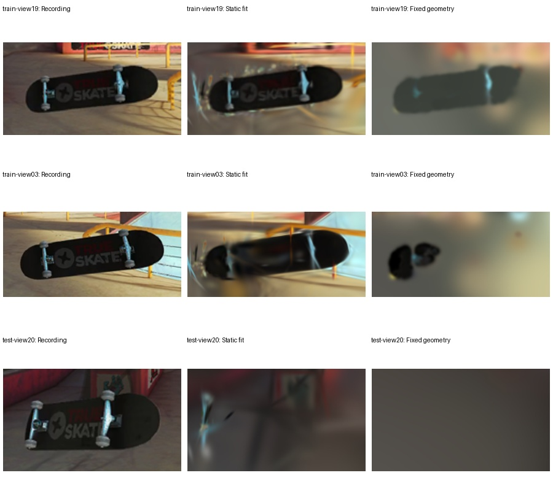
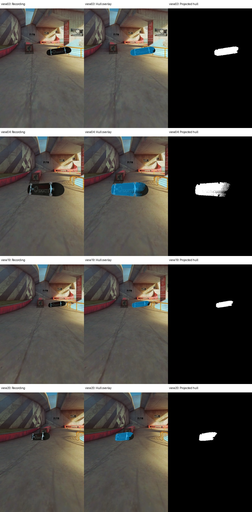

# Reconstrucción de la tabla en un instante — 24 de noviembre de 2026

[English](static-board.en.md) · [Evidencia medida](../evidence/static-board-2026-11-24.json) · [Prueba anterior de primer plano](foreground-trial.es.md)

**Corrección posterior:** la [auditoría del recorte cercano y el entrenamiento con escala segura](near-clip-fix.es.md) detectaron que este experimento recortaba la mayoría de semillas de la tabla en varias vistas. La ejecución corregida muestra una tabla reconocible en view20. Se conservan las mediciones históricas, pero no son una prueba limpia de capacidad de reconstrucción. El ejecutor actual rechaza el conjunto inseguro de los comandos históricos; usar el nuevo procedimiento de escala segura.

**La tabla ya es reconocible en vistas de entrenamiento inspeccionadas, pero la vista reservada sigue siendo mala.** Es un resultado estático de viabilidad sobre un subconjunto. No demuestra reconstrucción fiable desde vistas nuevas, movimiento ni seguimiento de la tabla.

Son recortes ampliados del mismo instante nominal desde distintas vistas, no fotogramas de movimiento reconstruido. [Comparación de la escena](../assets/static-board-scene.jpg).

## Geometría antes de entrenar

Se eligió la muestra **8**, **0,6 segundos antes de detectar la puntuación**. Es alineación de la captura, no tiempo verificado de la simulación. Los primeros fondos medianos de todo el clip conservaban la posición inicial estacionaria de la tabla y producían máscaras fantasma. Usar medianas de las 13 muestras de la acción corrigió ese problema de extracción. view19 sigue usando la referencia realmente vacía view18.

La comprobación de 17 vistas no encontró un volumen común en una cuadrícula de 128³ con dilatación de máscaras de dos píxeles. Como una cuadrícula finita no demuestra incompatibilidad global, se añadieron restricciones lineales de cajas generosas de la tabla, incluyendo cajas revisadas manualmente para view07/view11, cuyas máscaras eran incompletas. Con las poses, parámetros e instante actuales, el solver no encontró **ningún punto 3D común de profundidad positiva**, ni con dos píxeles adicionales. Hacían falta aproximadamente **32,48 píxeles** adicionales uniformes. Esto afecta a observaciones aproximadas y a la calibración actual; no demuestra imposibilidad física de la escena.

Se conservaron tres investigaciones:

- En siete vistas comprobadas, el desplazamiento mediano de características del fondo entre calibración y muestra8 es **0,035–0,091 píxeles** a la resolución de trabajo. Las cámaras parecen estables durante esas tomas; esto no valida su calibración 3D.
- Buscar desfases temporales en view07/view08/view09, entre −18 y +30 fotogramas capturados, deja distancias de aproximadamente **123 / 83 / 35 píxeles** entre centroides candidatos y la proyección del núcleo. Los desfases **no se aceptaron**.
- Estimar una focal por vista registra 17/17 cámaras y baja el error medio del fondo de 0,470 a 0,420 px, pero view09 alcanza una focal inverosímil de **475.066 píxeles** a resolución nativa. Esa calibración se **rechaza**. Un mejor ajuste del fondo por sí solo no basta.

[Vistas cuestionadas con coordenadas](../assets/static-board-questioned-views.jpg) · [Candidatos temporales rechazados](../assets/static-board-timing.jpg).

## Conjunto estático restringido

La optimización exploratoria excluye view07/view08/view09. Conserva **14 imágenes de entrenamiento** y una reservada, view20. view11 se usa para entrenar, pero su máscara incompleta no participa en el volumen ni en la pérdida adicional. Las otras **13 máscaras** generan una intersección de **6.051 vóxeles**. La discrepancia mediana de reproyección de centroides es 3,36 px; estos centroides son aproximaciones, no puntos físicos correspondientes.

Se conservan **2.337 puntos observados del fondo** y se añaden **3.000 vóxeles muestreados** con colores medianos de las 13 vistas de entrenamiento. Son **hipótesis sintéticas de volumen derivadas de siluetas, no puntos de superficie medidos**. La vista reservada no aporta posiciones ni colores de inicialización. El mapa/puntos del fondo heredados proceden de las 17 vistas originales: excluir tres aquí no elimina su contribución anterior a ese mapa.

El solapamiento inicial con las máscaras candidatas es aproximadamente 0,87 en view03, 0,79 en view19, 0,66 en view04 y **0,25 en view20 reservada**. Las máscaras no son etiquetas semánticas de referencia; aun así, la discrepancia reservada limita la confianza en la inicialización.

Se conserva el encuadre completo de **563 × 1218**. Todos los tiempos son cero y se usa explícitamente la rama **sin deformación** del renderizador al entrenar y evaluar. Se ejecutan 200 pasos gruesos + 2.000 finos; «fino» nombra aquí el bucle, no movimiento aprendido. Pérdida: L1 completa + 0,1 veces L1 media del primer plano candidato en 13 vistas de entrenamiento.

## Dos controles GPU completados

| Métrica | Ajuste estático | Geometría fija / color sin dependencia de dirección |
|---|---:|---:|
| Tiempo del programa de entrenamiento | 73,53 s | 69,98 s |
| Gaussianas finales | 13.421 | 5.337 |
| PSNR completo medio, 14 vistas de entrenamiento | 29,51 dB | 16,58 dB |
| PSNR candidato medio, 14 vistas de entrenamiento | 27,88 dB | 17,20 dB |
| PSNR completo reservado | 26,72 dB | 13,87 dB |
| PSNR candidato reservado | 12,85 dB | 12,77 dB |

El primer ajuste reconstruye una tabla reconocible en view19 de entrenamiento, incluyendo partes del dibujo y los ejes/ruedas, pero falla en view20 reservada. El segundo congela posiciones, escalas y rotaciones, desactiva densificación y usa color de grado cero, ajustando solo apariencia/opacidad. Se verificaron **5.337 posiciones idénticas** a la inicialización. No corrige la vista reservada y degrada mucho el fondo. Como cambian varios ajustes, no aísla el desplazamiento de puntos como causa del fallo.

Las **30 referencias de evaluación** coinciden exactamente con las imágenes preparadas. Las 40 pruebas distintas pasan entre Windows/WSL: Windows supera 35 y omite cinco por dependencias; nueve pruebas seleccionadas pasan en WSL, incluyendo las funcionalidades omitidas. Ambos controles GPU superan las comprobaciones reales de proyección.

## Decisión y reproducción

Antes de añadir tiempo, validar la geometría de cámaras cerca de la tabla y la vista reservada, y sustituir máscaras inciertas por siluetas completas inspeccionadas. Contrastar la forma estática con otro ángulo reservado. El resultado respalda esta investigación geométrica reducida; no justifica prolongar el entrenamiento dinámico fallido. Un instante nominal, un subconjunto seleccionado y máscaras aproximadas siguen siendo límites importantes. Cambian varios factores respecto a la prueba dinámica anterior, por lo que no es una comparación causal aislada de datos o inicialización.

Para explicar la demo: por qué importa reservar una vista; por qué ajustar el fondo no valida la tabla; y por qué un volumen derivado de siluetas difiere de puntos 3D de superficie observados.

Los datos/modelos permanecen locales y excluidos de Git. Se conservan las salidas existentes; para repetir, elegir destinos nuevos. La [secuencia de comandos](static-board.en.md#decision-and-reproduction) utiliza Windows/WSL con CUDA ya instalado. `scripts/check_static_boxes.py` requiere SciPy, disponible en WSL: ejecutarlo con `/opt/skate4d/venv/bin/python` y rutas Linux. Las cajas, ajustes manuales y resultados quedan en la evidencia publicada.
