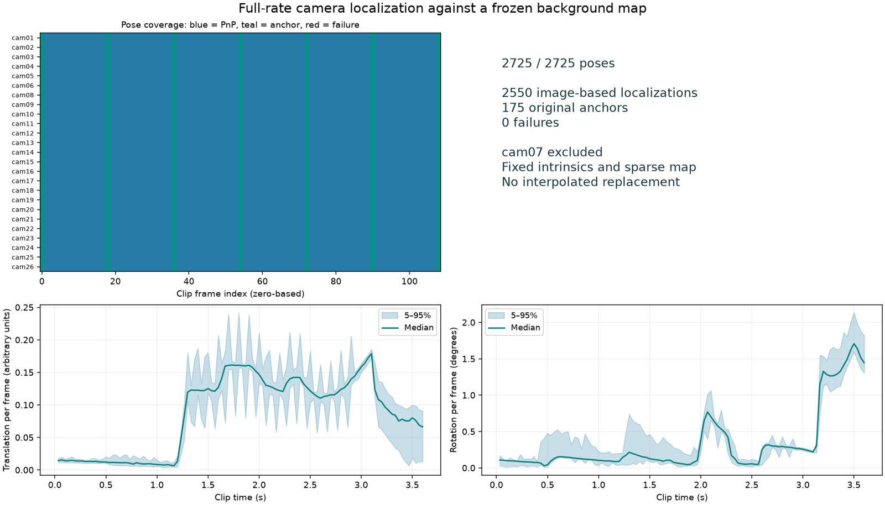

# Progress presentation — English

Checkpoint: 2026-11-18 · [PDF](progress.en.pdf) · [PowerPoint](progress.en.pptx)

Source / Fuente: [deck.json](deck.json).

## 01. A skate replay. Many viewpoints. One dynamic scene?

- Free-Viewpoint Replay of Skate Tricks using 4D Gaussian Splatting

- Computer Vision · CVI 26-2 · Final project · 18 November 2026

- Current result: poses for all 2725 training frames; dynamic training still pending.

### Speaker notes

This is the final project for Computer Vision, CVI 26-2, as specified by the project owner. The supplied CVI 26-2 Prompts notes provide the course-topic context. The long-term goal is a time-dependent 3D replay rendered from new cameras. Today I distinguish completed capture and camera estimation from dynamic reconstruction that has not yet been trained. This is a progress review, not a final free-viewpoint demonstration.

## 02. Course concepts guide the final project

- Viewing (pp. 3–4, 12–15): camera matrices and projection

- Sampling (pp. 5–6, 18–27): pixels, frames and alignment

- Curves (pp. 40–44): sampled trajectories and continuity

- Pipeline (pp. 15–18): future Gaussian image synthesis

### Speaker notes

Page numbers refer to the supplied 46-page CVI 26-2 Prompts PDF, credited to Pablo Figueroa. Camera matrices link to Viewing, frame synchronization to sampling, and estimated paths to curves. Each training path now has 109 image-based pose estimates, with no interpolated replacements. Gaussian rasterization remains future work and is compared with the traditional pipeline. The notes supply topics, not a final-project rubric.

## 03. One saved replay, recorded repeatedly

- Original recording: 118.63 s, 720 × 1280, 30 FPS.

- 26 candidate passages; 109 frames per exported clip.

- The cursor-based cutter replaces slow, unequal manual cuts.

- Passage order is known; exact angles and uniqueness are not.

### Speaker notes

The owner initially supplied eight manually cut views and the complete recording. The tool detects timeline resets and selects a common cursor interval. It preserves original media and writes a source-frame manifest. Twenty-six passages must not be described as twenty-six calibrated camera azimuths. These game images are supplied capture evidence.

## 04. A moving camera needs a pose per image

- Fixed capture: R[c], T[c] are shared across a sequence.

- Moving capture: R[c,t], T[c,t] vary with replay time.

- Upstream MultipleView calibrates from the first frame and repeats its pose.

- Decision: estimate background poses per sampled image; keep the fixed-loader path blocked.

### Speaker notes

This limitation was established by inspecting extractimages.py and multipleview_dataset.py in the pinned official repository. Following the board changes the extrinsics during the trick. Merely naming clips cam01 and cam02 does not make them fixed-camera data. The current experiment uses per-image SfM without modifying the 4DGS algorithm.

## 05. Make camera estimation about the background

- Decode directly from the original recording and retain source indexes.

- Apply one 592 × 820 crop; adjust the principal point after cropping.

- Exclude the board, approximate shadow and score band from SIFT features.

- Use CPU PyCOLMAP with shared intrinsics, independent image poses and a reserved view.

### Speaker notes

The crop is x64, y100, width592, height820, with no resize. The assumed original principal point becomes 296,540 after cropping. The shared SIMPLE_PINHOLE model refines focal length; centered projection and fixed FOV are assumptions, not exported game matrices. Masks suppress calibration features only: the skateboard must remain visible for future dynamic training.

## 06. Synchronization has evidence — and limits

- The persistent green score appears at clip index 97 or 98.

- Visual board-state comparisons support the timeline alignment.

- One UI event does not prove synchronization over every frame.

- Audio was inconclusive; no audio correction or time warp was applied.

- 26/26 — score events detected

- ≤1 — frame of onset spread

- ~33 ms — at 30 FPS

### Speaker notes

The score detector is specific to this capture and its overlay colors. The one-frame difference can reflect screen sampling and onset detection, so it should not be converted into a claim of exact simulation synchronization. No clip was silently shifted. The next temporal check should inspect fast rotational events as well as landing.

## 07. More overlap resolved partial registration

- Added intermediate viewpoints; mapper thresholds were not relaxed.

- Seven samples per passage; one reconstruction; cam07 excluded.

- A larger observation set changes the error: this is not a quality ranking.

| Run | Registered images | 3D points | Mean error |
| --- | --- | --- | --- |
| Initial: 6 passages | 33 / 42 | 1,651 | 0.403 px |
| Expanded: 25 passages | 175 / 175 | 8,767 | 0.473 px |

### Speaker notes

The initial run did not register nine images. The expanded experiment added available intermediate viewpoints and registered all 175 samples in approximately 101.5 seconds. The mean residual rose slightly because coverage and observations changed. Neither residual is a held-out image metric. The complete configuration and implementation commit are recorded in the repository.

## 08. All 2725 training images now have poses

### Speaker notes

The sparse background map is frozen. The first full-rate pass accepted 2694 of 2725 frames. Thirty-one failures near a dim ramp were recovered using reviewed masks and broader references; the last used matched inlier tracks from adjacent localized images, followed by its own PnP solve. Thresholds were unchanged. All 175 anchors are exact copies. No jump exceeds the review thresholds. There are 132 estimates with fewer than 50 inliers, so complete coverage is not ground-truth validation. This is not a trained dynamic model.

## 09. Reserve a real camera for a measurable test

- Training geometry uses 25 passages; cam07 is excluded.

- Later, localize cam07 against the fixed training reconstruction.

- Render its viewpoint at matched replay timestamps.

- Compare game frames and rendered frames with PSNR, SSIM and LPIPS.

### Speaker notes

cam07 was inspected for timing but contributed no SfM features, matches or geometry. Its localization and rendering have not been performed. The unmodified MultipleView test split samples training cameras and is not a held-out-camera experiment. Future metrics must specify color space, resolution, crop, masks and implementation versions, with the model frozen before scoring.

## 10. Progress is traceable to dated artifacts

- 19 Oct: audit, pinned dependency, helpers and camera-source analysis.

- 18 Nov: automatic cutting, event checks and sparse camera-pose experiments.

- 25 helper tests pass; manifests, configs and environment pins are retained.

- Bilingual reports, figures and these slides link to commits and limitations.

### Speaker notes

The work log records actual repository checkpoints. It does not imply continuous work between the two dates. Small evidence snapshots are versioned; raw videos and models are excluded. The course rubric and deadline have not been supplied, so the roadmap uses explicit acceptance gates rather than invented grade weights. AI assistance is acknowledged in the project documentation.

## 11. The remaining risks are explicit

- All training frames have estimates; 132 lower-support poses need closer review.

- Shared intrinsics, mask coverage and synchronization still need validation.

- Windows CPU SfM works; CUDA training and official 4DGS reproduction have not run.

- No dynamic model, novel-view render or held-out score is claimed.

### Speaker notes

The machine has an RTX 4050 Laptop GPU with 6 GB, but no working WSL training environment has been established. A proposed version file is not a validated environment. The official CUDA stack should be tested before changing dependencies or launching custom training. The static background result is encouraging, but does not remove the moving-camera loader requirement.

## 12. Next review: prove each gate before training

- Reproduce the official scene: CUDA imports, short training and rendering.

- Review full-rate poses and intrinsics; verify a per-frame loader.

- Train a first dynamic model and evaluate the reserved game camera.

- Reference: Wu et al., CVPR 2024 · official hustvl/4DGaussians · COLMAP.

### Speaker notes

Acceptance requires retained commands and real outputs, not just installation instructions. The proposed smoke configuration uses two coarse and ten fine iterations. Full-rate camera validation and environment provisioning can proceed separately, but official reproduction must precede custom dynamic training. Paper: arxiv.org/abs/2310.08528. Upstream pin: 843d5ac636c37e4b611242287754f3d4ed150144. See the repository roadmap for complete criteria.
