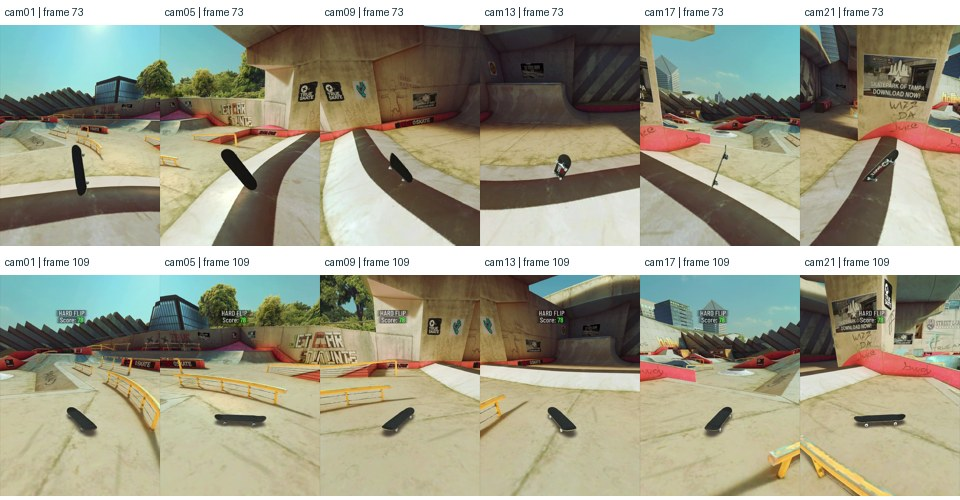
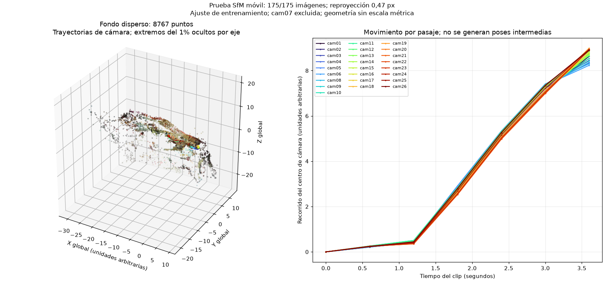

# Presentación de avance — Español

Checkpoint: 2026-11-18 · [PDF](progress.es.pdf) · [PowerPoint](progress.es.pptx)

Source / Fuente: [deck.json](deck.json).

## 01. Un truco de skate. Muchas vistas. ¿Una escena dinámica?

- Repetición con punto de vista libre mediante 4D Gaussian Splatting

- Seguimiento · 18 de noviembre de 2026

- Resultado actual: poses muestreadas y geometría dispersa del fondo.

### Notas para exponer

El objetivo final es una repetición 3D dependiente del tiempo, renderizada desde cámaras nuevas. Hoy se separa el trabajo completado de captura y estimación de cámaras de la reconstrucción dinámica aún no entrenada. Se presenta un avance, no una demostración final de punto de vista libre.

## 02. El flujo tiene un límite explícito

- Replay guardado → observaciones desde varias cámaras

- Cortes comunes → recorte y controles temporales

- SfM del fondo estático → poses muestreadas

- Siguiente: poses completas → 4DGS → vista reservada

### Notas para exponer

Las tres primeras etapas tienen herramientas ejecutables y evidencias. La última sigue pendiente. 3D Gaussian Splatting representa una escena principalmente estática; esta implementación 4DGS añade deformación condicionada por el tiempo. Ambas necesitan cámaras correctas. Estimar las cámaras es un requisito previo, no un resultado automático del entrenamiento.

## 03. Una repetición guardada, varias capturas

- Grabación: 118,63 s, 720 × 1280, 30 FPS.

- 26 pasajes candidatos; 109 imágenes por clip.

- El corte basado en el cursor sustituye el trabajo manual lento y desigual.

- Se conoce el orden; no los ángulos exactos ni su unicidad.

### Notas para exponer

Se aportaron ocho cortes manuales y la grabación completa. La herramienta detecta reinicios de la línea temporal y selecciona un intervalo común. Conserva los originales y guarda índices de origen. Veintiséis pasajes no equivalen a veintiséis azimuts calibrados. Las imágenes del juego son evidencia de captura aportada al proyecto.

## 04. Una cámara móvil necesita poses por imagen

- Captura fija: R[c], T[c] se comparten en una secuencia.

- Captura móvil: R[c,t], T[c,t] cambian con el tiempo.

- MultipleView calibra con la primera imagen y repite su pose.

- Decisión: estimar poses del fondo por imagen y bloquear el cargador fijo.

### Notas para exponer

La limitación se comprobó en extractimages.py y multipleview_dataset.py del repositorio oficial fijado. Seguir al skate cambia los parámetros extrínsecos. Llamar a los clips cam01 y cam02 no los convierte en cámaras fijas. La prueba actual usa SfM por imagen sin modificar el algoritmo 4DGS.

## 05. Estimar las cámaras a partir del fondo

- Decodificar el original y conservar los índices de origen.

- Aplicar un recorte común de 592 × 820 y ajustar el punto principal.

- Excluir skate, sombra aproximada y marcador de las características SIFT.

- Usar PyCOLMAP en CPU: intrínsecos compartidos, poses independientes y una vista reservada.

### Notas para exponer

El recorte es x64, y100, ancho592, alto820, sin redimensionar. El punto principal supuesto pasa a 296,540. SIMPLE_PINHOLE ajusta la focal; el campo visual constante y la proyección centrada son hipótesis, no matrices obtenidas del juego. Las máscaras solo suprimen características de calibración: el skate debe conservarse para el entrenamiento dinámico.

## 06. La sincronización tiene evidencias y límites

- La puntuación verde persistente aparece en el índice 97 o 98.

- La comparación visual del skate respalda la alineación temporal.

- Un evento de interfaz no prueba sincronización en cada imagen.

- El audio no fue concluyente; no se corrigió ni deformó el tiempo.

- 26/26 — eventos detectados

- ≤1 — imagen de diferencia

- ~33 ms — a 30 FPS

### Notas para exponer

El detector depende de esta captura y del color de su marcador. La diferencia de una imagen puede reflejar el muestreo de pantalla y la detección del inicio; no implica sincronización exacta de simulación. No se desplazó ningún clip silenciosamente. El siguiente control debe examinar rotaciones rápidas además de la recepción.

## 07. Más solapamiento resolvió el registro parcial

- Se añadieron vistas intermedias sin relajar los umbrales.

- Siete muestras por pasaje; un modelo; cam07 excluida.

- Cambian las observaciones: el error no clasifica la calidad final.

| Ejecución | Imágenes registradas | Puntos 3D | Error medio |
| --- | --- | --- | --- |
| Inicial: 6 pasajes | 33 / 42 | 1651 | 0,403 px |
| Ampliada: 25 pasajes | 175 / 175 | 8767 | 0,473 px |

### Notas para exponer

La prueba inicial dejó nueve imágenes sin registrar. Al añadir vistas intermedias, la ejecución ampliada registró las 175 muestras en unos 101,5 segundos. El residuo aumentó ligeramente porque cambiaron las observaciones. Ningún residuo es una métrica de imagen reservada. El repositorio guarda la configuración y el commit de implementación.

## 08. Un fondo compartido, todavía no un replay 4D

### Notas para exponer

La nube representa el fondo estático. La mayoría de los puntos se observa en varios pasajes, por lo que las vistas comparten reconstrucción. Todos los centros de cámara muestreados se desplazan. Siete poses no dan una trayectoria a frecuencia completa. El bajo error no demuestra geometría real, reconstrucción dinámica del skate ni calidad de vistas nuevas.

## 09. Reservar una cámara para una prueba medible

- La geometría utiliza 25 pasajes; cam07 queda fuera.

- Después, localizar cam07 contra la reconstrucción de entrenamiento.

- Renderizar su punto de vista en instantes coincidentes.

- Comparar juego y render mediante PSNR, SSIM y LPIPS.

### Notas para exponer

Se inspeccionó el tiempo de cam07, pero no aportó características, correspondencias ni geometría. Aún no se ha localizado ni renderizado. El test original de MultipleView muestrea cámaras de entrenamiento; no es una prueba con cámara reservada. Las métricas deberán especificar color, resolución, recorte, máscaras y versiones, con el modelo congelado antes de evaluar.

## 10. El avance se vincula a artefactos fechados

- 19 oct.: auditoría, dependencia fijada, herramientas y análisis de cámaras.

- 18 nov.: cortes automáticos, controles temporales y pruebas de poses.

- 19 pruebas superadas; manifiestos, configuraciones y versiones conservados.

- Informes, figuras y diapositivas bilingües enlazados con commits y límites.

### Notas para exponer

La bitácora registra cortes reales del repositorio, sin atribuir actividad continua entre ambas fechas. Se versionan evidencias pequeñas y se excluyen vídeos y modelos. Al no disponer de rúbrica ni fecha de entrega, la hoja de ruta usa criterios de aceptación y no pesos inventados. La documentación reconoce la asistencia de IA.

## 11. Los riesgos pendientes son explícitos

- Solo siete de 109 imágenes por pasaje tienen pose.

- Falta validar intrínsecos, cobertura de máscaras y sincronización.

- SfM en CPU funciona; CUDA y reproducción oficial 4DGS siguen pendientes.

- No se afirma disponer de modelo dinámico, vista nueva ni métrica reservada.

### Notas para exponer

El equipo tiene una RTX 4050 Laptop de 6 GB, pero aún no se ha establecido el entorno de entrenamiento WSL. Un archivo de versiones propuesto no equivale a un entorno validado. Hay que probar la pila oficial antes de cambiar dependencias o entrenar datos propios. El resultado del fondo es prometedor, pero sigue haciendo falta un cargador para cámaras móviles.

## 12. Próxima revisión: validar antes de entrenar

- Reproducir la escena oficial: CUDA, entrenamiento y render breves.

- Estimar todas las poses y validar un cargador por imagen.

- Entrenar un primer modelo dinámico y evaluar la cámara reservada.

- Referencia: Wu et al., CVPR 2024 · hustvl/4DGaussians oficial · COLMAP.

### Notas para exponer

Cada criterio exige comandos y resultados reales, no solo instrucciones. La prueba propuesta usa dos iteraciones gruesas y diez finas. Las poses completas y el entorno pueden prepararse por separado, pero la reproducción oficial debe preceder al entrenamiento propio. Artículo: arxiv.org/abs/2310.08528. Commit original: 843d5ac636c37e4b611242287754f3d4ed150144. La hoja de ruta contiene los criterios completos.
