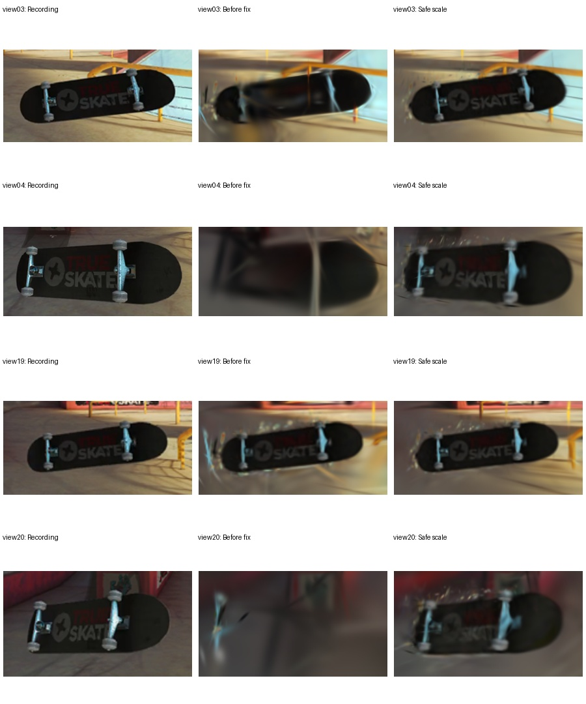

# Comprendre et expliquer le projet

Support d'apprentissage personnel — 26 novembre 2026. [Diapositives anglaises](progress-2026-11-26.en.pdf) · [Préparer l'oral](preparation-2026-11-26.fr.md).

Le but est de pouvoir expliquer les entrées, les sorties, le principe, le code associé et les limites de chaque étape. La maîtrise se vérifie en reformulant et en résolvant de petits exercices ; avoir lu le document ne suffit pas à la démontrer.

## Parcours conseillé

| Étape | Ce qu'il faut savoir expliquer | Exercice |
|---|---|---|
| 1. Le pipeline | Le rôle de chaque outil | Décrire le trajet d'une vidéo jusqu'à un rendu |
| 2. Les caméras | Intrinsèques, pose, SfM, triangulation, PnP | Calculer une projection et expliquer la calibration |
| 3. Le rendu statique | Gaussienne, projection, opacité, apprentissage | Expliquer une itération d'optimisation |
| 4. Les deux méthodes temporelles | Déformation partagée ou ajustements successifs | Comparer leurs hypothèses sur la planche |
| 5. Le cours et le code | Relier un concept à une opération réelle | Ouvrir les fonctions référencées au fil des diapositives |
| 6. Les résultats | Distinguer reconstruction, suivi et mesure validée | Interpréter un succès statique et un échec temporel |

Prendre environ 20 à 30 minutes par étape, avec reformulation orale et retour au code. Ce temps est indicatif, pas une garantie de maîtrise.

## 1. Les outils et leurs rôles

Le pipeline est : **vidéos → images alignées → caméras et points de départ → entraînement → images reconstruites → évaluation**.

| Outil | Rôle dans notre projet | Ce qu'il ne faut pas lui attribuer |
|---|---|---|
| FFmpeg | Découper, décoder, sélectionner des images | Il ne reconstruit pas la 3D |
| NumPy / Pillow | Calculer sur les pixels, produire les masques et préparer les données | Un masque de différence n'est pas une segmentation parfaite |
| COLMAP, via PyCOLMAP | Estimer des caméras et des points 3D à partir de correspondances | Il ne fournit pas ici une vérité terrain ni une échelle en mètres |
| 4DGaussians | Apprendre une représentation et ses déformations temporelles | Nos essais ne lui demandent pas d'estimer les poses des caméras |
| Dynamic3DGaussians | Ajuster successivement des Gaussiennes persistantes avec des contraintes de mouvement | Une trajectoire calculée n'est pas automatiquement correcte |
| PyTorch | Calculer les gradients et appliquer l'optimisation | L'optimisation ne corrige pas automatiquement toutes les erreurs des données |
| CUDA / GPU | Accélérer les calculs, notamment le rendu | Plus de calcul ne garantit pas une meilleure planche |
| WSL | Exécuter l'environnement Linux sur le PC Windows | Ce n'est pas une méthode de reconstruction |

Les deux méthodes temporelles réutilisent des moteurs de rendu développés par les auteurs. Les scripts du projet préparent, adaptent, contrôlent et évaluent ces méthodes ; ils ne constituent pas une réimplémentation complète des articles.

Dans notre préparation des caméras, les appels PyCOLMAP sont configurés sur CPU. L'entraînement et le rendu des Gaussiennes utilisent CUDA sur la RTX4050. Toutes les étapes du projet ne sollicitent donc pas le même processeur.

## 2. Comment retrouver les caméras

### Intrinsèques et pose : deux informations différentes

Les **intrinsèques**, notées K, décrivent la projection dans l'image : focale et point principal, notamment. La **pose** décrit la position et l'orientation de la caméra dans un repère 3D.

Nous utilisons un modèle SIMPLE_PINHOLE : une focale partagée f et un point principal (cx, cy). Dans les images préparées de563×1218pixels, ces valeurs sont environ f=422,08pixels, cx=281,5 et cy=609. La focale a été estimée sur les images natives puis adaptée à la réduction de résolution ; le point principal reste au centre. Ce choix est une hypothèse du modèle, pas une calibration indépendante connue à l'avance.

Une pose monde-vers-caméra contient une rotation R et une translation t. Pour un point du monde Xw :

```text
Xc = R × Xw + t
```

Xc contient les coordonnées du point dans le repère de la caméra. **t n'est généralement pas la position de la caméra dans le monde.** Son centre est :

```text
C = -transpose(R) × t
```

La convention est importante : COLMAP utilise ici des coordonnées caméra où x va vers la droite, y vers le bas et z vers l'avant. [Convention officielle](https://colmap.github.io/format.html#images-txt).

### Le raisonnement géométrique

Un coin de rampe visible dans plusieurs images fournit des observations du même point du décor. Avec suffisamment de correspondances, des hypothèses de projection et des points de vue différents, on peut chercher ensemble une disposition des caméras et des points compatible avec les observations.

La chaîne usuelle de SfM comporte la détection de points distinctifs, leur association entre images, la vérification géométrique robuste, l'estimation de poses relatives, la triangulation et l'ajustement conjoint des caméras et des points. Cet ajustement minimise notamment l'écart entre les pixels observés et les points 3D reprojetés. [Tutoriel COLMAP](https://colmap.github.io/tutorial.html).

**Application à notre code :** [prepare_clean_geometry.py](../scripts/prepare_clean_geometry.py) construit des images de fond par médiane de cinq images, masque les régions changeantes, extrait des caractéristiques SIFT et lance `match_exhaustive` puis `incremental_mapping`. Une médiane peut encore conserver des éléments mobiles ; les masques servent à limiter ce problème. Les détails du solveur sont fournis par COLMAP.

On utilise le décor parce qu'il reste immobile. Traiter comme un même point statique une vis de la planche pendant son mouvement violerait cette hypothèse. Des caméras fixes simplifient le problème à une pose par vue ; une caméra suivie demanderait des poses variables dans le temps, pas l'abandon automatique de la reconstruction.

### Triangulation et PnP

La **triangulation** estime un point 3D à partir de plusieurs observations 2D et de caméras. Le **PnP** estime la pose d'une caméra à partir de points 3D et de leurs observations 2D. Ils résolvent des problèmes différents.

Notre vue20 est localisée sur la carte du décor déjà reconstruite. [localize_fixed_holdout.py](../scripts/localize_fixed_holdout.py) associe ses caractéristiques à des points existants, appelle `estimate_and_refine_absolute_pose`, puis vérifie que la carte n'a pas changé. Le fond de cette vue sert à estimer sa pose, pas à entraîner le modèle de scène.

La reconstruction du décor a enregistré17caméras et obtenu une erreur moyenne de reprojection d'environ0,470pixel à la résolution native. La pose réservée a572correspondances retenues sur620, avec erreur médiane0,585pixel. Cela mesure une cohérence avec les données, pas l'exactitude physique absolue. Une reconstruction par images garde une ambiguïté globale d'échelle, de repère et d'orientation sans référence supplémentaire. Les coordonnées ne sont pas des mètres connus. [Évidence du projet](../docs/progress/clean-pilot.en.md).

### Exemple numérique à exécuter

Depuis le dossier du projet :

```powershell
.venv/Scripts/python.exe scripts/learn_camera_projection.py
.venv/Scripts/python.exe scripts/learn_camera_projection.py --real
```

Le premier exemple place une caméra à(1,0,0), sans rotation, regardant vers+Z. Un point du monde(2,0,4) devient(1,0,4) dans la caméra. Avec f=400 et le point principal(300,200) :

```text
u = 400 × 1/4 + 300 = 400
v = 400 × 0/4 + 200 = 200
```

Si sa profondeur devient8, u devient350. Il se rapproche du centre de l'image. L'option `--real` lit notre caméra view20, calcule son centre, vérifie sa rotation et projette le centre moyen du volume initial de la planche. Ce centre est synthétique : ce n'est pas un point matériel suivi.

**À expliquer sans les notes :** pourquoi faut-il distinguer K de R et t ? Pourquoi une faible erreur de reprojection ne prouve-t-elle pas que toute la planche est reconstruite correctement ?

## 3. Comment fonctionne le 3D Gaussian Splatting

Pour comprendre le modèle, on peut imaginer des éléments 3D en forme d'ellipsoïdes à influence progressive. Une Gaussienne possède un centre, une taille selon plusieurs axes, une orientation, une opacité et des paramètres d'apparence. Elle ne correspond pas nécessairement à un point mesuré sur une surface.

Pour rendre une image, on projette ces éléments vers l'écran, où ils produisent des contributions en forme de taches elliptiques. Leur ordre en profondeur et leurs opacités déterminent leur combinaison. L'entraînement ajuste les paramètres afin de rapprocher le rendu des photographies. Le contrôle de densité peut dupliquer, diviser ou supprimer des éléments. [Présentation originale](https://repo-sam.inria.fr/fungraph/3d-gaussian-splatting/).

### Lire notre implémentation

Dans [GaussianModel](../third_party/4DGaussians/scene/gaussian_model.py), `_xyz`, `_scaling`, `_rotation`, `_opacity` et les coefficients de couleur représentent ces paramètres. Certaines valeurs sont stockées dans des espaces adaptés à l'optimisation : l'échelle passe par une exponentielle, l'opacité par une sigmoïde et la rotation est normalisée. Lire une valeur brute de `_opacity` ne donne donc pas directement une transparence entre0et1.

Le [rendu](../third_party/4DGaussians/gaussian_renderer/__init__.py) passe les paramètres au rasteriseur CUDA. L'apparence peut utiliser des harmoniques sphériques : elles permettent une couleur dépendant de la direction de vue. Cela n'est pas une simulation complète du transport physique de la lumière.

Une étape d'apprentissage rend une image, calcule une erreur, calcule des gradients puis actualise les paramètres. Le rasteriseur fournit les dérivées nécessaires à PyTorch. Avec notre batch de taille1, une itération ne signifie pas un passage complet sur toutes les caméras. [Implémentation originale et paramètres d'optimisation](https://github.com/graphdeco-inria/gaussian-splatting).

Nos premiers points sont en partie observés sur le décor et en partie proposés à partir d'un volume compatible avec des silhouettes de la planche. Ces dernières graines sont des hypothèses de volume, pas des mesures de surface. Leur multiplication par densification ne crée pas de nouvelles observations physiques.

**À expliquer :** quelle différence entre un point SfM, une Gaussienne optimisée et un triangle de maillage ? Qu'est-ce qui change pendant l'entraînement ?

## 4. Comment fonctionne notre 4DGaussians

Cette méthode conserve un ensemble de Gaussiennes de référence et utilise un réseau pour prédire leurs déformations selon le temps. Son encodage spatio-temporel exploite des plans de caractéristiques liés aux coordonnées spatiales et au temps. Les Gaussiennes déformées sont ensuite rendues depuis la caméra demandée. [Article4DGS](https://arxiv.org/html/2310.08528v3).

Dans notre code, [deformation.py](../third_party/4DGaussians/scene/deformation.py) prédit notamment les changements de position, d'échelle et de rotation. Il propose aussi des variations d'opacité et de coefficients de couleur, activées ou désactivées par la configuration.

Nos essais initiaux autorisaient ces deux dernières variations. Le contrôle récent utilise `no_do=True` et `no_dshs=True` : pas de variation temporelle d'opacité ni de coefficients d'apparence. Les paramètres de référence continuent toutefois d'apprendre pendant l'optimisation. Et des coefficients d'apparence constants dans le temps peuvent toujours produire une couleur différente selon la direction de vue.

Le dernier modèle commun a110images d'entraînement :11caméras×10instants. Les temps normalisés vont de0à1 sur0,45seconde ; ce ne sont pas des secondes réelles. La configuration utilise200étapes initiales sans déformation, puis6.000étapes avec le modèle temporel. Le modèle partage ses paramètres entre instants ; nous n'entraînons pas dix modèles statiques indépendants.

[fixed_actor_deformation.py](../scripts/fixed_actor_deformation.py) empêche les descendants des graines du décor de recevoir les déformations temporelles. Les descendants du volume initial de la planche peuvent se déformer. C'est une classification par origine des graines, pas une garantie d'identité physique. Une Gaussienne de référence n'est pas nécessairement exactement à sa position physique du premier instant : le réseau peut aussi produire une déformation au temps zéro.

**À expliquer :** pourquoi un réseau dépendant du temps ne garantit-il pas un suivi correct d'une vis de la planche ? Comment peut-on obtenir un décor stable tout en gardant un objet mal reconstruit ?

## 5. Comment fonctionne Dynamic3DGaussians

L'autre méthode ajuste d'abord un premier instant, puis fait évoluer une représentation persistante vers les instants suivants. Sa conception vise aussi le suivi. Des contraintes de rigidité locale favorisent la cohérence des déplacements et des rotations entre voisins. [Présentation des auteurs](https://dynamic3dgaussians.github.io/).

Dans le [code fixé pour notre essai](https://github.com/JonathonLuiten/Dynamic3DGaussians/blob/7dbbd4dec404308524ff402756bdb8143a2589b0/train.py), l'instant suivant est initialisé par extrapolation des positions et rotations précédentes. Après le premier instant, tailles et opacités sont bloquées ; les couleurs restent actualisables avec une pénalité de variation. Les pertes incluent image, segmentation, rigidité locale, cohérence des rotations, distances entre voisins et stabilité du fond.

Notre [adaptateur](../scripts/dynamic_replay_engine.py) conserve ces mécanismes, mais désactive la contrainte de sol faute de plan connu dans notre repère. Il emploie des caméras et masques préparés, et un budget limité de2.000étapes initiales puis400par instant. Il ne reproduit pas intégralement le protocole publié.

| Question | 4DGaussians du projet | Dynamic3DGaussians adapté |
|---|---|---|
| Comment le mouvement est-il représenté ? | Réseau de déformation partagé, interrogé au temps demandé | États successifs de Gaussiennes persistantes |
| Quelle cohérence ajoute-t-on ? | Régularisations du réseau et notre décor sans déformation temporelle | Contraintes locales de mouvement et de rotation |
| Où intervient le temps ? | Entrée du réseau | Progression entre états successifs |
| Les poses de caméras sont-elles des entrées ? | Oui | Oui |
| Peut-on déjà annoncer une mesure fiable de rotation ? | Non | Non |

Les auteurs signalent une limite importante : les parties suivies doivent être visibles dans les observations initiales. Une face inférieure cachée au départ puis dévoilée pendant le flip est donc problématique. [Article, limites](https://dynamic3dgaussians.github.io/paper.pdf). Le fait que l'algorithme représente des rotations ne prouve pas qu'il retrouve celle de notre planche.

Nos résultats montrent une planche initiale reconnaissable avec Dynamic, puis une perte de la forme dans les instants suivants.4DGS conserve aussi des artefacts. Ce n'est pas une preuve qu'une méthode est mauvaise en général ; c'est le résultat d'un pilote limité avec nos données approximatives. [Comparaison mesurée](../docs/progress/dynamic-comparison.en.md).

**À expliquer :** quelles hypothèses de cette méthode conviennent à un objet rigide ? Quelles données manquent encore pour valider un nombre de rotations du skateboard ?

## 6. Comment les notions du cours interviennent réellement

Les pages ci-dessous sont celles du PDF de46pages fourni, titre compris. Le cours est désigné Computer Vision par le propriétaire du projet ; le document contient également des thèmes de graphisme. SfM et Gaussian Splatting sont des méthodes supplémentaires qui utilisent ces bases.

| Concept | Application concrète | Code ou preuve | Pages |
|---|---|---|---|
| Vecteurs et matrices | Exprimer points et caméras, changer de repère | `project`, calcul de C à partir de R,t |3–4,13–15|
| Perspective | Diviser par la profondeur puis appliquer la focale | Annexe de code du diaporama |12–15|
| Visibilité et clipping | Éviter la suppression des graines trop proches du seuil CUDA | Correction cohérente d'échelle, projections conservées |15–18|
| Échantillonnage | Sélectionner les instants, réduire la résolution et aligner les vues | Extraction des images et alignement par événement |21–22|
| Rasterisation | Transformer les contributions 3D en pixels | Rasteriseurs CUDA réutilisés |15–18|
| Rotations / quaternions | Représenter l'orientation des Gaussiennes dans les bibliothèques | Paramètres de rotation et contraintes Dynamic |4|

Nous n'avons pas implémenté une transformée de Fourier, SLERP, un ray tracer ou un shader physique. Le quaternion d'une Gaussienne décrit son orientation locale ; il n'est pas à lui seul la rotation globale validée du skateboard.

### Le bug de visibilité expliqué par le cours

Une caméra ne rend pas tous les points : un seuil proche en élimine certains. Dans notre normalisation, la plupart des graines de la planche tombaient devant le seuil CUDA dans certaines vues. Multiplier les points et les translations caméra par le même facteur conserve x/z et y/z, donc les pixels, mais change la profondeur par rapport au seuil. Cela a rendu la planche statique reconnaissable. Ce problème n'impliquait pas que toutes les poses étaient fausses.



**À expliquer :** pourquoi changer l'échelle peut-il modifier le clipping sans modifier la projection de perspective ?

## 7. Interpréter correctement les résultats

La référence DyNeRF a montré que le pipeline peut apprendre une petite scène dynamique calibrée. Les trois reconstructions statiques de True Skate montrent une faisabilité à plusieurs instants, avec des initialisations propres à chaque instant. Elles ne démontrent pas un modèle temporel partagé.

Un score calculé sur toute l'image est dominé par le décor lorsque la planche est petite. Il peut augmenter alors que l'objet devient moins correct. C'est pourquoi nous regardons aussi des régions changeantes, des enveloppes approximatives de la planche et les rendus eux-mêmes. Les annotations et les masques restent imparfaits ; leurs scores ne constituent pas une vérité terrain de suivi.

Il faut distinguer trois affirmations : **produire des images**, **suivre des points matériels** et **mesurer une rotation correctement**. Le passage d'une affirmation à la suivante demande une validation supplémentaire. Une séquence d'images plausible ne suffit pas à prouver les trois.

La vue20 a été écartée de l'optimisation, mais examinée à plusieurs reprises pour décider des essais. C'est une vue de validation réutilisée, pas un test final vierge. Et les dix instants du dernier comparatif ont tous été supervisés : ce comparatif ne mesure pas l'interpolation vers des instants inconnus.

## 8. Questions de vérification

1. Que contiennent K, R et t ? Pourquoi le centre C n'est-il pas simplement t ?
2. Pourquoi utilisons-nous les correspondances du décor pour estimer les caméras ?
3. Quelle différence entre triangulation et PnP ?
4. Qu'est-ce que l'erreur de reprojection vérifie, et que ne vérifie-t-elle pas ?
5. Quels paramètres une Gaussienne possède-t-elle ?
6. Que fait une étape d'apprentissage ? Quelle différence avec un rendu ?
7. Quelle différence entre dix reconstructions statiques et un modèle temporel ?
8. Comment les deux méthodes représentent-elles le mouvement ?
9. Pourquoi la face cachée initialement est-elle un problème pour Dynamic ?
10. Pourquoi une bonne image globale ne prouve-t-elle pas une bonne planche ?
11. Où retrouves-tu un concept du cours dans chaque extrait de code ?
12. Quelles observations permettraient de valider un angle ou un nombre de rotations ?

Pour chaque réponse : une phrase simple, un exemple du projet, puis une limite. Si tu ne peux pas expliquer une ligne, reviens à l'exemple numérique avant d'ajouter du vocabulaire.

## 9. Une explication courte en anglais à reformuler

“I first estimate camera poses from the static background using COLMAP. With these cameras, I can project 3D points into each image. Gaussian splatting then optimizes a scene representation to reproduce the input views. The temporal methods model how this representation changes over time. My current difficulty is reconstructing the moving board reliably, especially when new surfaces become visible. I evaluate the board separately from the background before making any tracking or rotation claim.”

Ce paragraphe résume le pipeline ; il sert de point de départ à une explication comprise et reformulée, pas de preuve de maîtrise à lui seul.
